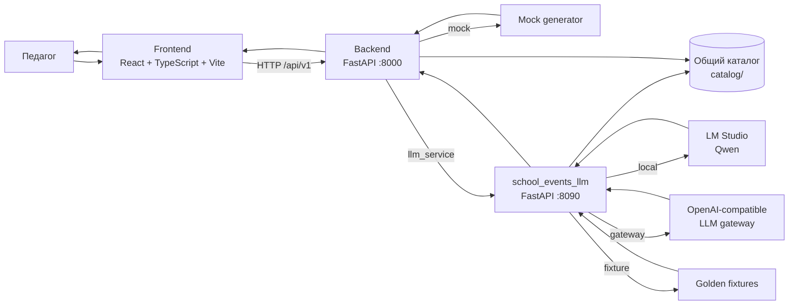

# Северус

**Северус** - веб-сервис для подготовки сценариев школьных мероприятий с использованием структурированного конструктора, общего каталога событий и LLM-генерации.

Проект создан в рамках кейса **Сбер + УрФУ «Школьные события»**. Пользователь проекта - педагог: он выбирает событие, класс, количество участников, длительность, формат, доступные ресурсы и пожелания к сценарию, после чего система формирует от одного до трёх вариантов мероприятия с таймингом, ролями, материалами и результатами автоматической проверки качества.

Репозиторий представляет собой единое приложение из четырёх основных частей:

- React/Vite Frontend;
- FastAPI Backend;
- независимый LLM-сервис генерации;
- единый каталог школьных событий и источников.

Frontend не обращается к LLM напрямую. Все пользовательские запросы проходят через основной Backend, поэтому ключи моделей и внутренние настройки генератора не передаются в браузер.

---

## Содержание

1. [Что может проект](#что-может-проект)
2. [Архитектура](#архитектура)
3. [Режимы работы](#режимы-работы)
4. [Структура репозитория](#структура-репозитория)
5. [Поддерживаемые параметры генерации](#поддерживаемые-параметры-генерации)
6. [Каталог мероприятий](#каталог-мероприятий)
7. [Системные требования](#системные-требования)
8. [Установка](#установка)
9. [Быстрый запуск без LLM](#быстрый-запуск-без-llm)
10. [Полный запуск через LLM-сервис в fixture-режиме](#полный-запуск-через-llm-сервис-в-fixture-режиме)
11. [Запуск с локальной Qwen через LM Studio](#запуск-с-локальной-qwen-через-lm-studio)
12. [Запуск через внешний OpenAI-compatible шлюз](#запуск-через-внешний-openai-compatible-шлюз)
13. [Переменные окружения](#переменные-окружения)
14. [Публичный API Backend](#публичный-api-backend)
15. [Внутренний API LLM-сервиса](#внутренний-api-llm-сервиса)
16. [Пример запроса на генерацию](#пример-запроса-на-генерацию)
17. [Как проходит генерация](#как-проходит-генерация)
18. [Этапы LLM pipeline](#этапы-llm-pipeline)
19. [Промпты и контекст](#промпты-и-контекст)
20. [Источники и фактологическая проверка](#источники-и-фактологическая-проверка)
21. [Логи и трассировка](#логи-и-трассировка)
22. [Тестирование](#тестирование)
23. [Работа с каталогом](#работа-с-каталогом)
24. [Работа с моделями](#работа-с-моделями)
25. [Безопасность](#безопасность)
26. [Текущие ограничения](#текущие-ограничения)
27. [Документация проекта](#документация-проекта)

---

## Что может проект

Северус позволяет:

- выбрать школьное событие из общего каталога;
- указать класс или возрастную группу;
- задать точное количество учеников;
- выбрать длительность 30, 45, 60 или 90 минут;
- выбрать формат мероприятия;
- учитывать количество педагогов;
- подключать родителей и задавать их роли;
- учитывать помещение, проектор, принтер, интернет, аудио и доступные материалы;
- задавать стиль сценария, уровень детализации, сложность, уровень взаимодействия и допустимый объём подготовки;
- сформировать от 1 до 3 существенно различающихся вариантов;
- получить точный тайминг сценария;
- получить роли участников, материалы, инструкции педагогу и ожидаемые результаты;
- проверять структуру результата программно;
- автоматически пытаться исправить некорректный ответ модели через repair-механику;
- работать без реальной LLM в demo, mock и fixture-режимах;
- переключать модель конфигурацией без переписывания генератора;
- использовать локальную Qwen через LM Studio или внешний OpenAI-compatible шлюз;
- хранить подробные DEV-трассы генерации для анализа качества.

---

## Архитектура



### Главный принцип

**Frontend знает только основной Backend.**

Frontend не знает адрес LLM-провайдера, не получает API-ключи и не зависит от внутреннего устройства генератора.

Основной Backend сохраняет внешний контракт `/api/v1/...` и в зависимости от настройки либо использует встроенный mock-генератор, либо передаёт тот же JSON внутреннему `school_events_llm`.

LLM-сервис является самостоятельным компонентом. Он отвечает за сборку контекста, вызов модели, этапы генерации, валидацию, repair, трассировку и формирование итогового проекта.

---

## Режимы работы

В проекте есть несколько уровней тестирования. Они решают разные задачи.

| Режим | Нужен Frontend | Нужен Backend | Нужен LLM-сервис | Нужна модель | Для чего |
|---|---:|---:|---:|---:|---|
| Frontend Demo | да | нет | нет | нет | проверить интерфейс и пользовательский путь |
| Backend Mock | да/нет | да | нет | нет | проверить Frontend ↔ Backend и внешний API |
| LLM Fixture | да/нет | да | да | нет | проверить полный Backend ↔ LLM pipeline |
| Local LLM | да/нет | да | да | да, LM Studio | проверить реальную локальную модель |
| External LLM | да/нет | да | да | да, API | проверить серверные Qwen/GigaChat и другие модели |

### Frontend Demo

Frontend создаёт тестовый сценарий локально в браузере. Серверы не требуются. Этот режим предназначен только для демонстрации интерфейса.

### Backend Mock

Frontend работает с настоящим FastAPI Backend, но Backend формирует тестовый проект встроенным Python mock-генератором.

### LLM Fixture

Frontend и Backend работают так же, как при настоящей LLM, но `school_events_llm` использует подготовленные эталонные ответы вместо внешней модели. Это режим автоматических интеграционных тестов. Он подходит только для эталонных запросов из `services/school_events_llm/examples/requests/`: произвольный запрос из формы Frontend в этом режиме завершится ошибкой проверки.

### Local / External LLM

Используется полный генерационный pipeline и реальная модель.

---

## Структура репозитория

```text
severus/
├── frontend/                       # React + TypeScript + Vite
├── backend/                        # основной публичный FastAPI Backend
├── services/
│   └── school_events_llm/          # независимый LLM-сервис
│       ├── app/                    # pipeline, API, модели, validation
│       ├── config/                 # модели и настройки генерации
│       ├── prompts/                # динамические prompt-блоки
│       ├── schemas/                # JSON Schema внутренних ответов
│       ├── examples/               # запросы, golden fixtures, readable examples
│       ├── docs/                   # документация LLM и ТЗ
│       └── tests/                  # тесты LLM-сервиса
├── catalog/                        # единый каталог событий и источников
│   ├── events/                     # 14 карточек событий
│   ├── sources/                    # источники и фрагменты
│   ├── regions/                    # региональные данные
│   ├── editorial/                  # правила наполнения
│   └── tools/                      # проверка и сборка каталога
├── acceptance/                     # материалы аудита и приёмки каталога
├── docs/                           # общая документация Backend/интеграции
├── tests/                          # тесты основного Backend и интеграции
├── requirements.txt                # Python-зависимости Backend
└── README.md
```

### Источник истины по событиям

`catalog/events/` - единственный каталог карточек событий для всего проекта.

Backend использует его для выдачи списка мероприятий Frontend, а LLM-сервис использует те же карточки при нормализации запроса и сборке prompt.

Отдельной копии карточек событий внутри LLM-сервиса нет.

---

## Поддерживаемые параметры генерации

На текущем пилотном контуре поддерживаются:

| Параметр | Значения |
|---|---|
| Регион | `RU-SVE` - Свердловская область |
| Класс | 1-11 |
| Возрастные группы | `1-4`, `5-8`, `9-11` |
| Количество учеников | 1-35 |
| Длительность | 30, 45, 60, 90 минут |
| Формат | классный час, общешкольное мероприятие, интерактивное занятие |
| Количество вариантов | 1-3 |
| Язык | русский |
| Родители | опционально |
| Роли родителей | помощник, активный участник, зритель, оценщик |
| Работа с аудиторией | обратная связь, голосование, приз зрительских симпатий |

Предпочтения педагога включают:

- стиль: `classic`, `interactive`, `creative`, `research`;
- детализацию: `brief`, `standard`, `detailed`;
- сложность: `basic`, `standard`, `advanced`;
- уровень взаимодействия: `low`, `medium`, `high`;
- групповую работу;
- объём подготовки: `minimal`, `standard`, `extended`;
- свободные заметки.

---

## Каталог мероприятий

В текущем каталоге 14 событий.

| ID | Событие | Категория |
|---|---|---|
| `knowledge_day` | День знаний | федеральное |
| `teachers_day` | День учителя | федеральное |
| `new_year` | Новый год | школьное |
| `christmas` | Рождество Христово | культурное |
| `defender_day` | День защитника Отечества | федеральное |
| `womens_day` | Международный женский день | федеральное |
| `labour_day` | Праздник Весны и Труда | федеральное |
| `victory_day` | День Победы | федеральное |
| `unity_day` | День народного единства | федеральное |
| `mothers_day` | День матери | федеральное |
| `last_bell` | Последний звонок | школьное |
| `graduation` | Выпускной вечер | школьное |
| `sverdlovsk_oblast_day` | День образования Свердловской области | региональное |
| `middle_urals_peoples_day` | День народов Среднего Урала | региональное |

Список, доступный Frontend, всегда формируется из общего каталога Backend через:

```text
GET /api/v1/catalog/events
```

---

## Системные требования

### Backend и LLM

- Python 3.10 или новее;
- pip;
- рекомендуется использовать виртуальное окружение.

### Frontend

Текущая версия Vite требует:

- Node.js `^20.19.0` или `>=22.12.0`;
- npm.

### Для локальной LLM

Дополнительно требуется LM Studio с запущенным OpenAI-compatible server.

---

## Установка

### 1. Клонировать репозиторий

```bash
git clone https://github.com/yasinnsbts/severus.git
cd severus
```

### 2. Создать Python-окружение

Windows PowerShell:

```powershell
python -m venv .venv
.\.venv\Scripts\Activate.ps1
python -m pip install --upgrade pip
python -m pip install -r requirements.txt
python -m pip install -r services/school_events_llm/requirements.txt
```

Windows CMD:

```cmd
python -m venv .venv
.venv\Scripts\activate.bat
python -m pip install --upgrade pip
python -m pip install -r requirements.txt
python -m pip install -r services/school_events_llm/requirements.txt
```

Linux/macOS:

```bash
python3 -m venv .venv
source .venv/bin/activate
python -m pip install --upgrade pip
python -m pip install -r requirements.txt
python -m pip install -r services/school_events_llm/requirements.txt
```

### 3. Установить Frontend

```bash
cd frontend
npm ci
cd ..
```

Для обычной разработки вместо `npm ci` допустим `npm install`, но для воспроизводимой установки по `package-lock.json` предпочтителен `npm ci`.

---

## Быстрый запуск без LLM

Это самый простой способ проверить проект после установки.

### Терминал 1 - Backend

Из корня репозитория:

```bash
python -m uvicorn backend.main:app --reload --port 8000
```

`GENERATOR_MODE` по умолчанию равен `mock`, поэтому LLM-сервис не требуется.

Проверка:

```text
http://127.0.0.1:8000/api/v1/health
```

Swagger:

```text
http://127.0.0.1:8000/docs
```

### Терминал 2 - Frontend

```bash
cd frontend
npm run dev
```

Откройте адрес Vite, обычно:

```text
http://127.0.0.1:5173
```

В интерфейсе можно выбрать:

- **Демо** - полностью локальный тест без Backend;
- **API** - работа через Backend.

---

## Полный запуск через LLM-сервис в fixture-режиме

Fixture-режим позволяет проверить всю цепочку:

```text
Frontend -> Backend -> school_events_llm -> pipeline -> fixture -> Backend -> Frontend
```

Реальный API-ключ модели не требуется.

**Ограничение:** fixture-режим возвращает заранее подготовленные ответы модели, поэтому он подходит только для запросов из `services/school_events_llm/examples/requests/`. Произвольный запрос из формы Frontend в этом режиме завершится ошибкой проверки. Для проверки интерфейса без модели используйте режим **Backend Mock**, для полного сценария с формы - реальную модель.

### 1. Настроить LLM-сервис

```bash
cd services/school_events_llm
```

Создайте `.env` из примера.

Windows PowerShell:

```powershell
Copy-Item .env.example .env
```

Linux/macOS:

```bash
cp .env.example .env
```

В `.env` установите:

```dotenv
LLM_SERVICE_FIXTURE_MODE=true
SERVICE_HOST=127.0.0.1
SERVICE_PORT=8090
```

Запустите сервис:

```bash
python -m app serve
```

### 2. Запустить Backend в режиме LLM-сервиса

**Важно:** основной Backend сейчас не загружает корневой `.env` автоматически. Его переменные задаются окружению процесса.

Windows PowerShell:

```powershell
$env:GENERATOR_MODE="llm_service"
$env:LLM_SERVICE_URL="http://127.0.0.1:8090"
python -m uvicorn backend.main:app --reload --port 8000
```

Linux/macOS:

```bash
export GENERATOR_MODE=llm_service
export LLM_SERVICE_URL=http://127.0.0.1:8090
python -m uvicorn backend.main:app --reload --port 8000
```

Проверка связки:

```text
GET http://127.0.0.1:8000/api/v1/health/llm
```

### 3. Запустить Frontend

```bash
cd frontend
npm run dev
```

В интерфейсе выберите **API**.

---

## Запуск с локальной Qwen через LM Studio

### 1. Запустить LM Studio

- загрузить совместимую Qwen-модель;
- запустить OpenAI-compatible server;
- стандартный адрес, используемый проектом: `http://127.0.0.1:1234/v1`.

### 2. Настроить LLM-сервис

В `services/school_events_llm/.env`:

```dotenv
ACTIVE_MODEL=qwen_local_9b
LLM_SERVICE_FIXTURE_MODE=false
```

Проверить подключение:

```bash
cd services/school_events_llm
python -m app health --model qwen_local_9b
```

Запустить сервис:

```bash
python -m app serve
```

### 3. Запустить Backend

Запустите Backend с `GENERATOR_MODE=llm_service` и `LLM_SERVICE_URL=http://127.0.0.1:8090`, как в разделе [fixture-режима](#2-запустить-backend-в-режиме-llm-сервиса) выше. Переменные задаются в консоли перед запуском: `.env` Backend не читает.

После этого пользовательские запросы из режима Frontend API проходят через реальную локальную модель.

---

## Запуск через внешний OpenAI-compatible шлюз

Внешние модели подключаются через Model Router LLM-сервиса.

В `services/school_events_llm/.env` задаются только локальные/серверные секреты:

```dotenv
ACTIVE_MODEL=urfu_qwen_27b
LITELLM_BASE_URL=https://example-llm-gateway/v1
LITELLM_API_KEY=your-secret-key
LLM_SERVICE_FIXTURE_MODE=false
```

Вместо `urfu_qwen_27b` можно выбрать другой включённый профиль из `config/models.json`, например:

```text
urfu_gigachat_3_pro
urfu_gigachat_2_max
urfu_gigachat_2_pro
```

Проверка конкретной модели:

```bash
python -m app health --model urfu_qwen_27b
```

После успешной проверки:

```bash
python -m app serve
```

`LITELLM_BASE_URL` и `LITELLM_API_KEY` не должны попадать в Git.

---

## Переменные окружения

### Backend

Основной Backend читает значения через `os.getenv`.

| Переменная | По умолчанию | Назначение |
|---|---|---|
| `GENERATOR_MODE` | `mock` | `mock` или `llm_service` |
| `LLM_SERVICE_URL` | `http://127.0.0.1:8090` | внутренний адрес LLM-сервиса |
| `LLM_SERVICE_TOKEN` | пусто | межсервисный токен |
| `LLM_SERVICE_HTTP_TIMEOUT` | `10` | HTTP timeout Backend -> LLM-service |
| `SEVERUS_CORS_ORIGINS` | локальные 5173/3000 | разрешённые Frontend origins через запятую |

Если `GENERATOR_MODE=llm_service` и LLM-сервис недоступен, Backend не переключается молча на mock, а возвращает `503 MODEL_UNAVAILABLE`.

### Frontend

`frontend/.env.local`:

```dotenv
VITE_API_BASE_URL=http://127.0.0.1:8000
```

### LLM-сервис

LLM-сервис сам загружает файл:

```text
services/school_events_llm/.env
```

и затем накладывает поверх него переменные процесса. Переменные процесса имеют более высокий приоритет.

Основные настройки:

```dotenv
ACTIVE_MODEL=qwen_local_9b
APP_ENV=development
APP_LOG_LEVEL=INFO

DATA_DIR=./data
LOG_FULL_PROMPTS=true
LOG_FULL_RESPONSES=true

CATALOG_DIR=../../catalog
REQUEST_DEFAULTS_FILE=./config/request_defaults.json
SCHOOL_PROFILE_FILE=./config/school_profile.json

SERVICE_HOST=127.0.0.1
SERVICE_PORT=8090
SERVICE_AUTH_TOKEN=

LLM_SERVICE_FIXTURE_MODE=false
LLM_SERVICE_FIXTURES=

LITELLM_BASE_URL=
LITELLM_API_KEY=
```

Для локальной модели также доступны настройки общего lock-файла:

```dotenv
LOCAL_LLM_MUTEX_ENABLED=false
LOCAL_LLM_MUTEX_PATH=./data/locks/lm_studio.lock
LOCAL_LLM_MUTEX_WAIT_SECONDS=120
```

---

## Публичный API Backend

Base URL при локальном запуске:

```text
http://127.0.0.1:8000
```

### Health

```http
GET /api/v1/health
```

### Состояние активного генератора

```http
GET /api/v1/health/llm
```

В `mock` режиме возвращается состояние mock-генератора. В `llm_service` запрос проксируется внутреннему LLM-сервису.

### Каталог мероприятий

```http
GET /api/v1/catalog/events
```

### Параметры конструктора

```http
GET /api/v1/catalog/options
```

### Создание генерации

```http
POST /api/v1/generations
```

Успешный ответ имеет HTTP `202 Accepted` и содержит `job_id`, `project_id`, `status_url` и `project_url`.

### Статус генерации

```http
GET /api/v1/generations/{job_id}
```

### Готовый проект

```http
GET /api/v1/projects/{project_id}
```

Swagger/OpenAPI:

```text
http://127.0.0.1:8000/docs
```

---

## Внутренний API LLM-сервиса

По умолчанию:

```text
http://127.0.0.1:8090
```

Frontend не должен обращаться к этим маршрутам напрямую.

```text
GET  /api/v1/health
GET  /api/v1/health/llm
GET  /api/v1/catalog/events
POST /api/v1/generations
GET  /api/v1/generations/{job_id}
GET  /api/v1/projects/{project_id}
GET  /api/v1/projects/{project_id}/variants/{variant_id}
```

Если задан `SERVICE_AUTH_TOKEN`, каждый внутренний запрос должен содержать:

```http
X-Service-Token: <token>
```

На стороне Backend тот же токен задаётся в `LLM_SERVICE_TOKEN`.

---

## Пример запроса на генерацию

Минимальный пример:

```json
{
  "event_id": "knowledge_day",
  "region_id": "RU-SVE",
  "grade": 6,
  "pupils_count": 25,
  "duration_minutes": 45,
  "format": "class_hour",
  "generation": {
    "variants_count": 2,
    "language": "ru"
  }
}
```

Расширенный пример:

```json
{
  "event_id": "knowledge_day",
  "region_id": "RU-SVE",
  "grade": 6,
  "pupils_count": 25,
  "duration_minutes": 45,
  "format": "class_hour",
  "participants": {
    "teachers_count": 1,
    "parents_enabled": true,
    "parents_count": 4,
    "parent_roles": ["audience", "helper"],
    "parent_audience_engagement": "feedback",
    "parent_notes": null
  },
  "resources": {
    "projector": true,
    "printer": true,
    "internet": false,
    "audio": true,
    "room": "classroom",
    "available_materials": ["бумага", "цветные маркеры"],
    "extra_notes": null
  },
  "teacher_preferences": {
    "style": "interactive",
    "script_detail": "detailed",
    "difficulty": "standard",
    "interaction_level": "high",
    "group_work": true,
    "preparation_effort": "minimal",
    "notes": "Добавить больше командной работы"
  },
  "generation": {
    "variants_count": 2,
    "language": "ru"
  }
}
```

Неуказанные вложенные параметры получают серверные значения по умолчанию.

---

## Как проходит генерация

### 1. Frontend

Педагог заполняет конструктор и отправляет структурированный JSON в основной Backend.

### 2. Backend

Backend:

- валидирует типы и обязательные поля;
- определяет возрастную группу по классу;
- сверяет событие с общим каталогом;
- проверяет допустимость возрастной группы и формата;
- создаёт задачу через mock или LLM-сервис.

### 3. LLM-сервис

При `GENERATOR_MODE=llm_service` основной Backend передаёт тот же эффективный JSON внутреннему сервису без отдельного преобразования DTO.

LLM-сервис:

1. нормализует запрос;
2. загружает карточку события из общего каталога;
3. выбирает prompt-блоки по возрасту, классу, размеру группы, формату, длительности, ресурсам и участникам;
4. добавляет ценности, региональный контекст, профиль школы и предпочтения педагога;
5. добавляет только разрешённые проверенные фактологические фрагменты;
6. строит план различий между вариантами;
7. запускает последовательные этапы генерации;
8. разбирает JSON модели;
9. валидирует результат Python-кодом;
10. при допустимых ошибках запускает repair;
11. формирует внешний проект;
12. сохраняет DEV-трассу запуска.

### 4. Backend и Frontend

Backend отдаёт Frontend состояние задачи и готовый проект. Frontend опрашивает `status_url`, а после `completed` получает `project_url` и отображает выбранный вариант педагогу.

---

## Этапы LLM pipeline

Основные этапы:

```text
variation_plan
      ↓
scenario_plan
      ↓
scenario_blocks / scenario_block
      ↓
materials
      ↓
quality_review (опционально)
      ↓
Python validation
      ↓
готовый variant_package
```

### `variation_plan`

Сначала модель проектирует различия между 1-3 вариантами, чтобы итоговые сценарии не были простой переформулировкой друг друга.

### `scenario_plan`

Формируется структура сценария и план временных блоков.

### `scenario_blocks`

Генерируется содержимое этапов: действия педагога, действия учеников, цели и материалы.

### `materials`

Формируются необходимые материалы и раздаточные элементы.

### `quality_review`

Дополнительный LLM-review может быть включён через `config/generation.json`. Независимо от него итог всё равно проверяется программно.

---

## Промпты и контекст

В проекте используется не один большой статический prompt, а динамический **Prompt Composer**.

Системные правила находятся в:

```text
services/school_events_llm/prompts/core/
```

Задачи отдельных этапов:

```text
services/school_events_llm/prompts/tasks/
```

Контекстные блоки находятся в каталогах:

```text
age/
grade/
size/
duration/
formats/
participants/
values/
family/
teacher/
school/
resources/
region/
events/
modes/
```

Prompt формируется только из блоков, которые нужны конкретному запросу.

Например, для шестого класса не передаются правила младшей или старшей школы, а при отключённых родителях не подключаются родительские блоки.

### Экспериментальные режимы

Режим `full` является штатным.

`universal` используется только для внутренних экспериментов и запускается отдельной CLI-командой. Экспериментальные флаги не входят во внешний пользовательский JSON-контракт.

---

## Источники и фактологическая проверка

Источники находятся в:

```text
catalog/sources/<event_id>.json
```

В файле хранятся:

- `sources` - сведения об источниках;
- `fragments` - фрагменты, которые потенциально могут использоваться в генерации.

Модель получает только фрагменты со статусом:

```text
verified
```

Черновые `draft`-фрагменты в prompt не передаются.

Фактологические утверждения модели фиксируются через `fact_claims`. Если утверждение требует источника, но подтверждённого фрагмента нет, оно не должно выдаваться как проверенный факт.

Проверка корпуса:

```bash
cd services/school_events_llm
python -m app sources-check
```

На момент текущей интеграционной версии структура корпуса валидна, но кураторская верификация ещё не завершена: проверенных фактологических фрагментов пока нет. Поэтому исторические и региональные факты должны рассматриваться как отдельный контур приёмки контента.

---

## Логи и трассировка

В development-режиме LLM-сервис может сохранять полный технический след генерации.

По умолчанию:

```text
services/school_events_llm/data/runs/<job_id>/
```

В трассу могут входить:

- исходный запрос;
- нормализованный запрос;
- prompt manifest;
- реально использованные prompt-блоки;
- полные сообщения модели;
- raw response;
- parsed JSON;
- результаты validation;
- промежуточные результаты этапов;
- итоговый `final_result.json`;
- читаемые версии сценариев;
- токены: по каждому вызову в `calls/<call_id>/manifest.json`, итог за генерацию в `metadata.json`.

Кроме папок прогонов, сервис ведёт общий журнал `services/school_events_llm/data/runs/runs.jsonl`: одна строка на каждую генерацию, включая неудачные (событие, модель, статус, число вызовов, время, токены, замечания, ошибка). Его удобно открыть в Excel или pandas, чтобы сравнить модели и режимы.

Значения ENV, имена которых содержат `KEY`, `TOKEN`, `SECRET` или `PASSWORD`, маскируются в трассах.

Для production не следует сохранять полные prompt/response без отдельной политики хранения данных.

---

## Тестирование

### Backend и интеграция

Из корня:

```bash
python -m pytest tests -q
```

### Каталог

```bash
python catalog/tools/build_catalog_index.py --check
```

Для проверки и одновременной пересборки производных файлов:

```bash
python catalog/tools/build_catalog_index.py
```

### LLM-сервис

```bash
cd services/school_events_llm
python -m pytest -q
python -m app catalog-check
python -m app sources-check
```

### Frontend

```bash
cd frontend
npm ci
npm run build
```

Перед разработкой интерфейса:

```bash
npm run dev
```

### Что покрывают автоматические тесты

Тесты проверяют, в частности:

- входной JSON-контракт;
- значения по умолчанию;
- каталог и его 14 `event_id`;
- согласованность Backend и LLM-контрактов;
- допустимые форматы и возрастные группы;
- родителей и их роли;
- ресурсы;
- Prompt Composer;
- full/universal context;
- exact timing;
- материалы;
- repair;
- reasoning stripping;
- Model Router;
- трассировку;
- внутренний HTTP API;
- полный Backend -> LLM-service -> Backend сценарий в fixture-режиме.

Текущее интеграционное состояние Python-части проверено полным набором тестов. Количество тестов в README намеренно не фиксируется как контракт проекта, потому что оно меняется по мере развития.

---

## Работа с каталогом

### Добавить событие

Нужно:

1. создать `catalog/events/<event_id>.json`;
2. создать `catalog/sources/<event_id>.json`;
3. добавить LLM-инструкцию `services/school_events_llm/prompts/events/<event_id>.md`;
4. проверить каталог;
5. пересобрать производные файлы;
6. прогнать тесты.

Команды:

```bash
python catalog/tools/build_catalog_index.py
python -m pytest tests -q

cd services/school_events_llm
python -m app catalog-check
python -m app sources-check
```

Если событие лежит в `catalog/events/`, Backend автоматически начинает отдавать его Frontend. LLM-сервис при запуске проверяет, что для каждой карточки существует необходимый prompt-блок.

### Изменить карточку

После изменения `catalog/events/*.json` или `catalog/sources/*.json` обязательно пересобрать:

```text
catalog/events_catalog_RU-SVE.json
catalog/catalog_index.csv
```

Это делает `catalog/tools/build_catalog_index.py`.

---

## Работа с моделями

Конфигурация находится в:

```text
services/school_events_llm/config/models.json
```

Model Router отделяет генератор от конкретного провайдера.

Модель выбирается:

1. через `ACTIVE_MODEL`;
2. если он не указан - через `default_model` в `models.json`.

Пример:

```dotenv
ACTIVE_MODEL=urfu_qwen_27b
```

Добавление новой OpenAI-compatible модели обычно требует новой записи в `models.json`, а не изменений pipeline.

### reasoning

Параметры:

```text
reasoning_mode
disable_thinking_method
```

задают правила обработки рассуждений конкретной модели.

Независимо от провайдера служебные `<think>` / `<analysis>` не должны попадать в итоговый JSON проекта.

### Локальная очередь

Вызовы к локальной модели внутри одного процесса сериализуются.

Если один LM Studio используют несколько процессов, можно включить общий lock-файл через `LOCAL_LLM_MUTEX_ENABLED=true`.

---

## Безопасность

### API-ключи

Настоящие ключи нельзя записывать в:

- `config/models.json`;
- исходный код;
- README;
- Frontend ENV;
- Git-коммиты.

В публичной конфигурации хранятся только имена переменных, например:

```json
{
  "base_url_env": "LITELLM_BASE_URL",
  "api_key_env": "LITELLM_API_KEY"
}
```

Реальные значения находятся только в локальном `services/school_events_llm/.env`, переменных процесса или secret storage платформы деплоя.

`.env` и `.env.*` исключены из Git, кроме `.env.example`.

### Межсервисный доступ

Для защиты LLM-сервиса можно задать одинаковый токен:

LLM:

```dotenv
SERVICE_AUTH_TOKEN=<secret>
```

Backend:

```text
LLM_SERVICE_TOKEN=<same-secret>
```

### Публичный доступ

LLM-сервис рассчитан на внутреннее использование. В обычной схеме внешний пользователь должен иметь доступ только к основному Backend.

---

## Текущие ограничения

Проект является рабочим интеграционным прототипом, а не завершённой production-платформой.

На текущем этапе важно учитывать:

- задачи и готовые проекты хранятся в памяти процесса;
- после рестарта Backend mock-задачи исчезают;
- после рестарта LLM-сервиса его задачи и проекты исчезают;
- для in-memory состояния не следует запускать несколько независимых workers без общего хранилища;
- пользовательская авторизация пока не реализована;
- production rate limiting пока не реализован;
- постоянная очередь и БД пока не подключены;
- политика retries и production timeouts требует отдельного согласования;
- фактологический корпус пока не прошёл полную кураторскую верификацию;
- качество реальной генерации зависит от выбранной модели и должно оцениваться отдельно;
- Frontend в API-режиме опрашивает статус примерно до 108 секунд, поэтому для медленных моделей может потребоваться увеличение клиентского времени ожидания;
- если готова только часть вариантов, LLM-сервис возвращает статус `partial`; Frontend пока его не обрабатывает и ждёт до таймаута;
- Frontend Demo использует собственные локальные тестовые данные и не является источником истины по каталогу.

---

## Документация проекта

### Общая

```text
docs/FRONTEND_API.md
docs/LLM_INTEGRATION.md
```

### Каталог

```text
catalog/README.md
catalog/editorial/RULES.md
```

### LLM-сервис

```text
services/school_events_llm/README.md
services/school_events_llm/docs/PROMPTS.md
services/school_events_llm/docs/tz/
```

### Контракты

Актуальные договорённости по Frontend, Backend и структуре ответа модели находятся в документации LLM-сервиса и JSON Schema.

---

## Коротко: как поднять весь проект

### Вариант без реальной модели

1. Установить Python-зависимости.
2. Установить Frontend через `npm ci`.
3. Запустить Backend на `:8000` в стандартном `mock` режиме.
4. Запустить Frontend на `:5173`.
5. Выбрать режим **API**.

### Полный интеграционный вариант

1. В `services/school_events_llm/.env` настроить реальную модель (LM Studio или шлюз). Fixture-режим (`LLM_SERVICE_FIXTURE_MODE=true`) годится только для эталонных запросов, сценарий из формы в нём не создать.
2. Запустить `python -m app serve` на `:8090`.
3. Запустить основной Backend с `GENERATOR_MODE=llm_service`.
4. Запустить Frontend.
5. Выбрать **API**.
6. Проверить `/api/v1/health/llm`.
7. Создать сценарий через интерфейс.

После генерации результат проходит обратно через Backend и отображается в интерфейсе педагога.

---

## Основная идея проекта

Северус разделяет пользовательский интерфейс, публичный Backend, генерационный LLM-контур и содержательный каталог.

Это позволяет независимо развивать каждую часть:

- Frontend не зависит от конкретной LLM;
- Backend сохраняет стабильный внешний JSON-контракт;
- LLM-модуль можно тестировать отдельно и переключать между моделями;
- каталог остаётся единым для Frontend, Backend и генератора;
- реальные ключи никогда не должны покидать серверную часть;
- отсутствие реальной модели не блокирует разработку остальной системы благодаря mock и fixture-режимам.

Такой подход позволяет использовать текущую версию как рабочую основу для дальнейшего подключения постоянного хранилища, очереди задач, авторизации, production deployment и окончательно проверенного корпуса источников.