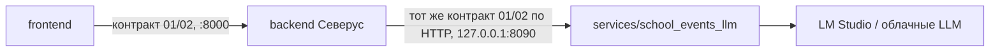
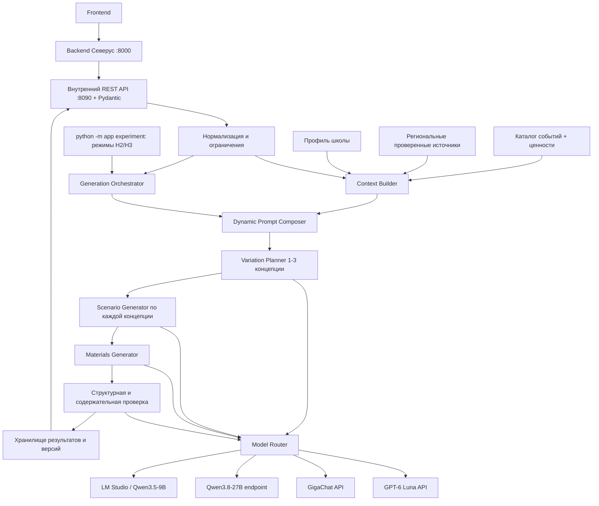

# Техническое задание: LLM-бэкенд сервиса «Школьные события»

**Версия:** 1.5 (проект ТЗ для согласования)  
**Дата:** 21.10.2026  
**Направление работ:** выбор и подключение LLM, динамические промпты, генерация сценариев, таймингов, ролей и материалов, **ценностный слой («ценность → механика»)**, персонализация, **серверный профиль школы**, гибкое участие родителей с точной численностью и ролями, генерация 1–3 вариантов, **культурный контур с проверенными источниками**, **режимы для экспериментов H2/H3**, проверка качества, внутренний HTTP-сервис для общего бэкенда «Северус», расширенное журналирование с полными DEV-трассами без автоматического обезличивания текста, аналитика и воспроизведение генераций (Replay).  
**Пилотный регион:** Свердловская область.  
**Язык MVP:** русский.  
**Целевая среда первого прототипа:** Python 3.11+ на любой ОС (Windows, Linux, macOS), локальная LM Studio + Qwen3.5-9B; возможность переключения на облачные/удалённые LLM **без изменения кода генератора**.  
**Репозиторий:** `github.com/yasinnsbts/severus`, каталог сервиса — `services/school_events_llm/`.

> **Статус документа.** Этот файл объединяет требования из предоставленного кейса «Школьные события» (Сбер / УрФУ, 6 страниц), решения, сформулированные в обсуждении, и технические предложения по реализации. Чтобы не смешивать согласованные требования с проектными решениями, ниже они помечены: **[ОБЯЗАТЕЛЬНО]** — явно задано заказчиком в обсуждении; **[КЕЙС]** — предусмотрено исходным кейсом; **[ПРЕДЛОЖЕНИЕ]** — архитектурная рекомендация, допускающая уточнение. Пометка **[v1.5]** отмечает пункты, добавленные или изменённые в этой версии. Окончательные инфраструктурные ограничения и доступы к API уточняются на этапе интеграции.

### Что изменилось относительно v1.4

**Главный принцип [ОБЯЗАТЕЛЬНО]:** JSON-контракты с фронтендом — **01 (запрос)** и **02 (ответ)** — **заморожены и не меняются относительно v1.4**: ни одно поле не добавлено, не удалено, не переименовано, типы и значения по умолчанию прежние, `config/request_defaults.json` прежний. Все новые возможности реализуются **внутри сервиса**: в каталоге, конфигурации, prompt-блоках, валидаторах и во внутреннем контракте **03 (ответ модели)**, который фронтенд и общий бэкенд не видят. Результат новых механик попадает к фронтенду только через **уже существующие поля** ответа 02.

| № | Изменение | Контракты 01/02 | Где |
|---|---|---|---|
| 1 | Сервис — **внутренний**: публичный API для фронтенда отдаёт общий бэкенд «Северус» (`backend/`, порт 8000), он вызывает наш сервис по HTTP (`127.0.0.1:8090`) с тем же контрактом 01/02. [ОБЯЗАТЕЛЬНО] | без изменений | 1.3, 5, 15.0, 23 |
| 2 | **Ценностный слой** из кейса: справочник ценностей и воспитательные задачи в каталоге событий, prompt-блок `VALUES`, связка `values_to_mechanics` в контракте 03, проверка реализации ценностей, детерминированный вывод в существующие поля `concept.tasks` и `teacher_instructions`. Педагог в MVP ценности не выбирает. [ОБЯЗАТЕЛЬНО] | без изменений | 2.5, 3.4, 7, 8.9, 14.6, 16 |
| 3 | **Профиль школы** хранится на сервере в `config/school_profile.json` (тип населённого пункта, малокомплектная школа, разновозрастные классы) и применяется ко всем генерациям; prompt-блок `SCHOOL`. [ОБЯЗАТЕЛЬНО] | без изменений | 2.6, 8.10 |
| 4 | **Семья**: отдельного «семейного задания» во входе нет. Если у события есть ценность `family`, генератор может предложить **необязательное** задание семье до события как обычный материал `handout` с равноценной альтернативой. [ОБЯЗАТЕЛЬНО] | без изменений | 2.7, 8.11 |
| 5 | **Режимы для гипотез H2/H3** (`context_mode`, `cultural_context`) — только во внутреннем экспериментальном CLI `python -m app experiment`, **не** в публичном API. [ОБЯЗАТЕЛЬНО] | без изменений | 7.1, 22.6 |
| 6 | **Культурный контур**: каталог расширяется до 15 позиций (2 кандидата на согласование), требования к корпусу проверенных источников (объём, статусы, ответственные), реестр фактических утверждений `fact_claims` в контракте 03, определение критической культурной ошибки. [ОБЯЗАТЕЛЬНО] | без изменений (используется существующий `sources[]`) | 3, 16.6, 17.4–17.7 |
| 7 | Исправлены нестыковки v1.4: пример 14.2 нарушал `group_work=false`; схема концепций беднее п. 9.3; нет примеров `scenario_plan`/`quality_review`; деление на группы только в названии роли; несогласованный словарь `dependencies`; разночтения в статусах и версиях схем. | без изменений | 3.5, 9.3, 12.3, 13.3, 14, контракт 03 |
| 8 | **Кроссплатформенность.** Сервис работает на Windows, Linux и macOS; вместо `.bat`-файлов v1.4 — команды `python -m app …` и `python -m pytest` (раздел 23.1). [ОБЯЗАТЕЛЬНО] | — | 21, 23, 23.1 |
| 9 | **Межпроцессная блокировка локальной LLM** — опциональная функция для случая, когда та же локальная модель используется не только этим сервисом. По умолчанию **выключена**, включается `LOCAL_LLM_MUTEX_ENABLED=true` в `.env` (в v1.4 была обязательной). Очередь «один вызов локальной модели за раз» внутри сервиса действует всегда. Добавлен учёт режима рассуждений модели. | — | 4.3, 4.4, 4.7 |
| 10 | Внутренний контракт 03 → `schema_version` **1.2**: расширенная схема концепций, `values_to_mechanics`, `pupil_grouping`, `fact_claims`, флаг `family_task` у материала, примеры `scenario_plan` и `quality_review`. | — | контракт 03 |
| 11 | Добавлены тест-кейсы T-081…T-112 и пункты Definition of Done. Приоритеты P0/P1/P2 v1.4 **не менялись**: новые функции распределены по существующим этапам. | — | 22.2, 24, 27 |

`teacher_preferences.group_work` остаётся строгим boolean с дефолтом `false`, как в v1.4: перевод на `null` («на усмотрение генератора») — изменение контракта 01 и отложен до его следующей версии (вопрос 13 в разделе 26).

---

## 1. Назначение и результат

Разработать самостоятельный сервис **School Events LLM Backend**, принимающий от фронтенда структурированный запрос на школьное мероприятие и возвращающий **от одного до трёх полных, содержательно различающихся проектов мероприятия**.

Каждый проект включает:

1. Название и концепцию мероприятия.
2. Цель, педагогические/воспитательные задачи, ожидаемый результат.
3. Подробную последовательность блоков с точным таймингом.
4. Сценарные тексты, реплики и подсказки педагогу/ведущим.
5. Роли, действия учащихся, педагогов и, при необходимости, **точного числа родителей**: помощники, активные участники, зрители, участники оценки/голосования.
6. Интерактивные активности, задания, вопросы и инструкции.
7. Тексты раздаточных карточек, заготовки структуры слайдов, список реквизита.
8. Инструкцию по подготовке и проведению.
9. Ссылки на подтверждающие источники там, где использованы исторические, культурные и региональные факты.
10. Результат автоматической валидации и предупреждения.

**Основная цель:** не «написать текст сценария», а предоставить педагогу **проект события**, который можно использовать и редактировать с минимальными дополнительными усилиями. [КЕЙС]

### 1.1. Что является частью данного бэкенда

- маршрутизация запросов к различным LLM (Model Router / Gateway);
- обработка и нормализация входных параметров;
- разрешение конфликтующих ограничений;
- подготовка предметного, культурного и педагогического контекста;
- библиотека шаблонов, условий, правил и версий промптов;
- генерация различных концепций (Variation Planner);
- генерация сценарного плана и детального сценария;
- расчёт и контроль таймингов;
- генерация ролей, интерактивов и текстовых материалов;
- персонализация под педагога и школу (в т. ч. серверный профиль школы) [v1.5];
- ценностный слой: перевод ценностей события в механику сценария и проверка реализации [v1.5];
- культурный контур: кураторский корпус проверенных источников, реестр фактических утверждений [v1.5];
- валидация структуры и содержательная проверка;
- выборочная регенерация варианта/блока;
- внутренний HTTP API для общего бэкенда, статусы заданий, подробное журналирование вызовов LLM, архивирование промежуточных данных, CSV-аналитика, диагностика и Replay, экспериментальный CLI для гипотез H2/H3 [v1.5], тесты, документация.

### 1.2. Что не входит в первую версию

- разработка самого фронтенда;
- регистрация пользователей и управление учётными записями;
- полнофункциональный электронный школьный календарь как отдельный продукт;
- генерация настоящих файлов PPTX/PDF/DOCX (LLM возвращает **содержательные заготовки**, экспорт — отдельный модуль);
- синтез музыки, аудио, изображений и видеороликов;
- автоматическая публикация/рассылка материалов;
- сбор персональных данных конкретных детей;
- самостоятельный неограниченный поиск по интернету на каждую генерацию;
- полноценная многопользовательская облачная инфраструктура с высокой нагрузкой до подтверждения необходимости;
- публичный API для фронтенда, CORS и авторизация пользователей — это зона общего бэкенда «Северус» [v1.5];
- выбор ценностей, ввод профиля школы и экспериментальных режимов через интерфейс педагога — требует изменения контрактов 01/02 и отложен [v1.5].

**При этом** API и JSON должны быть рассчитаны на последующее подключение функций экспорта, школьного календаря и хранилища проектов.

### 1.3. Место сервиса в репозитории «Северус» [ОБЯЗАТЕЛЬНО, v1.5]

```text
severus/
├── frontend/                    # фронтенд команды
├── backend/                     # общий бэкенд: публичный API :8000, CORS, (позже) авторизация
├── catalog/                     # текущий каталог общего бэкенда (v0.1, 2 события)
└── services/
    └── school_events_llm/       # наш сервис целиком: внутренний HTTP :8090
```



- Фронтенд **никогда** не обращается к сервису напрямую; сервис слушает только `127.0.0.1` (адрес задаётся `APP_HOST`).
- Общий бэкенд проксирует запросы фронтенда в сервис **без преобразования JSON**: контракт 01 на входе и контракт 02 на выходе совпадают у обоих.
- Источник истины по заданиям, проектам, вариантам и ревизиям — **сервис** (SQLite + артефакты). Бэкенд может кэшировать ответы, но не хранит собственную копию состояния генерации.
- Каждый блок разрабатывается локально и пушится в общий репозиторий; сервис не импортирует код из `backend/`, а бэкенд — из `services/` (связь только по HTTP).

Подробности интерфейса между бэкендом и сервисом — в разделе 15.0.

---

## 2. Исходные продуктовые условия

### 2.1. Аудитория

- Педагоги и классные руководители.
- Организаторы общешкольных мероприятий.
- Советники по воспитанию.
- Школы, ведущие календарь собственных событий.

По исходному кейсу сервис должен адаптировать мероприятия с учётом федерального/регионального календаря, культурного материала, возрастной группы, профиля школы, организационных ресурсов и воспитательной цели. [КЕЙС]

### 2.2. Поддерживаемые значения MVP

| Параметр | Значение / логика | Источник |
|---|---|---|
| Возрастная группа | `1-4`, `5-8`, `9-11` классы | [ОБЯЗАТЕЛЬНО] |
| Точный класс | `1..11`, желательно передавать; проверяется соответствие группе | [ПРЕДЛОЖЕНИЕ] |
| Число учащихся | **точное целое число**, в пилоте 1–35 | [ОБЯЗАТЕЛЬНО] |
| Категории количества | до 15; 16–25; 26–35 — вычисляются на бэкенде | [ОБЯЗАТЕЛЬНО] |
| Продолжительность | 30, 45, 60, 90 минут | [ОБЯЗАТЕЛЬНО] |
| Формат | классный час / общешкольное мероприятие / интерактивное занятие | [ОБЯЗАТЕЛЬНО] |
| Участники | учащиеся, педагоги; родители необязательны (возможно проведение только педагогом и учениками) | [ОБЯЗАТЕЛЬНО] |
| Количество родителей | **точное целое число**, если включены; `0`, если отсутствуют | [ОБЯЗАТЕЛЬНО] |
| Группы родителей | 1–2, 3–5, 6–10, **более 10 (11+)**; вычисляются на бэкенде | [ОБЯЗАТЕЛЬНО] |
| Роли родителей | помощь в проведении / активное участие / зрители / оценивание (жюри); допускаются сочетания | [ОБЯЗАТЕЛЬНО] |
| Вовлечение зрителей | без участия / обратная связь / голосование / «Приз зрительских симпатий» | [ОБЯЗАТЕЛЬНО] |
| Регион | Свердловская область (`RU-SVE`) для пилота | [ОБЯЗАТЕЛЬНО] |
| Каталог | 10–15 событий, федеральные, региональные, школьные | [ОБЯЗАТЕЛЬНО] |
| Количество выдаваемых вариантов | целое `1..3`, по умолчанию `1` | [ОБЯЗАТЕЛЬНО] |
| Персонализация | предпочтения педагога, школьные ресурсы, воспитательная цель | [КЕЙС] + [ОБЯЗАТЕЛЬНО] |

**Численность** хранится как точное число. Группы используются для подбора соответствующего блока инструкций; нельзя заменять `pupils_count=27` категорией `26–35` и забывать исходное значение.

Для общешкольных событий в будущем могут потребоваться десятки и сотни участников. **В MVP** протестированный диапазон — 1–35; расширение лимита требует отдельной оценки сценарных механик и нагрузки, а не случайного принятия произвольных значений.

### 2.3. Поддерживаемые форматы

| `format` | Отображаемое название | Особенности |
|---|---|---|
| `class_hour` | Классный час | Ведущий педагог, работа с одним классом, обсуждение и рефлексия |
| `school_event` | Общешкольное мероприятие | Сценические/организационные роли, выступления, управление переходами |
| `interactive_lesson` | Интерактивное занятие | Активные действия учащихся, задания, группы, исследование, обратная связь |

`format` и `style` — **разные сущности**: «классный час» может быть интерактивным, а «общешкольное мероприятие» — исследовательским по содержанию.

### 2.4. Родители: точная численность и возможные роли [ОБЯЗАТЕЛЬНО]

Родители являются **необязательной** группой участников. Педагог может провести мероприятие исключительно с учащимися без привлечения родителей. Варианты с родителями формируются **только при включении этого параметра на фронтенде**.

**Два независимых измерения:**

1. **Сколько родителей:** фронтенд передаёт точное `parents_count`; сервер вычисляет группу, но сохраняет точное число.
2. **Как они задействованы:** фронтенд передаёт допустимые роли `parent_roles` и при необходимости тип зрительской активности `parent_audience_engagement`. Не все указанные роли обязаны использоваться одновременно и всеми родителями.

| Точное число родителей | `parent_size_group` | Типичные реалистичные механики (примеры, не жёсткие ограничения) |
|---:|---|---|
| 0 | `none` | Педагог и учащиеся; без родительских ролей и голосований |
| 1–2 | `1-2` | Помощь педагогу, отдельная роль или небольшое участие; без обязательного массового голосования |
| 3–5 | `3-5` | Несколько помощников, участие в командах, небольшая группа зрителей, устная обратная связь |
| 6–10 | `6-10` | Возможность выделить зрителей/жюри и провести организованное голосование |
| 11 и более | `11_plus` | Зрительский сектор, распределение помощников, массовое голосование и «Приз зрительских симпатий» |

**Допустимые роли родителей:**

- `helper` — помогают организовать и провести мероприятие: выдавать карточки, помогать с группами, реквизитом, логистикой и подведением итогов;
- `active_participant` — непосредственно выполняют задания, участвуют в играх, обсуждении и совместных активностях;
- `audience` — зрители, могут оставаться пассивными или подключаться к отдельным механикам по выбранной настройке;
- `evaluator` — выступают членами жюри/оценивающими, когда это подходит формату и предусмотрены понятные критерии оценки.

**Варианты зрительской активности** (`parent_audience_engagement`):

- `none` — только наблюдают; обязательных действий нет;
- `feedback` — дают необязательную позитивную обратную связь по итогам;
- `vote` — голосуют по заранее объявленным понятным критериям;
- `audience_award` — голосуют за символический «Приз зрительских симпатий» с заранее заданными правилами, нейтральным награждением и регламентом.

Можно совмещать роли: например, из 12 родителей двое помогают педагогу, а десять остаются зрителями и выбирают понравившуюся творческую работу. Если один родитель последовательно выполняет несколько ролей, это фиксируется в сценарии по блокам. **Нельзя назначать одному человеку две несовместимые одновременные задачи.**

Для `audience_award` рекомендуется достаточная численность зрителей (проектный ориентир от 6, особенно удобно при 11+; порог предупреждения хранить в `generation.json`). Если зрителей мало, система предлагает необязательную альтернативу без соревновательного голосования; это **не основание автоматически менять запрошенный режим**. Важна численность именно фактических голосующих зрителей, а не всех приглашённых родителей.

**Этические требования:** участие родителей добровольное; нельзя ставить детей без пришедших родителей в невыгодное положение; не навязывать раскрытие семейных обстоятельств, персональные данные или сравнение «лучших семей». Оценка выступлений не должна превращаться в публичное унижение. Для конкурсов предусмотреть прозрачные критерии, ничью, предотвращение конфликта интересов, разумные призы и возможность отказаться от оценки.

### 2.5. Ценностный слой [КЕЙС + ОБЯЗАТЕЛЬНО, v1.5]

В кейсе ценности «не выводятся отдельным лозунгом, а переводятся в механику события», а конструктор фиксирует концептуальную рамку: воспитательную задачу и ценностный слой. В v1.5 этот слой реализуется **полностью на сервере**, без новых полей контракта 01:

1. **Справочник ценностей** `catalog/values.json` (раздел 3.4) — шесть ценностей кейса и их базовые механики.
2. **Каталог событий** задаёт для каждого события `values` (1–3 ценности) и `educational_goals` (воспитательные задачи). Это и есть «нормативно-методическая рамка» календаря из кейса.
3. **Нормализатор** формирует эффективный набор ценностей запроса: ценности события из каталога, в порядке приоритета. Модель **не выбирает** ценности сама.
4. **Prompt-блок `VALUES`** передаёт модели ценности, базовые механики и ограничения (возраст, `group_work`, наличие родителей).
5. **Контракт 03** требует `concept.values_to_mechanics` — для каждой ценности: какая механика её реализует и в каких блоках.
6. **Валидатор** проверяет, что каждая ценность реализована хотя бы в одном существующем блоке и что механика не противоречит ограничениям (раздел 16.6).
7. **Вывод фронтенду** — детерминированным Python-шаблоном в существующие поля 02: воспитательные задачи и строки «ценность → механика» добавляются в `concept.tasks`, практические указания — в `teacher_instructions` (раздел 14.6).

| Ценность (`value_id`) | Механика по кейсу | Как реализуется при ограничениях |
|---|---|---|
| `family` — семья | семейное исследование | при отсутствии родителей — обсуждение без раскрытия семейных обстоятельств; необязательное задание семье до события с равноценной альтернативой (2.7) |
| `mutual_aid` — взаимопомощь | командная задача | при `group_work=false` — парная работа по желанию или общая задача всего класса, без обязательных малых групп |
| `historical_memory` — историческая память | работа с источниками | только проверенные фрагменты из корпуса (раздел 17); для 1–4 классов — бережная подача |
| `labour_creation` — труд и созидание | совместный продукт | продукт выполним при заявленных ресурсах и `preparation_effort` |
| `cultural_diversity` — культурное многообразие | сравнительное изучение культур | только по источникам конкретной культуры, без «типичного представителя» |
| `citizenship` — гражданственность | решение реальной общественной задачи | задача посильна возрасту и решается в пределах класса/школы |

**Ограничение MVP:** педагог не выбирает ценности и не вводит собственную воспитательную задачу — это потребует новых полей контракта 01. Свободное пожелание педагога в `teacher_preferences.notes` учитывается как обычно, но не заменяет ценности каталога.

### 2.6. Профиль школы на сервере [КЕЙС + ОБЯЗАТЕЛЬНО, v1.5]

Кейс требует «одинаково доступный уровень методической поддержки для городской, сельской и малокомплектной школы». В пилоте профиль школы хранится в конфигурации сервиса `config/school_profile.json` (путь — `SCHOOL_PROFILE_FILE` в `.env`) и применяется ко всем генерациям:

```json
{
  "schema_version": "1.0",
  "profile_id": "pilot_school_01",
  "region_id": "RU-SVE",
  "settlement_type": "city",
  "small_school": false,
  "mixed_grade_classes": false,
  "typical_teachers_available": 1,
  "local_context_notes": null,
  "updated_at": "2026-10-21"
}
```

| Поле | Значения | Влияние на генерацию |
|---|---|---|
| `settlement_type` | `city`, `town`, `rural`, `null` | местные примеры и задания: для `rural` — без расчёта на городские музеи, выезды и платные площадки |
| `small_school` | `true` / `false` / `null` | малочисленные классы, мало взрослых, компактная организация, без многоступенчатых сценических ролей |
| `mixed_grade_classes` | `true` / `false` | советы по дифференциации заданий внутри одного класса; сам запрос по-прежнему содержит одну `grade_group` |
| `typical_teachers_available` | целое ≥1 | только справочно: обязательные ограничения задаёт `participants.teachers_count` из запроса |
| `local_context_notes` | строка или `null`, до 500 символов | недоверенные данные (раздел 20.2), не инструкция |

- Значения `null` означают «неизвестно» и не порождают предположений.
- Профиль **не может** противоречить запросу: при конфликте приоритет у запроса (например, `teachers_count` из запроса), расхождение пишется в предупреждения.
- Хеш файла профиля сохраняется в `metadata.json` и `prompt_manifest.json`, как для `request_defaults.json`.
- Персональных данных в профиле нет: название школы, ФИО и контакты не хранятся.
- Будущее развитие: общий бэкенд передаёт идентификатор школы, а сервис выбирает профиль из набора — после изменения контракта 01.

### 2.7. Семья: задание до события без нового поля [КЕЙС + ОБЯЗАТЕЛЬНО, v1.5]

В кейсе ценность «семья» переводится в механику «семейное исследование», а календарь задаёт «уровень участия семьи». Участие родителей **на мероприятии** покрывают поля `participants.*` (раздел 2.4). Отдельное поле «задание семье» в контракт **не добавляется**. Вместо этого:

- если в эффективных ценностях есть `family`, генератор **может** предложить необязательное задание семье до события (интервью с родственником, семейный предмет или фото по желанию, рассказ о профессии и т. п.);
- задание оформляется как обычный материал контракта 02 типа `handout` с пометкой в названии «(по желанию, до мероприятия)», а во внутреннем контракте 03 — с флагом `family_task: true`;
- в том же материале обязательна **равноценная альтернатива** для детей, которым дома помочь некому (работа со школьным музеем, интервью с педагогом, работа с проверенным источником из корпуса);
- блок мероприятия, использующий результаты задания, **должен проводиться и без них**; ни один ребёнок не оказывается в менее выгодном положении;
- запрещено требовать раскрытия семейных обстоятельств, фото, персональных данных, покупок; запрещено сравнивать и ранжировать семьи;
- подготовка учитывается в `teacher_instructions` (когда выдать задание, за сколько дней).

---

## 3. Каталог событий пилота

### 3.1. Базовый каталог (предложение — 13 позиций)

| ID | Мероприятие | Тип | Примечание |
|---|---|---|---|
| `knowledge_day` | День знаний | федеральное / школьное | обязательное |
| `teachers_day` | День учителя | федеральное / школьное | обязательное |
| `new_year` | Новый год | календарное / школьное | обязательное |
| `christmas` | Рождество | культурное / календарное | обязательное; учитывать светский формат школы |
| `defender_day` | 23 февраля / День защитника Отечества | федеральное | обязательное |
| `womens_day` | 8 марта / Международный женский день | федеральное | обязательное |
| `labour_day` | 1 мая / Праздник Весны и Труда («Мир, труд, май») | федеральное | обязательное |
| `victory_day` | 9 мая / День Победы | федеральное | обязательное |
| `unity_day` | День народного единства | федеральное | дополнительное |
| `mothers_day` | День матери | федеральное / школьное | дополнительное |
| `last_bell` | Последний звонок | школьное | дополнительное |
| `graduation` | Выпускной / завершение учебного года | школьное | дополнительное |
| `ural_culture` | История и культура Урала | региональное **тематическое событие** | требуется согласование конкретного содержания |
| `sverdlovsk_region_day` | День образования Свердловской области | региональное | **[v1.5] кандидат**; дата подтверждается источником из корпуса до включения |
| `native_language_day` | Международный день родного языка | культурное / международное | **[v1.5] кандидат**; основная площадка для ценности `cultural_diversity` |

Первые **восемь** мероприятий прямо названы заказчиком. Оставшиеся пять — проектное заполнение пилотного каталога до 13 позиций; список должен утверждаться отдельно.

**[v1.5]** Два кандидата доводят каталог до верхней границы пилота (15) и закрывают пробел кейса: «национально-культурные праздники» и «изучение конкретной культуры по источникам» в v1.4 были представлены только несогласованной позицией `ural_culture`. Кандидат включается в каталог (`status: active`) только после согласования и появления в корпусе не менее трёх проверенных фрагментов по нему (раздел 17.4). До этого запись хранится со `status: candidate` и **не отдаётся** в `GET /api/v1/catalog/events`. Новые позиции каталога — это данные, а не изменение контракта: фронтенд получает их тем же маршрутом.

Для `ural_culture` пока **не задана официальная дата**. Нельзя выдавать его за установленный государственный/региональный праздник: это тематическая позиция до согласования.

### 3.2. Структура каталога

Для каждой позиции хранятся:

- стабильный `event_id`, название, альтернативные названия;
- классификация (`federal`, `regional`, `school`, `cultural`);
- дата/правило вычисления даты, **если подтверждено**;
- возрастные и формальные ограничения, если они существуют;
- ссылка на тематический prompt-блок;
- образовательные/воспитательные цели и допустимые форматы;
- указатели на проверенные источники, региональные дополнения;
- правила культурно-возрастной проверки;
- **[v1.5]** `values` — 1–3 ценности из справочника `catalog/values.json` в порядке приоритета;
- **[v1.5]** `educational_goals` — 1–3 воспитательные задачи (короткие формулировки для педагога);
- **[v1.5]** `regional_topics` — ссылки на темы регионального пакета, которые разрешено подключать к событию;
- **[v1.5]** `status` — `active` / `candidate` / `archived`;
- версия каталожной записи и дата обновления.

Пример `catalog/events/victory_day.json`:

```json
{
  "id": "victory_day",
  "title": "День Победы",
  "category": "federal",
  "status": "active",
  "aliases": ["9 мая", "День Победы"],
  "supported_age_groups": ["1-4", "5-8", "9-11"],
  "supported_formats": ["class_hour", "school_event", "interactive_lesson"],
  "prompt_block": "events/victory_day.md",
  "source_collection": "victory_day",
  "values": ["historical_memory", "citizenship"],
  "educational_goals": [
    "Сформировать уважительное отношение к памяти о Великой Отечественной войне",
    "Научить работать с подлинными свидетельствами эпохи"
  ],
  "regional_topics": ["RU-SVE/ural_volunteer_tank_corps"],
  "review": {
    "historical_accuracy_required": true,
    "age_appropriateness_required": true,
    "cultural_review_required": true
  },
  "catalog_version": "1.1"
}
```

**Совместимость с `GET /api/v1/catalog/events` [v1.5].** Маршрут отдаёт фронтенду только поля, которые уже есть в ответе v1.4 (`id`, `title`, `category`, `aliases`, `supported_age_groups`, `supported_formats`, `catalog_version`). Новые служебные поля (`values`, `educational_goals`, `regional_topics`, `status`, `prompt_block`, `source_collection`, `review`) используются только внутри сервиса и наружу не выдаются.

Предлагаемое распределение ценностей по каталогу (утверждается вместе с каталогом):

| Событие | `values` |
|---|---|
| `knowledge_day` | `mutual_aid`, `citizenship` |
| `teachers_day` | `labour_creation`, `mutual_aid` |
| `new_year` | `family`, `labour_creation` |
| `christmas` | `cultural_diversity`, `family` |
| `defender_day` | `historical_memory`, `citizenship` |
| `womens_day` | `family`, `labour_creation` |
| `labour_day` | `labour_creation`, `mutual_aid` |
| `victory_day` | `historical_memory`, `citizenship` |
| `unity_day` | `cultural_diversity`, `citizenship` |
| `mothers_day` | `family` |
| `last_bell` | `mutual_aid`, `labour_creation` |
| `graduation` | `citizenship`, `mutual_aid` |
| `ural_culture` | `historical_memory`, `cultural_diversity` |
| `sverdlovsk_region_day` | `historical_memory`, `citizenship` |
| `native_language_day` | `cultural_diversity`, `family` |

### 3.3. Региональный пакет

В пилоте используются данные Свердловской области, подключаемые ко всем применимым мероприятиям:

`catalog/regions/RU-SVE/`:

- справочные сведения о регионе;
- проверенные историко-культурные источники;
- допустимые местные примеры и задания;
- перечень региональных тематических событий после согласования;
- даты, источники, версия и статус верификации.

**Запрет:** региональная вариативность не строится на выдуманных обрядах, стереотипах о «типичном представителе» культуры или неподтверждённых исторических фактах. [КЕЙС]

**[v1.5] Стартовые региональные темы** (`catalog/regions/RU-SVE/topics.json`; каждая подключается только при наличии проверенных фрагментов):

| `topic_id` | Тема | К каким событиям |
|---|---|---|
| `ural_volunteer_tank_corps` | Уральский добровольческий танковый корпус | `victory_day`, `defender_day` |
| `bazhov_tales` | П. П. Бажов и уральские сказы | `ural_culture`, `native_language_day` |
| `mining_heritage` | Горнозаводская история Урала | `ural_culture`, `labour_day`, `sverdlovsk_region_day` |
| `region_history` | Образование и история Свердловской области | `sverdlovsk_region_day`, `unity_day` |
| `peoples_of_the_region` | Народы и культуры Среднего Урала по источникам | `unity_day`, `native_language_day`, `ural_culture` |

Список — стартовая гипотеза для сбора корпуса; конкретные факты по каждой теме попадают в генерацию только через проверенные фрагменты (раздел 17).

### 3.4. Справочник ценностей `catalog/values.json` [v1.5]

```json
{
  "schema_version": "1.0",
  "values": [
    {
      "value_id": "mutual_aid",
      "title": "Взаимопомощь",
      "case_mechanic": "командная задача",
      "mechanic_guidance": "Задача, которую нельзя решить в одиночку: участники распределяют работу и помогают друг другу.",
      "constraints": {
        "if_group_work_false": "Без обязательных малых групп: общая задача всего класса или парная работа по желанию.",
        "age_1_4": "Простые совместные действия с наглядным результатом."
      },
      "evidence_required": false
    }
  ]
}
```

Справочник содержит все шесть ценностей таблицы 2.5. Поле `evidence_required=true` ставится у `historical_memory` и `cultural_diversity`: механика обязана опираться на фрагменты корпуса, иначе ценность реализуется заданием без фактических утверждений (например, работа с вопросами, а не с «фактами» от модели).

### 3.5. Словарь зависимостей материалов `catalog/dependencies.json` [v1.5]

Поле `materials[].dependencies` контракта 02 сохраняет формат (массив строк), но его значения берутся **только из словаря**. Каждый элемент словаря типизирован:

```json
{
  "schema_version": "1.0",
  "items": [
    {"id": "projector", "kind": "equipment", "resource_flag": "projector", "label": "Проектор"},
    {"id": "printer",   "kind": "equipment", "resource_flag": "printer",   "label": "Принтер"},
    {"id": "internet",  "kind": "equipment", "resource_flag": "internet",  "label": "Интернет"},
    {"id": "audio",     "kind": "equipment", "resource_flag": "audio",     "label": "Звуковое оборудование"},
    {"id": "paper",     "kind": "consumable", "resource_flag": null, "label": "Бумага"},
    {"id": "markers",   "kind": "consumable", "resource_flag": null, "label": "Маркеры"}
  ]
}
```

- `equipment` сверяется с булевыми флагами `resources.*`: при `false` зависимость запрещена без альтернативы, при `null` допустима только с альтернативой без оборудования.
- `consumable` сверяется с `resources.available_materials`; пустой список означает «не заявлено», поэтому расходники допустимы, но попадают в `teacher_instructions` как то, что нужно подготовить.
- Значение вне словаря — ошибка схемы этапа `materials` (repairable), а не повод расширять словарь на лету.

### 3.6. Источник истины каталога [ПРЕДЛОЖЕНИЕ, v1.5]

Сейчас общий бэкенд читает собственный каталог `severus/catalog/events/*.json` (v0.1, 2 события). Чтобы не держать два расходящихся каталога, источником истины становится `services/school_events_llm/catalog/`, а общий бэкенд проксирует `GET /api/v1/catalog/events` и `GET /api/v1/catalog/options` из сервиса (формат ответа v1.4 не меняется). Порядок перехода согласуется с владельцем `backend/` (вопрос 14 в разделе 26).

---

## 4. Модели и универсальный Model Router

### 4.1. Целевые конфигурации

| Конфигурация | Режим | API-адаптер | Назначение |
|---|---|---|---|
| `qwen_local_9b` | локальная **Qwen3.5-9B** в LM Studio | `openai_compatible` | **основная модель прототипа** |
| `qwen_27b` | **Qwen3.8-27B**, локальный/удалённый сервер | `openai_compatible` либо адаптер конкретного провайдера | сравнительные испытания, дальнейшее развитие |
| `gigachat` | **GigaChat** API | `gigachat` | альтернативная облачная модель |
| `gpt6_luna` | **GPT-6 Luna** API | `openai` | альтернативная облачная модель |

Наличие модели на конкретном аккаунте/тарифе **не предполагается автоматически**: перед использованием требуется проверка доступности, авторизации и поддерживаемых функций.

Подтверждённые документацией направления: LM Studio — OpenAI-совместимые `/v1/models` и `/v1/chat/completions`; OpenAI model ID `gpt-6-luna`; официальная модель `Qwen/Qwen3.8-27B`; GigaChat API с получением Bearer-токена. Ссылки — в разделе 25.

### 4.2. Главный архитектурный контракт

**[ОБЯЗАТЕЛЬНО]** Изменение активной модели выполняется только через `.env` и/или `config/models.json` без исправления исходного кода генерации.

Все этапы используют общий интерфейс `LLMClient`/`ModelRouter`, например:

```python
from dataclasses import dataclass
from typing import Any

@dataclass
class LLMResult:
    text: str
    parsed: dict[str, Any] | None
    model_key: str
    provider_model_id: str
    usage: dict[str, Any] | None
    latency_ms: int

class LLMClient:
    async def generate(
        self,
        *,
        messages: list[dict[str, str]],
        output_schema: dict[str, Any] | None,
        task_name: str,
        model_key: str | None = None,
    ) -> LLMResult:
        ...
```

Это **иллюстрация интерфейса**, а не требование использовать именно эти имена классов.

### 4.3. Конфигурация `.env`

```dotenv
# Выбор профиля модели
ACTIVE_MODEL=qwen_local_9b

# Доступы (в реальном .env значения секретные)
OPENAI_API_KEY=
GIGACHAT_AUTH_KEY=
QWEN_API_KEY=

# Работа сервиса
APP_HOST=127.0.0.1
APP_PORT=8090
APP_ENV=development
APP_LOG_LEVEL=DEBUG

# Журналирование и диагностика (значения для локальной разработки)
LOG_FORMAT=jsonl
LOG_DIR=./data/logs
LOG_LLM_DETAILS=true
LOG_FULL_PROMPTS=true
LOG_FULL_RESPONSES=true
LOG_REDACT_SECRETS=true
LOG_REDACT_PERSONAL_DATA=false
LOG_SAVE_INTERMEDIATE=true
LOG_SAVE_VALIDATION=true
LOG_EXPORT_CSV=true
LOG_REPLAY_ENABLED=true
LOG_RETENTION_DAYS=30
LOG_RAW_API_PAYLOADS=false

# Межпроцессная блокировка локальной модели (опция, по умолчанию выключена — раздел 4.7)
LOCAL_LLM_MUTEX_ENABLED=false
LOCAL_LLM_MUTEX_PATH=./data/locks/lm_studio.lock
LOCAL_LLM_MUTEX_WAIT_SECONDS=120

# Конфигурация значений по умолчанию для входных полей
REQUEST_DEFAULTS_FILE=./config/request_defaults.json

# v1.5: серверный профиль школы
SCHOOL_PROFILE_FILE=./config/school_profile.json

# v1.5: связь с общим бэкендом «Северус»
SERVICE_AUTH_TOKEN=

# Пилотные ограничения
PILOT_REGION_ID=RU-SVE
MAX_PUPILS_PILOT=35
MAX_VARIANTS=3
```

`.env` никогда не включается в репозиторий; распространяется только `.env.example` с пустыми секретами.

### 4.4. Конфигурация `config/models.json`

```json
{
  "schema_version": "1.0",
  "default_model": "qwen_local_9b",
  "fallback": {
    "enabled": false
  },
  "models": {
    "qwen_local_9b": {
      "provider": "openai_compatible",
      "base_url": "http://127.0.0.1:1234/v1",
      "model_id": "auto_loaded",
      "api_key_env": null,
      "timeout_seconds": 240,
      "max_concurrency": 1,
      "structured_output_mode": "auto",
      "reasoning_mode": "disabled",
      "enabled": true
    },
    "qwen_27b": {
      "provider": "openai_compatible",
      "base_url": null,
      "model_id": "SET_ACTUAL_SERVER_MODEL_ID",
      "api_key_env": "QWEN_API_KEY",
      "timeout_seconds": 300,
      "max_concurrency": 1,
      "structured_output_mode": "auto",
      "enabled": false
    },
    "gigachat": {
      "provider": "gigachat",
      "base_url": "https://api.giga.chat",
      "model_id": "GigaChat",
      "api_key_env": "GIGACHAT_AUTH_KEY",
      "timeout_seconds": 240,
      "max_concurrency": 2,
      "structured_output_mode": "auto",
      "enabled": false
    },
    "gpt6_luna": {
      "provider": "openai",
      "model_id": "gpt-6-luna",
      "api_key_env": "OPENAI_API_KEY",
      "timeout_seconds": 240,
      "max_concurrency": 3,
      "structured_output_mode": "auto",
      "enabled": false
    }
  }
}
```

- `model_id=auto_loaded` — **внутренний маркер проекта**, не отправляется дословно в LM Studio. Роутер запрашивает `/v1/models`, выбирает загруженную/доступную модель; при нескольких неоднозначных моделях выдаёт ошибку конфигурации и просит указать ID явно.
- `SET_ACTUAL_SERVER_MODEL_ID` — **заглушка**, её заменяют идентификатором, реально объявленным сервером Qwen3.8-27B. Идентификатор репозитория модели не обязан совпадать с API `model`.
- Для GigaChat адаптер отдельно получает и обновляет токен доступа, используя настроенный ключ авторизации; не следует напрямую передавать `GIGACHAT_AUTH_KEY` как готовый Bearer-токен генерации.
- Для OpenAI использовать рекомендуемый интерфейс провайдера; особенности параметров (`reasoning`, `temperature`, structured output, лимиты) скрыты внутри адаптера.
- Структурированный вывод через JSON Schema включать только при подтверждённой поддержке выбранной модели/серверного режима; иначе текст → извлечение JSON → локальная валидация и ограниченное исправление.
- **[v1.5] `reasoning_mode`** (`disabled` / `provider_default` / `enabled`) — для каждой модели явно. Для локальной Qwen по умолчанию `disabled`: скрытые рассуждения кратно увеличивают время и расход `max_output_tokens`. Адаптер сам переводит настройку в механизм конкретного провайдера/модели (параметр запроса, шаблон чата, системная директива) и **вырезает** блок рассуждений из ответа до извлечения JSON. Если провайдер вернул токены рассуждений, они пишутся в журнал отдельно (`reasoning_tokens`). Способ отключения для конкретной сборки модели подтверждается интеграционным тестом этапа 1.

### 4.5. Приоритет настроек

1. `ACTIVE_MODEL` из `.env`, если установлен;
2. `default_model` из `models.json`;
3. если ни одно значение не указано — ошибка запуска с ясным сообщением.

Опциональное поле модели в пользовательском запросе **не принимается** в публичном API MVP. Выбор модели — серверная конфигурация, иначе фронтенд сможет обходить инфраструктурные/стоимостные ограничения.

### 4.6. Поведение при сбое

- Невозможно подключиться — состояние `failed` с кодом `MODEL_UNAVAILABLE`.
- Истёк срок ожидания — `MODEL_TIMEOUT`.
- Ошибка авторизации — `MODEL_AUTH_ERROR`.
- Неподдерживаемый метод структурированного вывода — предусмотренный fallback вывода, если безопасен и настроен.
- Превышен лимит — `RATE_LIMITED`, ограниченная повторная попытка с backoff.
- **Запрещено** незаметно переключаться на другую модель при выключенном `fallback.enabled`.
- В лог пишутся фактические `provider`, `model_key`, `provider_model_id`, `task_name`, время и статистика токенов (если доступна).

### 4.7. Очередь и межпроцессная блокировка локальной модели

**[ОБЯЗАТЕЛЬНО] Очередь внутри сервиса.** Не отправлять несколько тяжёлых генераций одновременно в одну локальную модель: внутри сервиса вызовы к локальной модели выполняются строго по одному (очередь по `max_concurrency` из `config/models.json`, для локальной модели — 1). Действует всегда, отключению не подлежит.

**[ПРЕДЛОЖЕНИЕ, v1.5] Межпроцессная блокировка — опция.** Нужна, когда та же локальная модель используется не только этим сервисом (другие программы или несколько экземпляров сервиса на одной машине). **По умолчанию выключена.**

| Параметр `.env` | По умолчанию | Назначение |
|---|---|---|
| `LOCAL_LLM_MUTEX_ENABLED` | `false` | `true` — включить межпроцессную блокировку |
| `LOCAL_LLM_MUTEX_PATH` | `./data/locks/lm_studio.lock` | lock-файл; все программы, которые делят модель, должны использовать один и тот же путь |
| `LOCAL_LLM_MUTEX_WAIT_SECONDS` | `120` | сколько ждать освобождения модели |

Особенности:

- блокировка берётся **на время одного вызова к локальной модели**, а не на всю генерацию;
- ожидание ограничено таймаутом; превышение — ошибка `MODEL_UNAVAILABLE` с `retryable=true`;
- освобождение гарантируется даже при исключении или отмене;
- работает одинаково на Windows, Linux и macOS, без внешних утилит;
- блокировка действует только между программами, которые используют тот же lock-файл; программы, которые его не проверяют, она не останавливает;
- для облачных моделей не используется;
- время ожидания пишется в `mutex_wait_ms` (раздел 19.3).
---

## 5. Схема компонентов



**Ключевое разделение:**

- **Что генерировать:** нормализованные данные фронтенда и каталог.
- **Как генерировать:** промпт-блоки, шаблоны, ограничения, конвейер, валидаторы.
- **Чем генерировать:** модель, выбранная конфигурацией через Model Router.

Изменение одного уровня не требует переписывания двух остальных.

---

## 6. Входной JSON: контракт фронтенд → LLM-бэкенд

> **[v1.5] Контракт заморожен.** Состав полей, типы, ограничения и значения по умолчанию этого раздела совпадают с v1.4 и с документом `01_FRONTEND_REQUEST`. Общий бэкенд передаёт в сервис этот же JSON без преобразования. Новые данные v1.5 (ценности, воспитательные задачи, профиль школы, экспериментальные режимы) появляются только в **нормализованном внутреннем объекте** (раздел 6.3) и берутся из каталога и конфигурации сервиса, а не из запроса. Неизвестные поля запроса по-прежнему отклоняются (`422 VALIDATION_ERROR`).

### 6.1. Основной запрос

`POST /api/v1/generations`

```json
{
  "event_id": "knowledge_day",
  "region_id": "RU-SVE",
  "grade_group": "5-8",
  "grade": 6,
  "pupils_count": 27,
  "duration_minutes": 45,
  "format": "class_hour",
  "participants": {
    "teachers_count": 1,
    "parents_enabled": true,
    "parents_count": 12,
    "parent_roles": ["helper", "audience"],
    "parent_audience_engagement": "audience_award",
    "parent_notes": "Двое родителей помогают с карточками, остальные зрители"
  },
  "resources": {
    "projector": true,
    "printer": true,
    "internet": false,
    "audio": false,
    "room": "classroom",
    "available_materials": ["paper", "markers"],
    "extra_notes": ""
  },
  "teacher_preferences": {
    "style": "interactive",
    "script_detail": "detailed",
    "difficulty": "standard",
    "interaction_level": "high",
    "group_work": true,
    "preparation_effort": "minimal",
    "notes": "Меньше длительных монологов"
  },
  "generation": {
    "variants_count": 3,
    "language": "ru"
  }
}
```

### 6.2. Обязательные поля

| Поле | Тип | Правило |
|---|---|---|
| `event_id` | string | ID существующей позиции каталога |
| `region_id` | string | для MVP `RU-SVE` |
| `grade_group` | enum | `1-4`, `5-8`, `9-11`; может вычисляться по `grade` |
| `grade` | int / null | 1..11, если присутствует — согласован с группой |
| `pupils_count` | int | пилот: 1..35, без округления |
| `duration_minutes` | int | 30, 45, 60 или 90 |
| `format` | enum | один из 3 поддерживаемых форматов |
| `generation.variants_count` | int | 1..3, default 1 |
| `participants.teachers_count` | int | >=1; если отсутствует, default 1 |
| `participants.parents_enabled` | bool | default `false` |
| `participants.parents_count` | int | при `true` — обязательное точное число >=1; при `false` — 0 |
| `participants.parent_roles` | array[enum] | `helper`, `active_participant`, `audience`, `evaluator`; при `true` и отсутствии поля — default `["audience"]` |
| `participants.parent_audience_engagement` | enum | `none`, `feedback`, `vote`, `audience_award`; default `none` |
| `participants.parent_notes` | string / null | дополнительные пожелания, ограниченная длина; не являются системными инструкциями |

`participants`, `resources` и `teacher_preferences` допускают частичное заполнение, однако бэкенд обязан применять документированные значения по умолчанию, а не гадать.

### 6.2.1. Значения необязательных входных полей на сервере V1 [ОБЯЗАТЕЛЬНО]

**Общая логика:** дефолт применяется только к отсутствующему полю. Вложенные объекты объединяются с дефолтами рекурсивно, по полям. Явно переданные корректные значения не заменяются. Поля обязательные (`event_id`, `region_id`, `pupils_count`, `duration_minutes`, `format`, `grade_group` либо вычислимый `grade`) **не получают искусственных дефолтов**.

| Поле (путь JSON) | Тип / допустимые значения | Сервер V1 при отсутствии |
|---|---|---|
| `grade` | `integer 1..11` или `null` | `null` |
| `grade_group` | `1-4`, `5-8`, `9-11` | вычисляется из `grade` или ошибка, если нет обоих |
| `participants.teachers_count` | `integer ≥1` | `1` |
| `participants.parents_enabled` | `boolean` | `false` |
| `participants.parents_count` | `integer ≥0` | `0` при отключённых родителях; при включённых поле обязательно (`≥1`) |
| `participants.parent_roles` | массив `helper`, `active_participant`, `audience`, `evaluator` | `[]` при отключённых; `["audience"]` при включённых |
| `participants.parent_audience_engagement` | `none`, `feedback`, `vote`, `audience_award` | `none` |
| `participants.parent_notes` | `string` или `null` | `null` |
| `resources.projector` | `boolean` или `null` | `null` — неизвестно |
| `resources.printer` | `boolean` или `null` | `null` — неизвестно |
| `resources.internet` | `boolean` или `null` | `null` — неизвестно |
| `resources.audio` | `boolean` или `null` | `null` — неизвестно |
| `resources.room` | `classroom`, `assembly_hall`, `gym`, `other`, `null` | `null` — не указано |
| `resources.available_materials` | `array<string>` | `[]` — нет заявленных материалов |
| `resources.extra_notes` | `string` или `null` | `null` |
| `teacher_preferences.style` | `classic`, `interactive`, `creative`, `research` | `classic` |
| `teacher_preferences.script_detail` | `brief`, `standard`, `detailed` | `standard` |
| `teacher_preferences.difficulty` | `basic`, `standard`, `advanced` | `standard` |
| **`teacher_preferences.interaction_level`** | `low`, `medium`, `high` | **`low` — минимальная интенсивность** |
| **`teacher_preferences.group_work`** | `boolean` | **`false` (`0`) — малые группы не требуются** |
| `teacher_preferences.preparation_effort` | `minimal`, `standard`, `extended` | `minimal` |
| `teacher_preferences.notes` | `string` или `null` | `null` |
| `generation.variants_count` | `integer 1..3` | `1` |
| `generation.language` | `ru` (в пилоте) | `ru` |

Сервер хранит значения в **`config/request_defaults.json`**, а путь берёт из `REQUEST_DEFAULTS_FILE` в `.env`. Этот файл — единый источник значений по умолчанию для API, Prompt Composer и тестов. Рекомендованный первичный вариант файла:

```json
{
  "participants": {
    "teachers_count": 1,
    "parents_enabled": false,
    "parents_count": 0,
    "parent_roles": [],
    "parent_audience_engagement": "none",
    "parent_notes": null
  },
  "resources": {
    "projector": null,
    "printer": null,
    "internet": null,
    "audio": null,
    "room": null,
    "available_materials": [],
    "extra_notes": null
  },
  "teacher_preferences": {
    "style": "classic",
    "script_detail": "standard",
    "difficulty": "standard",
    "interaction_level": "low",
    "group_work": false,
    "preparation_effort": "minimal",
    "notes": null
  },
  "generation": {
    "variants_count": 1,
    "language": "ru"
  }
}
```

**Особенности V1:** `low` — минимальное участие учащихся (основной акцент на объяснении, обсуждении и коротких индивидуальных ответах), а `group_work=false` запрещает планировать **обязательное разделение на малые группы**. Это не запрет на вопросы ученикам или добровольные парные задания. `false` — логическое JSON-значение, `0` только текстовое пояснение, не допустимый тип для boolean API. В Pydantic применять строгий boolean (`StrictBool`), чтобы `0`, `1`, `"false"` не приводились к логическому типу автоматически. Неизвестные ресурсы `null` никогда не принимаются автоматически за `true`.

**Условные правила имеют приоритет над базовым файлом дефолтов.** При включении родителей требуется `parents_count ≥1`; если роли опущены, разрешается `audience`. При отключении родителей нормализуются `parents_count=0`, `parent_roles=[]`, `parent_audience_engagement=none`; противоречивый явно переданный запрос отклоняется. Значение `null` нельзя отправлять вместо отсутствующего поля, если его тип не допускает null.

Нормализация выполняется до выбора prompt-блоков и генерации. В `input` ответа фронтенду должны входить эффективные параметры, а в логах хранятся и исходный входной JSON, и нормализованный результат с версией/хешем дефолтов. **Модель LLM не подставляет дефолты самостоятельно.**


### 6.3. Нормализация

Входные параметры преобразуются в `NormalizedEventRequest`:

```json
{
  "event_id": "knowledge_day",
  "age_group": "5-8",
  "grade": 6,
  "pupils_count": 27,
  "size_group": "26-35",
  "duration_minutes": 45,
  "format": "class_hour",
  "region_id": "RU-SVE",
  "parents_enabled": true,
  "parents_count": 12,
  "parent_size_group": "11_plus",
  "parent_roles": ["helper", "audience"],
  "parent_audience_engagement": "audience_award",
  "variants_count": 3,
  "required_resources": ["projector", "printer"],
  "unavailable_resources": ["internet", "audio"],
  "teacher_style": "interactive",
  "teacher_interaction_level": "high",
  "teacher_group_work": true,
  "defaults_config": "config/request_defaults.json",
  "values": ["mutual_aid", "citizenship"],
  "educational_goals": ["Сформировать общие цели класса на учебный год"],
  "school_profile_id": "pilot_school_01",
  "context_mode": "full",
  "cultural_context": true,
  "experiment_tag": null
}
```

**Важно:** указанный фрагмент — демонстрация нормализованного объекта, не полный перечень его полей.

**[v1.5] Внутренние поля нормализованного объекта** (не приходят из запроса и не возвращаются в `input` ответа 02):

| Поле | Источник | Правило |
|---|---|---|
| `values` | `catalog/events/<event_id>.json` → `values` | порядок сохраняется; каждая ценность существует в `catalog/values.json`, иначе ошибка конфигурации при старте |
| `educational_goals` | каталог события | 1–3 строки |
| `school_profile_id` + снимок профиля | `SCHOOL_PROFILE_FILE` | хеш файла пишется в `metadata.json` |
| `context_mode` | для API всегда `full`; иное значение — только из `python -m app experiment` | раздел 22.6 |
| `cultural_context` | для API всегда `true`; `false` — только из `python -m app experiment` | раздел 22.6 |
| `experiment_tag`, `experiment_pair_id` | только из `python -m app experiment` | для API — `null` |

Эти поля сохраняются в `normalized_request.json` и участвуют в выборе prompt-блоков.

Для неизвестных ресурсов лучше использовать трёхзначную логику (`available` / `unavailable` / `unknown`), чем автоматически предполагать наличие проектора или принтера. Обязательные занятия должны работать с точно доступными средствами; альтернативы могут быть рекомендованы отдельно.

### 6.4. Проверки до обращения к LLM

- событие существует и разрешено в каталоге (`status=active`; кандидаты отклоняются как `EVENT_NOT_FOUND`) [v1.5];
- у события есть хотя бы одна ценность и одна воспитательная задача — иначе событие считается некорректно заведённым и не отдаётся в каталог [v1.5];
- класс соответствует возрастной группе;
- число учеников допустимо для пилота;
- продолжительность и формат входят в перечисления;
- `parents_enabled=false` требует `parents_count=0`, пустого `parent_roles` и `parent_audience_engagement=none`; никакие родительские роли не генерируются;
- `parents_enabled=true` требует **точного** `parents_count>=1`; значение не заменяется диапазоном; при неуказанных `parent_roles` применяется `["audience"]`;
- диапазон родителей вычисляется программно: `1-2` / `3-5` / `6-10` / `11_plus`;
- `parent_audience_engagement` со значением `feedback`, `vote` или `audience_award` требует роли `audience`; роль `evaluator` может использоваться отдельно для формального жюри;
- при выборе неподходящего механизма (например, зрительский приз при 1–2 зрителях) возвращается предупреждение и рекомендации, но допустимые пожелания не заменяются без ведома пользователя;
- параметры ресурсов непротиворечивы;
- количество вариантов в диапазоне 1–3;
- входные строки ограничены по длине и очищены от управляющих символов;
- при невозможном организационном требовании формируется ошибка/предупреждение до запуска дорогостоящей генерации.

API возвращает `422 VALIDATION_ERROR` при формально неверном запросе; для мягких конфликтов — структурированные `warnings`, при необходимости без запуска задачи до корректировки.

---

## 7. Архитектура Dynamic Prompt Composer

**[ОБЯЗАТЕЛЬНО]** Промпт собирается динамически из независимых блоков, соответствующих фактическим параметрам запроса. Не допускается реализация сотен жёстко заданных комбинаций `праздник × возраст × численность × время × формат`.

### 7.1. Блоки и назначение

| Имя | Подключение | Смысл |
|---|---|---|
| `CORE` | всегда | базовые правила, роль, надёжность |
| `SAFETY` | всегда | корректность, возраст, чувствительные темы |
| `TASK` | всегда | текущий этап: концепции/план/сценарий/материалы/проверка |
| `EVENT` | всегда | специфика выбранного события |
| `AGE` | всегда | особенности конкретной возрастной группы |
| `GRADE` | если указан точный класс | тонкая адаптация сложности |
| `SIZE` | всегда | организация учеников, групп и ролей |
| `DURATION` | всегда | временные ограничения |
| `FORMAT` | всегда | классный час / общешкольное / интерактивное |
| `PARTICIPANTS` | всегда | педагоги, учащиеся, опционально родители |
| `PARENT_SIZE` | если `parents_enabled=true` | отдельный блок для 1–2 / 3–5 / 6–10 / 11+ родителей + точное число |
| `PARENT_ROLE` | если `parents_enabled=true` | допустимые роли помощников, участников, зрителей и жюри |
| `PARENT_AUDIENCE` | если выбрана активность зрителей | обратная связь, голосование или зрительский приз |
| `VALUES` [v1.5] | всегда | ценности события, базовые механики кейса, воспитательные задачи, ограничения реализации |
| `SCHOOL` [v1.5] | если в профиле школы есть хотя бы одно значение, отличное от `null`, и `context_mode=full` | тип населённого пункта, малокомплектность, разновозрастные классы |
| `FAMILY` [v1.5] | если в `values` есть `family` | правила необязательного задания семье и равноценной альтернативы (2.7) |
| `REGION` | если доступен подтверждённый контекст и `cultural_context=true` | местные источники и культурные особенности |
| `TEACHER` | если задан профиль и `context_mode=full` | предпочтения педагога |
| `RESOURCES` | всегда | доступные/недоступные ресурсы |
| `MODE` [v1.5] | только при `context_mode=universal` | инструкция «универсальный сценарий без адаптации» для эксперимента H2 |
| `VARIATION` | при концептуальном планировании/регенерации | различия 1–3 концепций |
| `SOURCE_CONTEXT` | если подобраны фактические источники | цитируемые подтверждённые фрагменты |
| `OUTPUT` | всегда | схема результата для текущего этапа |

### 7.2. Не одна строка, а набор сообщений

Сборщик формирует **логически разделённые сообщения**:

1. системное: неизменяемые правила, границы и назначение этапа;
2. управляющее: структурированные требования задачи и требуемая схема;
3. предметное: характеристики мероприятия и педагогические ограничения;
4. справочное: подтверждённые факты и источники как **данные**, а не инструкции;
5. список проверяемых ограничений.

Способ передачи этих сообщений определяется возможностями конкретного API-адаптера. Модуль не должен вслепую склеивать непроверенный текст сайта с системными инструкциями.

### 7.3. Приоритеты правил

1. Безопасность, достоверность, отказ от выдуманных источников/традиций.
2. Инварианты схемы и бизнес-ограничения (длительность, возраст, число детей, ресурсы).
3. Предметные и возрастные правила события.
4. Предпочтения педагога.
5. Необязательные стилевые рекомендации/творческая вариативность.

При конфликте нижестоящий блок не может отменять вышестоящий. Конфликты выявляются до вызова LLM, а непреодолимые ограничения возвращаются как отдельная диагностическая запись.

### 7.4. Метаданные prompt-блока

Каждый блок имеет стабильный идентификатор, версию, условия применимости, приоритет, параметры и тесты:

```yaml
id: age.grades_1_4
version: 1.0.0
path: prompts/age/grades_1_4.md
applies_when:
  age_group: "1-4"
priority: 50
required_variables:
  - grade
  - pupils_count
```

Правила `applies_when` интерпретирует код на основе белого списка допустимых полей; запрещено выполнять произвольные выражения/код из конфигурации.

### 7.5. Версионирование

Хранить:

- список использованных блоков + версий + контрольных сумм;
- идентификатор каталога и регионального пакета;
- версию выходной схемы;
- нормализованные входные параметры;
- `model_key`, параметры генерации и выбранный API;
- безопасный снимок собранного промпта/его хэш (с учётом политики персональных данных).

Редактирование `.md`-блока не изменяет ранее созданные проекты. Новая генерация использует новую версию, старые проекты сохраняют связь с прежней.

### 7.6. Пример Composer (псевдокод)

```python
def compose_prompt(request, task_name, extra_context=None):
    context = normalize_request(request)
    blocks = [
        load("core/system"),
        load("core/safety"),
        load(f"tasks/{task_name}"),
        load(f"events/{context.event_id}"),
        load(f"age/{context.age_group}"),
        load(f"size/{context.size_group}"),
        load(f"duration/{context.duration_minutes}"),
        load(f"formats/{context.format}"),
        load("participants/base"),
    ]
    if context.grade is not None:
        blocks.append(load_grade_hint(context.grade))
    if context.parents_enabled:
        blocks.append(load("participants/parents"))
        blocks.append(load(f"participants/parents_size/{context.parent_size_group}"))
        blocks.append(render_parent_roles(context.parent_roles, context.parents_count))
        if context.parent_audience_engagement != "none":
            blocks.append(load(f"participants/audience/{context.parent_audience_engagement}"))
    blocks.append(render_values(context.values, context.educational_goals, context))  # v1.5
    if "family" in context.values:
        blocks.append(load("family/family_value"))                                   # v1.5
    full = context.context_mode == "full"
    if full and context.teacher_preferences:
        blocks.append(render_teacher_preferences(context))
    if full and context.school_profile.has_known_values():
        blocks.append(render_school_profile(context.school_profile))                 # v1.5
    if not full:
        blocks.append(load("modes/universal"))                                       # v1.5
    blocks.append(render_resource_constraints(context))
    if context.cultural_context:
        blocks.append(load_verified_region_context(context.region_id))
    if task_name in ("variation_plan", "regenerate_variant"):
        blocks.append(load(f"variations/{task_name}"))
    if context.cultural_context:
        blocks.append(render_untrusted_source_data(extra_context))
    blocks.append(load(f"output/{task_name}"))
    return compile_messages(blocks, context)
```

**Проверяемое свойство:** изменение одного параметра (например, 12 → 32 ученика) меняет список/наполнение нужных блоков, но не нарушает остальные условия.

**[v1.5] Режим `universal`** отключает адаптацию, но **не** безопасность и инварианты результата. По умолчанию (`config/experiment_modes.json`):

| Блок | `full` | `universal` |
|---|---|---|
| `CORE`, `SAFETY`, `TASK`, `EVENT`, `AGE`, `DURATION`, `FORMAT`, `VALUES`, `OUTPUT` | да | да |
| `SIZE`, `PARTICIPANTS`, `PARENT_*` (точные численности) | да | да — иначе результат не пройдёт валидаторы ролей и групп |
| `GRADE` (точный класс) | да | нет |
| `TEACHER` | да | нет |
| `SCHOOL` | да | нет |
| `RESOURCES` | фактические ресурсы | нейтральное «обычный кабинет, наличие техники не подтверждено» |
| `REGION`, `SOURCE_CONTEXT` | по `cultural_context` | нет |
| `MODE` | нет | да |

Состав блоков — конфигурация, а не код: команда может уточнить постановку эксперимента без правок генератора. Для эксперимента H2 рекомендуется подбирать запросы без родителей, чтобы различие версий определялось именно персонализацией.

---

## 8. Библиотека промптов: конкретные требования

### 8.1. Общий `core/system.md`

- ИИ работает как методист-конструктор школьных мероприятий.
- Создаёт исполнимый проект события, а не литературное сочинение.
- Учитывает возраст, людей, ресурсы, длительность и цель.
- Ясно разделяет факты и творческие сценарные элементы.
- Не придумывает подтверждающие источники.
- Не добавляет не запрошенные обязательные ресурсы/роли.
- Строго следует выходной структуре указанного этапа.
- При недостаточном контексте использует предусмотренные безопасные значения по умолчанию или формирует предупреждение.

### 8.2. Возрастные блоки

**`age/grades_1_4.md`:** короткие инструкции, доступная лексика, игровая механика, конкретные действия, наглядность, частая смена деятельности, минимум длительного самостоятельного чтения, эмоционально уместное содержание.

**`age/grades_5_8.md`:** обсуждение, командные задания, поиск объяснений, простая работа с источниками, творческое сотрудничество, возрастная детализация между 5-м и 8-м классами.

**`age/grades_9_11.md`:** аналитические задания, обоснование выводов, дискуссии, критическое мышление, самостоятельные проекты и рефлексия без искусственного «облегчения» материала.

Возрастные блоки изменяют **саму механику**, а не только лексику. Точный класс используется для дополнительной корректировки.

### 8.3. Размер групп

**`size/up_to_15.md`:** больше индивидуальных/парных заданий, общая дискуссия, гибкая обратная связь.

**`size/from_16_to_25.md`:** малые команды, распределение ролей внутри группы, управляемые выступления.

**`size/from_26_to_35.md`:** несколько команд, параллельные активности, уменьшение времени ожидания, ограничение последовательных выступлений, точное деление учеников на группы.

В промпт передаётся `pupils_count` без потери точного значения; при 27 учениках модель не вправе назначать 5 команд по 6 человек без объяснения оставшихся участников.

### 8.4. Длительность

`duration/30.md`, `duration/45.md`, `duration/60.md`, `duration/90.md` задают ограничения объёма и рекомендуемые организационные паттерны.

Окончательная сумма длительностей проверяется **обычным кодом**, а не только LLM. При необходимости производится локальная коррекция распределения до точной суммы, без сокращения педагогически обязательных переходов ниже допустимого минимума.

### 8.5. Форматы

- `formats/class_hour.md` — сценарий для одного класса, ведущий педагог, работа с учащимися, обсуждение, рефлексия.
- `formats/school_event.md` — сцена/зал при наличии, ведущие, выступающие, технические переходы, резервный план без лишнего оборудования.
- `formats/interactive_lesson.md` — инструкция → действие → обсуждение → обратная связь; обязательная измеримая активность самих учеников.

### 8.6. Участники

- `participants/base.md` — педагоги и ученики, роли и согласование нагрузок.
- `participants/parents.md` — базовые правила добровольного и безопасного участия родителей, активируется только при `parents_enabled=true`.
- `participants/parents_size/1_2.md`, `3_5.md`, `6_10.md`, `11_plus.md` — диапазоны численности; в каждом блоке сохраняется точное `parents_count` и предлагается реалистичная механика.
- `participants/parent_roles.md` (параметризованный) — разрешённые способы привлечения: `helper`, `active_participant`, `audience`, `evaluator`; нельзя назначать непросимые роли.
- `participants/audience/feedback.md`, `vote.md`, `audience_award.md` — необязательная реакция зрителей, сбор оценок, правила зрительского приза и тайминг.

**Правила родительских промптов:**

1. Указывать точное число родителей, распределять роль по реальным людям, а не по условной группе.
2. Позволять одному человеку сменить роль между разными блоками, но не выполнять несовместимые действия одновременно.
3. Если выбраны только зрители и `parent_audience_engagement=none`, не вовлекать их в задания, голосование или подготовку.
4. Если выбран `helper`, описать конкретную пользу каждого помощника и краткую инструкцию педагогу.
5. Если выбран `active_participant`, включать родителей в подходящие возрасту совместные активности, не подменяя деятельность школьников.
6. Если выбран `evaluator`, дать прозрачную шкалу/критерии и регламент, исключить оценивание собственного выступления в ситуации конфликта интересов.
7. Если выбраны зрительские оценки, обозначить способ сбора (листки, карточки, аплодисменты или техника при наличии), подсчёт, равенство голосов и момент объявления результатов.
8. Для `audience_award` предложить понятное название, простой подсчёт, **необязательный** символический приз, ограничение времени и нейтральное по отношению к детям награждение.
9. При слишком малом числе зрителей или нехватке времени дать предупреждение или доступную альтернативу, не отменяя запрос молча.
10. Не ставить детей без сопровождающих взрослых в менее выгодные условия.

### 8.7. Педагогические предпочтения

Поддержать:

- `style`: `classic` / `interactive` / `creative` / `research`;
- `script_detail`: `brief` / `standard` / `detailed`;
- `difficulty`: `basic` / `standard` / `advanced`;
- `interaction_level`: `low` / `medium` / `high`;
- `group_work`: boolean;
- `preparation_effort`: `minimal` / `standard` / `extended`;
- свободные дополнительные пожелания (ограниченный по длине текст данных).

Пожелание «минимальная подготовка» должно реально сокращать реквизит и предварительные действия, а не просто добавлять соответствующую фразу в выводе.

В режиме V1 при отсутствии `teacher_preferences` в нормализованном запросе включаются `style=classic`, `script_detail=standard`, `difficulty=standard`, `interaction_level=low`, `group_work=false`, `preparation_effort=minimal`, `notes=null`. Все эти значения берутся из `config/request_defaults.json`; Prompt Composer не придумывает их заново. При частично заполненном объекте сохраняются все переданные допустимые значения.

### 8.8. Тематические блоки

Для каждого события создать отдельный файл `prompts/events/<event_id>.md` с:

1. темой и педагогическими смыслами;
2. допустимыми/нежелательными акцентами;
3. возрастной адаптацией предмета;
4. требованиями к культурной/исторической проверке;
5. идеями активностей без навязывания единственного шаблона;
6. ссылками на источники из каталога, если нужно.

Примеры особых условий:

- День Победы: достоверность, бережное обращение с тяжёлым материалом для младших классов.
- 23 февраля и 8 марта: без предписывающих гендерных стереотипов, оставлять образовательную/социальную цель.
- Рождество: культурное описание в соответствии со светским контекстом школы, без принуждения к религиозному участию.
- Региональные сюжеты: без этнических стереотипов, опора на проверяемые источники.

### 8.9. Блок `VALUES` [v1.5]

Файлы: `prompts/values/base.md` (общие правила) + параметризованный рендер по `catalog/values.json`. Блок обязан:

1. Перечислить ценности события в порядке приоритета с базовой механикой кейса и ограничениями из справочника.
2. Перечислить воспитательные задачи события.
3. Потребовать: каждая ценность реализуется **действием участников** в конкретном блоке, а не лозунгом, цитатой или финальной фразой педагога.
4. Потребовать заполнить `concept.values_to_mechanics` в ответах `variation_plan` и `scenario_plan` (контракт 03).
5. Напомнить о приоритетах (7.3): ценностная механика не может нарушать `group_work=false`, ресурсы, возраст и правила участия родителей; в таких случаях выбирается допустимая форма из справочника.
6. При 2–3 вариантах ценности общие, но **механики их реализации** должны различаться между вариантами (часть проверки разнообразия 9.4).

### 8.10. Блок `SCHOOL` [v1.5]

`prompts/school/profile.md` — рендер профиля школы (2.6). Для `rural` — местные примеры без расчёта на городскую инфраструктуру; для `small_school` — компактная организация и минимум взрослых ролей; для `mixed_grade_classes` — указания по дифференциации заданий для разных возрастов внутри класса. Пустой профиль (все `null`) блок не подключает.

### 8.11. Блок `FAMILY` [v1.5]

`prompts/family/family_value.md` — правила раздела 2.7: необязательность, равноценная альтернатива, отсутствие раскрытия семейных обстоятельств, работа блока без результатов задания, отсутствие сравнения семей. Блок подключается только при ценности `family`; при `parents_enabled=false` он **не** подключает родителей к мероприятию.

### 8.12. Блок `MODE` [v1.5]

`prompts/modes/universal.md` — используется только экспериментальным CLI: «создай типовой сценарий события для указанного возраста, формата и длительности, без адаптации к конкретной школе, региону и предпочтениям педагога». Все остальные требования к качеству и структуре сохраняются — универсальная версия не должна быть заведомо хуже по полноте, иначе эксперимент H2 измеряет не персонализацию, а качество.

---

## 9. Variation Engine: генерация 1–3 полноценных вариантов

### 9.1. Базовая семантика

**[ОБЯЗАТЕЛЬНО]** `generation.variants_count` принимает только `1`, `2`, `3`. При отсутствии — `1`.

- **1:** одна полноценная концепция и один полный проект.
- **2:** две самостоятельные, реально разные концепции и два полных проекта.
- **3:** три самостоятельные, реально разные концепции и три полных проекта.

**Вариант** — не аннотация, не часть сценария, не сокращённая версия, а **полный пакет**, включающий сценарий, тайминг, роли, задания и материалы.

### 9.2. Содержание разных вариантов

Все варианты обязаны одинаково соблюдать **инварианты**:

- событие, регион, возраст и точный класс;
- численность и обязательные участники, в том числе точное число родителей и разрешённые роли;
- формат и длительность;
- доступность ресурсов;
- цели, ограничения и предпочтения педагога;
- проверенные историко-культурные факты.

Содержательные различия допускаются и ожидаются по:

- основной идее и сюжетному ходу;
- структуре блоков;
- взаимодействию учащихся;
- видам заданий;
- организации ролей;
- используемым материалам;
- итоговому продукту/образовательному результату.

**Недостаточные различия:** заменить название, переставить два блока, поменять несколько слов, повысить `temperature` и получить перефразирование.

### 9.3. Двухуровневый алгоритм

**Уровень A — планирование разнообразия.**

Одним вызовом `variation_plan` попросить LLM сформировать `N` кратких разных концепций (при невозможности получить корректный JSON допускается восстановление отдельными вызовами). Для каждой концепции сохранить:

- `concept_id`;
- название;
- сюжетный подход;
- механизм вовлечения;
- предполагаемую структуру;
- ключевые активности;
- итоговый результат;
- признаки отличия от остальных концепций.

**[v1.5]** Эти пункты один к одному отражены в схеме `variation_plan` контракта 03 (`schema_version` 1.2): `variant_id` (= `concept_id`), `title`, `summary`, `narrative_approach`, `primary_mechanic`, `engagement_mode`, `planned_structure[]`, `key_activities[]` с `activity_type` из закрытого перечня, `distinctive_result`, `differs_from[]`, `values_to_mechanics[]`. Закрытый перечень `activity_type` (`discussion`, `team_task`, `pair_task`, `individual_task`, `game`, `quiz`, `source_work`, `creative_product`, `performance`, `project_pitch`, `research`, `reflection`, `voting`) нужен для программной проверки 9.4: множества `activity_type` и `primary_mechanic` не должны совпадать у всех концепций.

**Уровень B — независимая детализация.**

Для каждой концепции последовательно (локально) или ограниченно параллельно (облачно): план → сценарий → материалы → проверки.

### 9.4. Проверка различий

Прежде чем писать полные сценарии:

1. программно проверить уникальность названий и идентификаторов;
2. проверить, что типы активности и цели **не идентичны во всех концепциях**;
3. LLM-проверкой или дополнительной эвристикой сравнить центральные механики;
4. при слабом отличии регенерировать **концепцию**, не все сценарии;
5. после генерации выполнить повторную проверку итоговых проектов.

Нельзя использовать одну только косинусную близость текста как окончательный критерий: разные педагогические подходы могут использовать общую лексику события. Экспертная оценка разнообразия остаётся контрольной метрикой.

### 9.5. Пример для Дня знаний

Запрос: 6-й класс, 27 учеников, 45 минут, классный час, три варианта.

| Вариант | Концепция | Основа сценария |
|---|---|---|
| A | «Наш класс: новые цели» | коллективное обсуждение + постановка целей + план класса |
| B | «Миссия: учебный год» | командный игровой маршрут + испытания + общий финал |
| C | «Школа будущего» | исследование школьных проблем + проектные идеи + мини-защита |

Это **пример**, а не закреплённый порядок «первый всегда классический, второй игровой».

### 9.6. Перегенерация одного варианта

**[ОБЯЗАТЕЛЬНО в целевой функциональности]** Педагог может заменить только вариант `v2`, оставив `v1` и `v3` без изменений.

Логика:

1. получить существующий проект и ID изменяемого варианта;
2. зафиксировать неизменяемые параметры и краткие описания сохраняемых концепций;
3. сгенерировать **новую** концепцию, отличающуюся от сохраняемых;
4. создать полный новый сценарий и материалы;
5. валидировать его и выполнить сравнение;
6. сохранить как **новую ревизию** `v2`, не изменяя другие варианты;
7. хранить историю замен/причину изменения.

Если пользователь запросил «изменить интерактив только в блоке 3», это отдельная операция **редактирования блока**, не полная замена варианта.

### 9.7. Статусы вариантов и частичный результат

Каждый вариант имеет собственное состояние:

`queued → planning → writing → materials → validating → completed`

Ошибочные состояния: `failed`, `cancelled`.

Состояние общего задания:

- `queued` — задание принято, обработка не начата (в т. ч. ожидание очереди локальной модели) [v1.5: добавлено для согласования с ответом 202 и контрактом 02];
- `running` — есть незавершённые варианты;
- `completed` — **все заказанные** варианты успешно завершены;
- `partial` — часть вариантов завершена, часть безуспешна;
- `failed` — готовых вариантов нет;
- `cancelled` — задача отменена.

Фронтенд может отображать готовые варианты **до завершения всей задачи**; отсутствие результата по одному варианту не блокирует уже созданные.

### 9.8. Нагрузка и очередность

Для Qwen3.5-9B в LM Studio: один активный запрос к LLM за раз (очередь сервиса, раздел 4.7); концепции, сценарии и материалы генерируются последовательно. Для облака — настраиваемая конкуррентность провайдера; ограничения стоимости и rate limits обязательны.

Не создавать бессмысленно длинный промпт, содержащий три полных ранее написанных сценария: для сопоставления достаточно кратких характеристик концепций и структурной сводки.

---

## 10. Конвейер генерации

### 10.1. Общий сценарий работы

1. **Receive** — API получает JSON и создаёт `job_id`.
2. **Validate/Normalize** — валидирует данные, вычисляет возрастную и размерную группы, выявляет ограничения.
3. **Context Build** — собирает каталог события, региональные сведения и релевантные проверенные источники.
4. **Prompt Composition** — готовит блоки под текущий этап; фиксирует версии.
5. **Variation Plan** — генерирует и проверяет от 1 до 3 концепций.
6. Для каждой концепции:
   1. **Scenario Plan** — цели, блоки, действия, исходный тайминг;
   2. **Timing Normalize** — проверка и согласование временной сетки;
   3. **Scenario Detail** — инструкции, реплики и действия по отдельным блокам;
   4. **Materials** — карточки, задания, тексты слайдов, реквизит;
   5. **Validate** — программные проверки, фактологические/педагогические проверки;
   6. **Repair** — точечное исправление допустимого числа ошибок;
   7. **Persist** — сохранить готовую ревизию с результатом проверок.
7. **Return** — API отдаёт агрегированный результат, в котором доступны уже завершённые варианты.

### 10.2. Почему не один длинный вызов

Локальная Qwen3.5-9B потенциально менее устойчива при требовании одновременно выдать длинный подробный сценарий, много материалов и строгую вложенную JSON-структуру. Поэтому генерация разбивается на управляемые порции.

Для 90-минутного сценария допускается **генерация детализации по блокам**:

```text
scenario_plan (все блоки целиком)
    ├── expand block_01
    ├── expand block_02
    ├── expand block_03
    └── ...
materials_generator (по ссылочным материалам)
merge + validate (единый результат)
```

При детализации блока LLM получает:

- общую концепцию и цель;
- краткое описание всех блоков;
- точное место и продолжительность текущего блока;
- входы/выходы блока, чтобы обеспечить последовательность;
- точное число детей, родителей, разрешённые роли взрослых и доступные ресурсы;
- идентификаторы материалов, которые нужны для блока.

Это позволяет сохранить цельность сценария без повторной генерации всего текста в каждом вызове.

### 10.3. Стратегия бюджета контекста

В конфигурации генерации задаются пределы на:

- системные правила;
- общую информацию события;
- релевантные культурные источники;
- сводку ранее созданных частей;
- целевой объём ответа;
- запас на ошибку/повторный запрос.

Обрезка должна быть семантической: в первую очередь исключаются нерелевантные необязательные источники и подробности чужих вариантов. **Нельзя обрезать** возраст, ресурсы, длительность, критические ограничения и выходную схему.

### 10.4. Настройки по этапам

В `config/generation.json`:

```json
{
  "schema_version": "1.0",
  "defaults": {
    "language": "ru",
    "variants_count": 1,
    "max_variants": 3,
    "max_repair_attempts_per_stage": 2,
    "max_concept_retries": 2,
    "allow_partial_result": true
  },
  "tasks": {
    "variation_plan": {
      "max_output_tokens": 1800,
      "temperature_hint": 0.65
    },
    "scenario_plan": {
      "max_output_tokens": 3500,
      "temperature_hint": 0.40
    },
    "scenario_block": {
      "max_output_tokens": 4500,
      "temperature_hint": 0.45
    },
    "materials": {
      "max_output_tokens": 4000,
      "temperature_hint": 0.40
    },
    "quality_review": {
      "max_output_tokens": 1800,
      "temperature_hint": 0.10
    }
  }
}
```

Значения — **исходные ориентиры для бенчмарка**, не гарантированно оптимальные для любой модели. Адаптер вправе преобразовывать/не передавать неподдерживаемые параметры. Точные лимиты подбираются на тестовом наборе.

---

## 11. Тайминги: разделение ответственности Python и LLM

### 11.1. Правило точного времени

**Для каждого завершённого варианта:**

`sum(block.duration_minutes) == request.duration_minutes`

Обязательны:

- последовательное начало блоков без случайных разрывов;
- начало первого блока — `0`;
- конец последнего блока — строго `duration_minutes`;
- длительность каждого блока положительна;
- суммарное время на задания, инструктаж, переходы и обсуждение явно учтено.

### 11.2. Как формируется сетка

1. LLM предлагает содержательные блоки, их цели и примерную длительность.
2. Python проверяет суммарное время.
3. Если сумма не совпадает, `TimingService` пробует допустимое перераспределение минут в пределах настраиваемых ограничений.
4. Если исправление ломает сценарий, инициируется исправление плана **до** детализации текстов.
5. После финальной генерации повторно проверяются структура и сумма.

### 11.3. Пример для 45 минут

| Блок | Начало | Длительность | Конец |
|---|---:|---:|---:|
| Ввод и цель | 0 | 5 | 5 |
| Тематическое погружение | 5 | 10 | 15 |
| Командное задание | 15 | 20 | 35 |
| Результаты | 35 | 7 | 42 |
| Рефлексия | 42 | 3 | 45 |

Это демонстрационная сетка; для 30/60/90 минут и различных событий структура меняется по содержательным основаниям.

### 11.4. Реалистичность выполнения

Помимо математической суммы, проверяется осуществимость:

- нельзя запланировать 30 индивидуальных ответов за 2 минуты;
- количество групп согласуется с количеством детей;
- выступления/переходы/инструктаж не исчезают из тайминга;
- для 1–4 классов длина монологических блоков ограничивается педагогическим шаблоном;
- обязательный цифровой этап не допускается, если `internet=false` и нет локальной альтернативы;
- подготовка родителями реквизита, смена ролей, зрительское голосование, подсчёт и награждение входят в общий тайминг и не создают скрытого времени сверх лимита.

Проверка осуществимости комбинирует эвристики и отдельный содержательный ревью; автоматическая система не гарантирует точность фактического проведения «по секундомеру».

---

## 12. Роли и распределение участников

### 12.1. Обязательные данные по ролям

Для каждой роли:

- `role_id`, название, описание;
- тип участника (`teacher`, `pupil`, `pupils_group`, `parent`, `guest`);
- число исполнителей;
- когда участвует;
- какие действия/реплики выполняет;
- какая предварительная подготовка требуется;
- связь с блоками и материалами.

### 12.2. Ограничения

- Количество одновременно занятых учеников/групп **не превышает реальное количество**, кроме явно разрешённого совмещения ролей.
- Не назначать родителей, если `parents_enabled=false`; при отключённых родителях мероприятие реализуется педагогом и учащимися.
- Не превышать точное число родителей при **одновременном** распределении; не требовать участия зрителя, которому явно задан пассивный режим.
- Родительские роли должны входить в `parent_roles`, а голосование и награждение — в разрешённый `parent_audience_engagement`.
- Не требовать больше педагогов/ведущих, чем доступно.
- Не создавать «лишних персонажей» без практического назначения.
- Для большого класса избегать схем, где 25–30 учеников пассивно ждут выхода трёх ведущих.
- Для общешкольного формата, если организационных ресурсов недостаточно, предлагать реалистичную компактную версию или предупреждение.

### 12.3. Группы

Группы рассчитываются детерминированно, когда возможно. Например, 27 учеников → 5 групп (6, 6, 5, 5, 5) либо другое деление в зависимости от задания. Размеры и число групп фиксируются в результате, чтобы фронтенд и педагог видели конкретную организацию.

**[v1.5] Где фиксируется деление.** Во внутреннем контракте 03 — структурное поле `pupil_grouping` (`mode`: `whole_class` / `pairs` / `small_groups` / `mixed`; `group_sizes`; `block_ids`). Его размеры рассчитывает **Python** (`role_service`) по `pupils_count` и желаемому числу групп из плана модели; модель числа не пересчитывает. Валидатор проверяет `sum(group_sizes) == pupils_count`, разницу размеров не более 1 (если задание не требует иного и это объяснено) и что `mode=small_groups` не используется как обязательный при `group_work=false`. Фронтенду деление передаётся **в существующих полях 02**: в `title` роли учащихся («Учащиеся (5 групп: 6, 6, 5, 5, 5)»), в `teacher_script` соответствующего блока и отдельной строкой в `teacher_instructions`.

### 12.4. План распределения родителей и зрительские механики

Для каждого варианта генератор создаёт независимый **`parent_participation_plan`** с такими данными:

- `enabled`, `parents_count`, `parent_size_group` — фактические входные ограничения;
- `selected_roles` — только разрешённые роли;
- `assignments` — назначение роли и числа родителей по конкретным блокам сценария;
- `audience_engagement` — уровень вовлечения зрителей;
- `voting` — при необходимости: что оценивается, кто голосует, метод, критерии, подсчёт, правила ничьей, объявление результатов, ссылка на материал;
- `teacher_fallback` — как провести событие без родительской помощи, если часть взрослых не пришла, без ухудшения положения детей.

**Пример:** 12 родителей, `parent_roles=["helper", "audience"]`, режим `audience_award`: два помощника выдают материалы и помогают педагогам, десять зрителей в финале голосуют за творческие работы. Число одновременно занятых = 12. Если два помощника голосуют после завершения работы, сценарий явно указывает момент смены роли — только если это допускается выбранными ролями/правилами.

Правила голосования:

1. Объяснить критерии до выступлений и определить количество голосов на человека.
2. Считать только фактически присутствующих голосующих; не выдавать предполагаемое число за реальное.
3. Не поручать LLM фактический подсчёт голосов после мероприятия; она создаёт **регламент, бланки и инструкции**, а подсчёт происходит во время события.
4. Не требовать цифровой системы при отсутствии соответствующих ресурсов; предусмотреть бумажные бюллетени или иной простой способ.
5. Заложить время на выдачу, сбор, подсчёт и объявление результата.
6. При конфликте интересов и малом составе оценщиков использовать добровольную обратную связь либо заранее оговорённые честные правила, без публичного отрицательного ранжирования детей.

Система не обязана выделять зрительское голосование в каждый вариант. Она обязана соблюдать выбор пользователя и предлагать **разные механики** в рамках разрешённых ролей при генерации 1–3 вариантов.

---

## 13. Материалы: состав и контракт

### 13.1. Типы материалов MVP

- `teacher_instruction` — памятка организатору и инструкция по проведению;
- `worksheet` — лист задания для ученика/группы;
- `activity_card` — карточка упражнения, роли или станции;
- `slide_outline` — текст и структура отдельного слайда;
- `quiz` — вопросы, варианты ответов и корректные ответы;
- `discussion_questions` — вопросы для обсуждения;
- `handout` — текст для печатной раздатки;
- `props_checklist` — реквизит и предварительная подготовка;
- `parent_instruction` — памятка родителю-помощнику/участнику;
- `audience_ballot` — бланк зрительского голосования при соответствующем режиме;
- `jury_scorecard` — лист критериев для родителей-оценщиков при наличии жюри;
- `award_instruction` — инструкция для символического приза зрительских симпатий и подведения итогов.

### 13.2. Обязательные поля материала

```json
{
  "material_id": "card_01",
  "type": "activity_card",
  "title": "Командное задание",
  "used_in_blocks": ["block_03"],
  "audience": "pupils_group",
  "content": "Подробный текст задания...",
  "teacher_notes": "Как объяснить задание и оценить результат...",
  "print_required": false,
  "dependencies": ["paper", "markers"],
  "estimated_preparation_minutes": 5
}
```

### 13.3. Проверки

- Все ссылки вида `material_ids` из сценария существуют в `materials`.
- Нет невостребованных обязательных материалов без причины.
- Список оборудования согласован с `resources`.
- У заданий есть исполнимая инструкция; у викторин — ключи ответов.
- У презентации есть **содержание слайдов**, но не делается ложный вывод, что PPTX уже создан.
- У материала есть назначение, возраст и соответствующий блок.
- Бюллетени/оценочные листы не появляются, если зрительское голосование или жюри не выбраны; для голосования есть понятные правила подсчёта, а материалы связаны с конкретным блоком.
- **[v1.5]** Каждое значение `dependencies` есть в словаре `catalog/dependencies.json` (3.5); оборудование согласовано с флагами `resources`.
- **[v1.5]** Материал с флагом `family_task: true` (контракт 03) имеет тип `handout`, пометку «(по желанию, до мероприятия)» в названии, текст равноценной альтернативы в `content` и связан с блоком, который проводится и без результатов задания. Флаг `family_task` в ответ 02 не передаётся.

---

## 14. Выходной JSON: контракт LLM-бэкенд → фронтенд

### 14.1. Принцип

**Один API-ответ** — контейнер задания, общие метаданные и массив `variants` длиной от 1 до 3 при полном успешном выполнении. **Каждый вариант** — самодостаточный проект.

Все успешные объекты проходят валидацию на соответствие версии JSON Schema. Рекомендуется хранить схемы отдельно в `schemas/*.json`, а Python-модели — в `app/api/schemas.py`.

### 14.2. Пример полного контейнера

```json
{
  "schema_version": "1.2",
  "job_id": "job_20261017_a001",
  "project_id": "evt_20261017_0001",
  "status": "completed",
  "requested_variants": 2,
  "completed_variants": 2,
  "input": {
    "event_id": "knowledge_day",
    "grade_group": "5-8",
    "grade": 6,
    "pupils_count": 27,
    "duration_minutes": 45,
    "format": "class_hour",
    "region_id": "RU-SVE",
    "participants": {
      "teachers_count": 1,
      "parents_enabled": false,
      "parents_count": 0,
      "parent_roles": [],
      "parent_audience_engagement": "none"
    },
    "resources": {
      "projector": null,
      "printer": null,
      "internet": null,
      "audio": null,
      "room": null,
      "available_materials": [],
      "extra_notes": null
    },
    "teacher_preferences": {
      "style": "classic",
      "script_detail": "standard",
      "difficulty": "standard",
      "interaction_level": "medium",
      "group_work": true,
      "preparation_effort": "minimal",
      "notes": null
    },
    "generation": {
      "variants_count": 2,
      "language": "ru"
    }
  },
  "variants": [
    {
      "variant_id": "v1",
      "revision": 1,
      "status": "completed",
      "title": "Наш класс: новые цели",
      "concept": {
        "summary": "Совместное определение целей класса",
        "goal": "Сформировать совместный план учебного года",
        "tasks": ["Определить общие цели", "Спланировать первые действия"],
        "expected_outcomes": ["Совместно сформулированный план"]
      },
      "roles": [
        {
          "role_id": "teacher_1",
          "participant_type": "teacher",
          "title": "Ведущий педагог",
          "count": 1,
          "block_ids": ["block_01", "block_02", "block_03"]
        },
        {
          "role_id": "pupils_all",
          "participant_type": "pupils_group",
          "title": "Участники обсуждения и командной работы",
          "count": 27,
          "block_ids": ["block_01", "block_02", "block_03"]
        }
      ],
      "timeline": [
        {
          "block_id": "block_01",
          "start_minute": 0,
          "duration_minutes": 5,
          "title": "Открытие",
          "purpose": "Представить цель встречи",
          "teacher_script": "Педагог приветствует класс и предлагает назвать ожидания от года.",
          "pupil_actions": ["Короткие ответы по желанию"],
          "role_ids": ["teacher_1", "pupils_all"],
          "material_ids": []
        },
        {
          "block_id": "block_02",
          "start_minute": 5,
          "duration_minutes": 30,
          "title": "Совместный план",
          "purpose": "Сформулировать общие цели",
          "teacher_script": "Педагог объясняет правила работы в командах и задаёт вопросы.",
          "pupil_actions": ["Работа в малых группах", "Обсуждение предложений"],
          "role_ids": ["teacher_1", "pupils_all"],
          "material_ids": ["card_01"]
        },
        {
          "block_id": "block_03",
          "start_minute": 35,
          "duration_minutes": 10,
          "title": "Итоги",
          "purpose": "Подвести итог и закрепить результат",
          "teacher_script": "Педагог обобщает предложения и фиксирует общие решения.",
          "pupil_actions": ["Выбирают общие действия", "Делятся итогами"],
          "role_ids": ["teacher_1", "pupils_all"],
          "material_ids": []
        }
      ],
      "materials": [
        {
          "material_id": "card_01",
          "type": "activity_card",
          "title": "Наши цели на год",
          "used_in_blocks": ["block_02"],
          "audience": "pupils_group",
          "content": "Выберите две общие цели и предложите по одному действию для каждой.",
          "teacher_notes": "Дайте группам время обсудить предложения.",
          "print_required": false,
          "dependencies": ["paper", "markers"]
        }
      ],
      "teacher_instructions": [
        "Подготовить бумагу и маркеры",
        "Организовать обсуждение итогов"
      ],
      "sources": [],
      "quality_report": {
        "status": "passed",
        "issues": [],
        "checked_at": "2026-10-17T12:00:00Z"
      }
    },
    {
      "variant_id": "v2",
      "revision": 1,
      "status": "completed",
      "title": "Миссия: учебный год",
      "concept": {
        "summary": "Командная игра с последовательными заданиями",
        "goal": "Развить навыки сотрудничества и планирования",
        "tasks": ["Распределить роли", "Выполнить совместные задания"],
        "expected_outcomes": ["Командный план действий"]
      },
      "roles": [
        {
          "role_id": "teacher_1",
          "participant_type": "teacher",
          "title": "Ведущий педагог",
          "count": 1,
          "block_ids": ["block_01", "block_02", "block_03"]
        },
        {
          "role_id": "pupils_all",
          "participant_type": "pupils_group",
          "title": "Участники командного маршрута",
          "count": 27,
          "block_ids": ["block_01", "block_02", "block_03"]
        }
      ],
      "timeline": [
        {
          "block_id": "block_01",
          "start_minute": 0,
          "duration_minutes": 5,
          "title": "Старт миссии",
          "purpose": "Представить правила командного маршрута",
          "teacher_script": "Педагог объявляет миссию и объясняет правила сотрудничества.",
          "pupil_actions": ["Слушают правила", "Распределяются на команды"],
          "role_ids": ["teacher_1", "pupils_all"],
          "material_ids": []
        },
        {
          "block_id": "block_02",
          "start_minute": 5,
          "duration_minutes": 30,
          "title": "Командные испытания",
          "purpose": "Применить навыки сотрудничества",
          "teacher_script": "Педагог выдаёт карточки и помогает командам организовать работу.",
          "pupil_actions": ["Выполняют задания", "Фиксируют общий результат"],
          "role_ids": ["teacher_1", "pupils_all"],
          "material_ids": ["card_02"]
        },
        {
          "block_id": "block_03",
          "start_minute": 35,
          "duration_minutes": 10,
          "title": "Финиш и рефлексия",
          "purpose": "Представить итоги командной работы",
          "teacher_script": "Педагог просит команды назвать один результат и один следующий шаг.",
          "pupil_actions": ["Представляют итоги", "Выбирают следующий шаг"],
          "role_ids": ["teacher_1", "pupils_all"],
          "material_ids": []
        }
      ],
      "materials": [
        {
          "material_id": "card_02",
          "type": "activity_card",
          "title": "Командная миссия",
          "used_in_blocks": ["block_02"],
          "audience": "pupils_group",
          "content": "Решите две командные задачи и запишите общий план действий.",
          "teacher_notes": "Назначьте ответственного за представление ответа в каждой команде.",
          "print_required": false,
          "dependencies": ["paper", "markers"]
        }
      ],
      "teacher_instructions": ["Подготовить карточки миссии", "Организовать команды"],
      "sources": [],
      "quality_report": {
        "status": "passed",
        "issues": [],
        "checked_at": "2026-10-17T12:00:00Z"
      }
    }
  ],
  "generation_meta": {
    "model_key": "qwen_local_9b",
    "prompt_version": "1.0.0",
    "catalog_version": "1.0"
  }
}
```

**[v1.5] Исправление примера.** В v1.4 вход примера содержал `interaction_level="low"` и `group_work=false`, а оба варианта планировали работу в малых группах и командные испытания — то есть пример нарушал правило 6.2.1. В v1.5 во входе примера педагог явно передал `interaction_level="medium"` и `group_work=true`; формат JSON не изменился. При дефолтном `group_work=false` эти же концепции обязаны обходиться без обязательных малых групп (фронтальная работа, индивидуальные ответы, пары по желанию). Примеры из этого документа и из контрактов используются в `tests/golden_cases` только после прохождения тех же валидаторов, что и реальный результат.

**Пояснение:** JSON показывает **два самостоятельных варианта** с собственными ролями, блоками и материалами. Сценарные тексты намеренно краткие **только в примере контракта**: реальный генератор должен выдавать подробные реплики и инструкции. Пример не заменяет окончательную машиночитаемую JSON Schema, которая разрабатывается отдельно.

### 14.3. Строгие инварианты production-схемы

- `completed` у проекта разрешён только при `len(variants) == requested_variants` и успешном состоянии каждого варианта.
- `completed` у варианта разрешён только при **полном сценарии** и корректной сетке таймингов.
- `variant_id` уникален внутри проекта; `revision` увеличивается при замене.
- Каждый `block_id`, `role_id` и `material_id` уникален в пределах варианта.
- Все ссылки на роли и материалы разрешаются в соответствующих массивах.
- Все `start_minute` и `duration_minutes` — целые неотрицательные/положительные значения по правилам схемы.
- Общие входные параметры не подменяются при генерации альтернатив; точное число родителей, разрешённые роли и выбранное вовлечение зрителей сохраняются для всех вариантов.
- Если родители включены, `parent_participation_plan` обязателен в каждом завершённом варианте; его одновременные назначения не превышают `parents_count`, а ссылки на блоки и материалы разрешаются.
- Голосование/приз в результате допускаются только при соответствующих значениях `parent_audience_engagement` и наличии зрителей; время на оценку и итоги учтено.
- `sources` содержит только реальные зарегистрированные источники, использованные для утверждений, а не ссылки, придуманные LLM.
- В отчёте качества различаются `passed`, `warning`, `blocked` и перечисляются проверенные правила.
- **[v1.5]** У `completed`-варианта каждая ценность из нормализованного `values` реализована хотя бы в одном блоке (по внутреннему `values_to_mechanics`) и отражена в `concept.tasks`.
- **[v1.5]** Каждое фактическое утверждение варианта зарегистрировано во внутреннем `fact_claims` со ссылкой на проверенный фрагмент; все использованные источники перечислены в `sources[]`; источников, не упомянутых в `fact_claims`, в `sources[]` нет.
- **[v1.5]** Ответ 02 содержит **только** поля контракта v1.4: внутренние поля 03 (`values_to_mechanics`, `pupil_grouping`, `fact_claims`, `family_task`, `differs_from` и др.) удаляются при сборке ответа; это проверяет контрактный тест.

### 14.4. Пример фрагмента результата при участии родителей

Ниже — **дополнительный пример отдельного поля внутри каждого варианта**, не самостоятельный полный ответ API:

```json
{
  "parent_participation_plan": {
    "enabled": true,
    "parents_count": 12,
    "parent_size_group": "11_plus",
    "selected_roles": ["helper", "audience"],
    "audience_engagement": "audience_award",
    "assignments": [
      {
        "role_id": "parent_helpers",
        "participant_type": "parent",
        "role_mode": "helper",
        "count": 2,
        "block_ids": ["block_02"]
      },
      {
        "role_id": "parent_audience",
        "participant_type": "parent",
        "role_mode": "audience",
        "count": 10,
        "block_ids": ["block_01", "block_02", "block_03"]
      }
    ],
    "voting": {
      "enabled": true,
      "award_title": "Приз зрительских симпатий",
      "voters_count_planned": 10,
      "criterion": "Понятность и творческий подход к представлению работы",
      "method": "paper_ballot",
      "votes_per_person": 1,
      "tie_rule": "совместное признание при равенстве",
      "block_id": "block_03",
      "material_ids": ["audience_ballot_01"]
    },
    "teacher_fallback": "Если родители не пришли, провести рефлексию без соревновательного голосования"
  }
}
```

Здесь `voters_count_planned` — **плановый** состав голосующих, не фактическое число полученных голосов. Поля `assignments[].role_id` и `voting.material_ids` должны существовать в соответствующих `roles` и `materials` полного проекта. Фрагмент определяет дополнительную структуру схемы v1.1; при `parents_enabled=false` можно возвращать `parent_participation_plan` с `enabled=false`, нулевым количеством и отсутствующим голосованием.

### 14.5. JSON Schema и адаптеры

В проекте хранятся отдельные формальные схемы:

- `concept_plan.schema.json`;
- `scenario_plan.schema.json`;
- `scenario_block.schema.json`;
- `materials.schema.json`;
- `event_project.schema.json`;
- `parent_participation_plan.schema.json`;
- `quality_report.schema.json`.

Схема output зависит от **задачи**, а не от LLM. Адаптеры приводят внешний ответ к одной внутренней структуре. Если провайдер не поддерживает строгий JSON mode, проверку и восстановление выполняет наше приложение.

**[v1.5] Версии схем.** Контракт 02 (бэкенд → фронтенд) остаётся `schema_version` **1.2**. Внутренний контракт 03 (модель → сервис) переходит на **1.2**. Дополнительно в `schemas/` появляются `values.schema.json`, `school_profile.schema.json`, `fact_claims.schema.json`, `dependencies.schema.json`. `variant_package` — внутреннее объединение ответов этапов по контракту 03; ответ 02 строится из него отдельной функцией `render_frontend_variant()` с белым списком полей.

### 14.6. Как данные v1.5 попадают в существующие поля ответа 02 [v1.5]

Вывод выполняет **Python-шаблон**, а не модель, — чтобы формат был стабилен и проверяем.

| Внутренние данные (03 / нормализация) | Поле 02 | Правило вывода |
|---|---|---|
| `educational_goals` каталога | `concept.tasks` | первыми элементами, с префиксом «Воспитательная задача: …» |
| `values_to_mechanics[]` | `concept.tasks` | по строке на ценность: «Ценность «Взаимопомощь» → командная задача (блоки: «Командная мастерская»)»; блоки — названиями, не ID |
| `pupil_grouping` | `roles[].title`, `timeline[].teacher_script`, `teacher_instructions` | «Учащиеся (5 групп: 6, 6, 5, 5, 5)»; строка «Разделить класс на 5 групп: 6, 6, 5, 5, 5» |
| материал с `family_task: true` | `materials[]` (тип `handout`) + `teacher_instructions` | название с «(по желанию, до мероприятия)»; строка «Выдать задание семьям за N дней до мероприятия; напомнить, что оно необязательно» |
| `fact_claims[]` | `sources[]`, `quality_report.issues[]` | `sources[]` — записи `{source_id, title, publisher, url}` из корпуса; утверждения со статусом `needs_teacher_check` → `issues[]` с `severity=warning` |
| профиль школы | нигде отдельно | влияет только на содержание |

Пример `concept.tasks` после вывода:

```json
[
  "Воспитательная задача: сформировать общие цели класса на учебный год",
  "Ценность «Взаимопомощь» → командная задача (блоки: «Командная мастерская»)",
  "Ценность «Гражданственность» → решение реальной задачи класса (блоки: «Совместный план»)",
  "Определить общие приоритеты",
  "Научиться аргументировать предложения"
]
```

Формат `sources[]` в 02 уже допускается контрактом v1.4 («запись разрешённого источника из каталога с ID, названием и ссылкой/локатором»); v1.5 лишь фиксирует состав полей, не добавляя новых полей верхнего уровня.

---

## 15. API: эндпоинты и поведение

### 15.0. Интерфейс с общим бэкендом «Северус» [ОБЯЗАТЕЛЬНО, v1.5]

Сервис — внутренний HTTP-сервис. Маршруты 15.1 реализуются **в сервисе** на `127.0.0.1:8090` с тем же JSON, что и публичные маршруты общего бэкенда на `:8000`. Общий бэкенд — единственный клиент сервиса.

| Вопрос | Решение |
|---|---|
| Адрес | `LLM_SERVICE_URL=http://127.0.0.1:8090` в `.env` общего бэкенда |
| Аутентификация между сервисами | заголовок `X-Service-Token`; если `SERVICE_AUTH_TOKEN` в `.env` сервиса непустой, запрос без совпадающего токена → `401` с внутренним кодом `SERVICE_UNAUTHORIZED`. Этот код фронтенду не пробрасывается: бэкенд отвечает `500 INTERNAL_ERROR` и пишет причину в свой журнал. В локальном DEV допускается пустой токен; сервис всё равно слушает только `127.0.0.1` |
| Корреляция | бэкенд передаёт `X-Request-Id`; сервис пишет его в `request_id` журналов (19.3) и возвращает в ответе тем же заголовком |
| Идемпотентность | бэкенд пробрасывает `Idempotency-Key` фронтенда без изменения (15.7) |
| Тело запроса и ответа | без преобразования: контракт 01 → сервис → контракт 02 |
| Ошибки | сервис возвращает формат 15.6; бэкенд пробрасывает код, `message`, `field`, `retryable` и HTTP-статус без изменения. Если сервис недоступен — бэкенд отвечает `503` с кодом `MODEL_UNAVAILABLE`, `retryable=true` |
| Таймауты | `POST /generations` у сервиса отвечает `202` быстро (< 2 с без учёта очереди локальной модели); бэкенд не ждёт генерации синхронно |
| CORS | в сервисе не нужен: браузер к нему не обращается |
| Каталог | см. 3.6: источник истины — сервис, бэкенд проксирует |
| Режим разработки фронтенда | у общего бэкенда сохраняется mock-генератор; переключение `GENERATOR_MODE=mock|llm_service` в `.env` бэкенда. Mock и сервис обязаны проходить **одни и те же** контрактные тесты 01/02 |

**Что меняется в `backend/` (зона владельца общего бэкенда, не наша):** HTTP-клиент к сервису вместо mock при `GENERATOR_MODE=llm_service`; проксирование `GET /generations/{job_id}`, `GET /projects/{project_id}`, `GET /projects/{project_id}/variants/{variant_id}`, `POST .../regenerate`, `POST /generations/{job_id}/cancel`, `GET /health/llm`, каталога. **Схемы `backend/schemas.py` и смежные не меняются**, так как контракты 01/02 заморожены.

**Что делает сервис для совместимости:** контрактные тесты в `tests/contract/` используют те же примеры JSON 01/02, что и тесты общего бэкенда (`tests/test_contract_v14.py`), чтобы расхождение ловилось с обеих сторон.

### 15.1. Базовые маршруты

| Метод | Endpoint | Приоритет | Назначение |
|---|---|---|---|
| `GET` | `/api/v1/health` | P0 | жив ли сервис |
| `GET` | `/api/v1/health/llm` | P0 | доступна ли выбранная модель |
| `GET` | `/api/v1/catalog/events` | P0 | каталог мероприятий |
| `GET` | `/api/v1/catalog/options` | P0 | справочники форматов, возрастов, длительностей, ролей родителей и режимов вовлечения зрителей |
| `POST` | `/api/v1/generations` | P0 | создать задачу (1–3 варианта) |
| `GET` | `/api/v1/generations/{job_id}` | P0 | прогресс, ошибки, метаданные |
| `GET` | `/api/v1/projects/{project_id}` | P0 | проект с готовыми и текущими вариантами |
| `GET` | `/api/v1/projects/{project_id}/variants/{variant_id}` | P0 | один вариант целиком |
| `POST` | `/api/v1/projects/{project_id}/variants/{variant_id}/regenerate` | P0 | перегенерировать один вариант |
| `POST` | `/api/v1/projects/{project_id}/variants/{variant_id}/revisions` | P1 | редактирование выбранных блоков |
| `POST` | `/api/v1/generations/{job_id}/cancel` | P1 | отменить незавершённую задачу |

### 15.2. Создание задачи

Запрос — как в разделе 6. Ответ при приёме:

```json
{
  "job_id": "job_20261017_a001",
  "project_id": "evt_20261017_0001",
  "status": "queued",
  "requested_variants": 3,
  "completed_variants": 0,
  "status_url": "/api/v1/generations/job_20261017_a001",
  "project_url": "/api/v1/projects/evt_20261017_0001"
}
```

HTTP `202 Accepted` означает: **задача принята, но результат ещё не создан**.

### 15.3. Прогресс

```json
{
  "job_id": "job_20261017_a001",
  "project_id": "evt_20261017_0001",
  "status": "running",
  "phase": "materials",
  "requested_variants": 3,
  "completed_variants": 2,
  "variants": [
    {"variant_id": "v1", "status": "completed", "revision": 1},
    {"variant_id": "v2", "status": "completed", "revision": 1},
    {"variant_id": "v3", "status": "materials", "revision": 1}
  ],
  "warnings": [],
  "errors": []
}
```

**Фронтенд вправе показать `v1` и `v2` сразу**, пока `v3` создаётся.

### 15.4. Регенерация варианта

`POST /api/v1/projects/{project_id}/variants/{variant_id}/regenerate`

```json
{
  "reason": "Нужна более творческая концепция",
  "preserve_other_variants": true
}
```

Возвращается новый `job_id`, ссылающийся на указанную ревизию. До успешной замены **старая рабочая версия остаётся доступной**. Нельзя затереть успешный вариант из-за неудачной попытки регенерации.

### 15.5. Редактирование отдельного блока (следующий этап)

`POST /api/v1/projects/{id}/variants/{variant_id}/revisions`

```json
{
  "edit_scope": "block",
  "block_id": "block_03",
  "instruction": "Замени викторину на командное исследование",
  "preserve_total_duration": true
}
```

После изменения проверяются все затронутые связи и общий тайминг, а не только текст изменённого блока.

### 15.6. Ошибки API

Все ошибки имеют единый формат:

```json
{
  "error": {
    "code": "INVALID_VARIANTS_COUNT",
    "message": "Количество вариантов должно быть от 1 до 3",
    "field": "generation.variants_count",
    "retryable": false
  }
}
```

Основные коды: `VALIDATION_ERROR`, `EVENT_NOT_FOUND`, `UNSUPPORTED_REGION`, `CONFLICTING_CONSTRAINTS`, `MODEL_UNAVAILABLE`, `MODEL_TIMEOUT`, `MODEL_AUTH_ERROR`, `RATE_LIMITED`, `OUTPUT_SCHEMA_INVALID`, `QUALITY_BLOCKED`, `MAX_RETRIES_EXCEEDED`, `INTERNAL_ERROR`.

### 15.7. Идемпотентность и повторные запросы

Предусмотреть `Idempotency-Key` для `POST /generations`, чтобы двойное нажатие кнопки на фронтенде не создавало два дорогостоящих задания. Повтор того же ключа и того же тела запроса возвращает прежний `job_id`; тот же ключ с другим телом — конфликт.

### 15.8. Потоковая выдача

**P0:** обычный HTTP polling по статусу с получением готовых вариантов.  
**P1:** SSE/WebSocket для событий статуса и прогресса.  
**Не требуется:** передавать сырые токены LLM на экран пользователя — фронтенд работает со структурированным проверенным результатом.

---

## 16. Качество, модерация и проверки

### 16.1. Три независимых уровня

**A. Программные проверки:**

- JSON соответствует схеме;
- обязательные поля существуют;
- длительности корректны;
- идентификаторы и ссылки корректны;
- нет потребности в недоступных ресурсах;
- число ролей и групп согласуется с реальными участниками;
- все обязательные варианты полностью сформированы.

**B. Педагогическая/логическая проверка:**

- возраст и точный класс учтены содержательно;
- задания понятны и реалистичны по времени;
- есть образовательная цель, активность и итог;
- сценарий не превращается в сплошной монолог вопреки настройкам;
- нет противоречий между блоками и действиями;
- родительское участие не навязывается при `parents_enabled=false`;
- точное `parents_count`, группы `1–2 / 3–5 / 6–10 / 11+` и одновременные назначения соблюдены;
- роли родителей соответствуют только выбранным режимам; при `audience` + `none` зрителей не вынуждают голосовать;
- зрительское голосование/оценивание имеет чёткие критерии и учитывает доступные ресурсы, регламент и тайминг;
- оценка и награды не создают психологически небезопасную конкуренцию между детьми или семьями.

**C. Культурно-фактологическая проверка:**

- нет выдуманных традиций и исторических фактов;
- не представлены стереотипы как общепринятые нормы группы;
- региональный контент опирается на подтверждённые источники;
- источники действительно содержат то, на что ссылается сценарий;
- для возрастных ограничений учитывается эмоциональная уместность.

### 16.2. Формат проблемы

```json
{
  "issue_id": "Q-017",
  "severity": "critical",
  "category": "resources",
  "location": "timeline.block_04",
  "message": "Сценарий требует интернет, но интернет недоступен",
  "repairable": true,
  "suggested_action": "Заменить онлайн-викторину на офлайн-карточки"
}
```

`severity`: `info`, `warning`, `critical`.

### 16.3. Статусы проверки

| Статус | Смысл | Можно показывать как готовый? |
|---|---|---|
| `passed` | все обязательные проверки пройдены | да |
| `warning` | нет критических ошибок, остались предупреждения | да, с предупреждениями |
| `blocked` | есть критическая ошибка или нет достаточных оснований для фактического утверждения | нет |

**Нельзя** считать LLM само по себе доказательством истинности исторического утверждения. Если проверенных источников нет, система удаляет сомнительный фрагмент, заменяет нейтральным заданием либо помечает как «требует проверки педагога» — в зависимости от критичности и политики выдачи.

### 16.4. Repair Loop

- Для структурных ошибок — сначала локальная программа (если возможно).
- Для содержательных ошибок — целевой запрос к модели с точным списком проблем.
- Максимум 2 попытки исправления этапа по умолчанию (настройка).
- После исправления обязательна **повторная** проверка.
- При повторном критическом сбое — не помечать результат `completed`; сохранить диагностику и перейти к `failed`/`partial`.
- **Запрещены бесконечные циклы**, самопроизвольное ослабление правил и удаление обязательных материалов только ради успешной валидации.

### 16.5. Проверка разнообразия

Отдельно рассчитываются признаки:

- одинаковое/разное построение блоков;
- совпадение центральной игровой/исследовательской механики;
- пересечение основных заданий;
- однотипность итогового результата;
- восприятие различий экспертами по бальной шкале.

Если заявлено три варианта, а два фактически одинаковы, один регенерируется и не должен маскироваться как полноценный третий.

**[v1.5]** Дополнительный признак: совпадение механик реализации ценностей (`values_to_mechanics[].mechanic_type`) во всех вариантах — предупреждение и, при `variants_count≥2`, повод регенерировать концепцию.

### 16.6. Проверки ценностного слоя и культурного содержания [v1.5]

**Ценностный слой (программно + LLM-ревью):**

| Код | Проверка | Severity | Repairable |
|---|---|---|---|
| `VAL-001` | для каждой ценности из `values` есть запись в `values_to_mechanics` | critical | да |
| `VAL-002` | все `block_ids` записи существуют в `timeline` | critical | да (локально) |
| `VAL-003` | механика — действие участников, а не лозунг/монолог педагога (LLM-ревью по тексту блока) | warning | да |
| `VAL-004` | механика не нарушает `group_work=false`, ресурсы, возраст, правила участия родителей | critical | да |
| `VAL-005` | материал с `family_task: true` содержит равноценную альтернативу, помечен «по желанию», блок проводится без него | critical | да |
| `VAL-006` | ценности и воспитательные задачи выведены в `concept.tasks` по шаблону 14.6 | critical | да (локально) |

**Критическая ошибка культурного/исторического содержания** (для метрики кейса «0 критических ошибок в экспертной проверке») — любое из:

1. выдуманная традиция, обряд, факт, дата, имя или цитата, поданные как реальные;
2. приписывание черт, обычаев или поведения всей национальной, культурной, религиозной или социальной группе («типичный представитель»);
3. неверные ключевые факты темы (дата, место, участник, итог) по сравнению с проверенным фрагментом;
4. ссылка на источник, который не содержит приведённого утверждения, или на источник вне корпуса;
5. принуждение к религиозной практике или подача религиозного содержания как обязательного в светской школе;
6. травмирующее содержание, неуместное для возрастной группы (особенно для 1–4 классов).

Автоматически такие ошибки выявляются частично (п. 4 — программно по `fact_claims`; пп. 1–3, 5, 6 — LLM-ревью и правила), поэтому окончательную оценку даёт экспертная проверка по этому же перечню (22.3). Вариант с хотя бы одной обнаруженной критической ошибкой этого перечня не получает `completed`.

---

## 17. Культурно-исторические источники и ограниченный RAG

### 17.1. MVP: кураторский каталог, а не открытый интернет

Кейс требует особого внимания к достоверности региональных и культурных материалов. Для первого прототипа достаточно **небольшого проверенного корпуса**, релевантного 10–15 событиям и Свердловской области.

Каждая запись источника должна содержать:

```json
{
  "source_id": "src_ru_sve_001",
  "title": "Подтверждённый материал о регионе",
  "publisher": "Наименование учреждения",
  "url": "https://example.org/source",
  "retrieved_at": "2026-10-17",
  "verification_status": "pending",
  "topics": ["regional_history"],
  "regions": ["RU-SVE"],
  "text_excerpt": "Фрагмент, допустимый для использования..."
}
```

`example.org/source` — **технический пример**, не реальный подтверждённый источник; записи со статусом `pending` **не должны выступать основанием для подтверждения фактов**.

### 17.2. Retrieval

1. Получить `event_id`, `region_id`, возрастную группу и тему задания.
2. Найти подходящие верифицированные записи по тегам/ключевым словам (для MVP достаточно простого поиска; векторная БД необязательна).
3. Отобрать ограниченный объём релевантных фрагментов.
4. Передать их как справочный контекст с `source_id`.
5. Потребовать от генератора ссылаться на `source_id` для проверяемых утверждений.
6. Сопоставить ссылки с реестром при валидации.

### 17.3. Культурные ограничения

- Не приписывать одинаковые черты всем представителям национальной/культурной группы.
- Не создавать «типовые» традиции и факты без источников.
- Не выдавать художественный приём за историческое свидетельство.
- Не использовать спорные факты как достоверные без обоснования.
- Сохранять возможность педагогической и экспертной корректировки.

### 17.4. Объём корпуса для пилота [ОБЯЗАТЕЛЬНО, v1.5]

Без корпуса фактологическая проверка может только запрещать факты, и культурный контур (гипотеза H3) не измерить. Минимум для демонстрации:

| Что | Минимум |
|---|---|
| События с историко-культурным содержанием (`victory_day`, `defender_day`, `unity_day`, `christmas`, `ural_culture`, кандидаты 3.1) | ≥ 3 проверенных фрагмента на событие |
| Остальные события каталога | ≥ 1 фрагмент (смысл и история праздника) |
| Региональные темы RU-SVE (3.3) | ≥ 3 фрагмента на тему, ≥ 15 по региону всего |
| Итого | ориентир 60–80 фрагментов |

Фрагмент — короткая выдержка (обычно 300–1500 символов) с точным текстом из источника, а не пересказ.

**Приоритет источников:** официальные сайты органов власти и государственных учреждений; музеи, архивы, библиотеки; энциклопедические и научные издания; учебные издания из федерального перечня. Пользовательские энциклопедии, блоги и агрегаторы допускаются только как подсказка, где искать первоисточник, но не как `source_id`.

### 17.5. Статусы и процедура проверки [v1.5]

`draft → pending → verified`, а также `rejected` и `expired`.

- `draft` — фрагмент собран; `pending` — передан на проверку; в генерацию попадает **только** `verified`.
- Проверка — два человека: составитель (`collected_by`) и проверяющий (`verified_by`), не одно лицо; проверяющий сверяет текст фрагмента с источником по ссылке и отмечает возрастные ограничения.
- `expired` — источник недоступен или изменился при плановой перепроверке; такой фрагмент не используется до повторной проверки.
- Дополнительные поля записи (к 17.1): `fragment_id`, `quote` (точный текст), `collected_by`, `verified_by`, `verified_at`, `allowed_age_groups`, `sensitivity` (`none` / `war_trauma` / `religion` / `ethnicity`), `topics`, `events`.
- Команда `python -m app sources-check` проверяет схему, дубликаты, пустые цитаты, наличие проверяющего, совпадение `events`/`topics` с каталогом и выводит покрытие по таблице 17.4.

### 17.6. Реестр фактических утверждений `fact_claims` [v1.5]

Во внутреннем контракте 03 модель обязана перечислить каждое фактическое утверждение сценария и материалов:

```json
{
  "claim_id": "fc_01",
  "text": "Уральский добровольческий танковый корпус был сформирован в 1943 году",
  "location": "timeline.block_02.teacher_script",
  "source_id": "src_ru_sve_tank_001",
  "fragment_id": "frag_0007"
}
```

- `source_id` и `fragment_id` должны существовать в корпусе и иметь `verified`; иначе — `critical`, утверждение удаляется или заменяется нейтральным заданием (16.3).
- LLM-ревью сверяет `text` с текстом фрагмента; расхождение — `critical`.
- Если модель не может привязать утверждение к фрагменту, она обязана либо не делать утверждения, либо пометить его `needs_teacher_check` — тогда оно уходит в `quality_report.issues` с `warning` (14.6), а вариант не может быть `passed`.
- Программная эвристика ищет в текстах неперечисленные утверждения (даты, годы, числа, имена собственные вне каталога) и требует их регистрации.
- Пример текста утверждения выше — иллюстрация формата; включение факта в генерацию возможно только по проверенному фрагменту.

### 17.7. Ответственность [ОБЯЗАТЕЛЬНО, v1.5]

| Роль | Кто | Что делает |
|---|---|---|
| Куратор корпуса | назначается командой (вопрос 11 в разделе 26) | собирает фрагменты, ведёт покрытие 17.4 |
| Проверяющий | член команды с педагогической/предметной подготовкой или внешний эксперт | переводит фрагменты в `verified` |
| Разработчик сервиса | мы | формат, загрузка, поиск, `python -m app sources-check`, валидаторы, отчёт покрытия |

Сбор корпуса идёт **параллельно** с этапами 1–4 разработки, а не после них: этап 5 (24) не завершается без минимума 17.4.

---

## 18. Профиль педагога и персонализация

### 18.1. Два режима

- **Разовый:** фронтенд присылает объект `teacher_preferences`; профиль не сохраняется отдельно.
- **Постоянный:** основной бэкенд хранит профиль и передаёт его настройки в генерацию (либо предоставляет сервису профиль по авторизованному `teacher_profile_id`).

LLM-модуль не должен сам придумывать психологический портрет педагога на основе свободного текста.

### 18.2. Семантика персонализации

Персонализация влияет на:

- подбор механик;
- объём и подробность реплик;
- нагрузку на подготовку;
- количество и сложность заданий;
- баланс активности и выступлений;
- состав материалов и реквизита;
- организацию ролей;
- формы рефлексии.

Это действие **на этапе планирования**, а не поверхностная редактура после генерации общего сценария.

### 18.3. Приоритеты

Например, если выбрано `teacher_preferences.style=interactive`, но `format=class_hour`, система сохраняет формат классного часа, увеличивая долю интерактивных элементов **внутри** него. При этом `interaction_level=low` (в том числе подставленный по умолчанию) ограничивает **интенсивность** взаимодействия; если пользователь хочет много активностей, фронтенд должен явно отправить `interaction_level=medium` или `high`. При `group_work=false` не создаются обязательные малые группы, даже если выбрано `style=interactive`.

Если педагог указал «минимум подготовки» и «сложное сценическое представление с большим реквизитом», бэкенд должен либо предложить компромисс, либо дать предупреждение о противоречии.

---

## 19. Хранение, журналирование, аналитика и Replay [ОБЯЗАТЕЛЬНО ДЛЯ MVP]

**Решение версий 1.2–1.3:** журналирование реализуется не только как системный текстовый лог, а как **воспроизводимая трасса всего конвейера**, где можно установить: какие данные пришли от фронтенда, какие prompt-блоки активировались, какой запрос реально отправился модели, что она вернула, как результат изменили валидаторы и почему был принят/отклонён вариант. Каждый артефакт связан по `job_id` → `variant_id` → `stage` → `call_id` → `attempt`.

Логи не являются результатом для фронтенда и не должны утекать через обычный пользовательский API. **В локальном `APP_ENV=development` при включённых флагах записываются полные тексты запросов, фактически подготовленные сообщения, сырые ответы, входные значения и промежуточные артефакты, без автоматического удаления ФИО, телефонов и иных персональных сведений из содержимого.** Это нужно для диагностики ошибок и сравнения моделей. **Секреты аутентификации не записываются ни в каком режиме.** Для рабочего/облачного окружения полный захват текстов по умолчанию выключен; доступ, состав хранимого содержимого, правовое основание обработки и срок хранения настраиваются отдельно.

### 19.1. Форматы: что и для чего сохраняем

| Формат | Содержимое | Как используется | Приоритет |
|---|---|---|---|
| **JSONL** (`*.jsonl`) | Отдельные события запуска/завершения этапов, вызовов модели, mutex, ошибок, повторов, валидаторов | Поиск проблем, хронология, последующая автоматизированная обработка | **P0** |
| **JSON** (`*.json`) | Снимок входа, нормализованный запрос, конфигурация, манифест промптов, результаты этапов, итоговые варианты, отчёты | Восстановление этапов, тесты, аудит конкретной генерации | **P0** |
| **TXT / MD** (`*.txt`, `*.md`) | Полные промпты, сообщения модели и сырые ответы без обезличивания в локальном DEV; только секреты исключаются всегда | Ручной анализ качества промптов и причин ошибок | **P0 для локального DEV**, отключаемо |
| **CSV** (`*.csv`) | Одна строка на LLM-вызов/попытку и/или итоговую генерацию, с метриками моделей | Сравнение Qwen9B, Qwen27B, GigaChat, GPT-6 Luna, pandas/Excel | **P0** |
| **SQLite** (`*.db`) | Индексы `job_id`, статусы, ревизии вариантов, ссылки на артефакты, метаданные вызовов | Надёжный доступ через API, поиск задач, защита от дублей | **P0** |

**JSONL** — именно *JSON Lines*: одна валидная JSON-запись на строку, UTF-8, без вложенного многострочного форматирования строки. События записываются по мере возникновения, без ожидания окончания сценария. **CSV** — аналитическая производная от сохранённых событий и записей БД; её можно пересоздать, не повреждая исходную трассу.

### 19.2. Файловая структура, привязка к задаче и вариантам

```text
data/
├── storage.db
├── logs/
│   ├── 2026.10.17_app.jsonl
│   ├── 2026.10.17_llm.jsonl
│   └── 2026.10.17_errors.jsonl
├── analytics/
│   ├── 2026.10.17_llm_calls.csv
│   └── 2026.10.17_generations.csv
├── generations/
│   └── job_000001/
│       ├── input.json                  # точный нормализуемый вход (без служебных секретов)
│       ├── normalized_request.json     # после нормализации
│       ├── metadata.json               # модель, параметры, версии, время
│       ├── prompt_manifest.json        # список и хеши всех prompt-блоков
│       ├── concepts.json               # 1–3 согласованные концепции
│       ├── calls/
│       │   └── call_000001/
│       │       ├── manifest.json        # этап, попытка, модель, usage
│       │       ├── messages.json        # фактически подготовленные сообщения*
│       │       ├── prompt.md            # удобочитаемый вид сообщений*
│       │       ├── response.raw.txt     # сырой ответ LLM*
│       │       ├── response.parsed.json # результат после парсинга
│       │       └── validation.json      # ошибки и корректировки
│       ├── variants/
│       │   ├── v1/
│       │   │   ├── rev_0001/
│       │   │   │   ├── scenario_plan.json
│       │   │   │   ├── scenario.json
│       │   │   │   ├── materials.json
│       │   │   │   └── quality_report.json
│       │   ├── v2/
│       │   └── v3/
│       ├── quality_report.json
│       └── final_result.json
└── locks/
    └── lm_studio.lock
```

`*` Три файла формируются только при включённых соответствующих флагах. **В локальном DEV текст сохраняется без автоматического обезличивания: ФИО, телефон или свободный комментарий, если они действительно попали в подготовленные сообщения и ответ, остаются видны в файлах.** Исключение — секреты аутентификации: известные API-ключи/пароли/токены никогда не сохраняются, даже если ошибочно включены во свободный текст. `messages.json` фиксирует массив ролей/контента, а `prompt.md` — читаемую проекцию тех же сообщений. **Исходный токен авторизации и полные HTTP-заголовки не сохраняются ни при каких флагах.** Если секрет был изъят из снимка, в `manifest.json` фиксируется `secret_redacted=true`; такой снимок нельзя считать побайтово точным для Replay.

`call_id` уникален во всём проекте; в каждом `manifest.json` обязательно указаны `job_id`, `variant_id` (или `null`, если концепции общие), `stage`, `attempt`, `parent_call_id` (если повторное исправление), `model_key`, `model_id`, `prompt_manifest_hash` и пути к артефактам. Повторная попытка — **новый `call_id`**, а не перезапись исходного вызова.

Хранение всех каталогов `v1/v2/v3` **не обязательно**, если запрошено меньше вариантов; отсутствующие варианты не создаются как пустые результаты. Ревизия `rev_0002` не затирает `rev_0001`.

### 19.3. Структурированные события: поля JSONL

Обязательные универсальные поля:

- `timestamp` — ISO 8601 с часовым поясом;
- `level` — `DEBUG | INFO | WARNING | ERROR`;
- `event_type` — стабильный код события (см. ниже);
- `request_id`, `job_id`, `project_id`, `variant_id`, `revision`, `call_id` — применимые корреляционные идентификаторы, иначе `null`;
- `stage` — `concept | scenario_plan | scenario_write | materials | validation | repair | replay | storage | router`;
- `status` — `started | completed | failed | skipped | cancelled | warning`;
- `model_key`, `provider`, `provider_model_id` — при обращении к LLM;
- `prompt_manifest_hash` и `prompt_versions` — для контроля версии промпта, при необходимости ссылка на манифест;
- `attempt`, `duration_ms`, `mutex_wait_ms` — если применимо;
- `input_tokens`, `output_tokens`, `usage_source` (`provider | tokenizer_estimate | unavailable`), `estimated_cost` — если известны;
- `error_code`, `error_message_safe`, `retryable`, `validation_status` — по ситуации.

Коды `event_type` для P0: `job_received`, `job_started`, `stage_started`, `prompt_composed`, `llm_call_started`, `llm_call_completed`, `llm_call_failed`, `validation_completed`, `repair_started`, `repair_completed`, `variant_completed`, `variant_failed`, `job_completed`, `job_partial`, `job_failed`, `replay_started`, `replay_finished`, `artifact_saved`, `mutex_wait_started`.

**Пример одной строки** `2026.10.17_llm.jsonl` (условные значения):

```json
{"timestamp":"2026-10-17T16:10:35+07:00","level":"INFO","event_type":"llm_call_completed","request_id":"req_001","job_id":"job_000001","project_id":"evt_000001","variant_id":"v2","revision":1,"call_id":"call_000015","stage":"scenario_write","status":"completed","provider":"lm_studio","model_key":"qwen_local_9b","provider_model_id":"qwen3.5-9b","prompt_manifest_hash":"sha256:...","attempt":1,"duration_ms":18450,"mutex_wait_ms":400,"input_tokens":3250,"output_tokens":2100,"usage_source":"provider","estimated_cost":null,"validation_status":"passed"}
```

**Недопустимо** выводить в операционные JSONL полный `Authorization`, значения `.env`, пароли и известные секреты. В JSONL оставлять короткие технические поля, идентификаторы и ссылки на файловые артефакты, **не дублировать** большие тексты входа/ответов; это правило структуры журнала, а не автоматическое обезличивание сохраняемых DEV-снимков. Полные свободные поля педагога и ответы сохраняются в ограниченно доступных JSON/TXT/MD артефактах локального DEV.

### 19.4. Какие данные сохраняются для каждой генерации

**На уровне `job_id`:**

1. `input.json`: фактический JSON фронтенда с исходными значениями (мероприятие, число учеников, **точное число родителей**, их роли, длительность, регион, предпочтения педагога, число вариантов 1–3); не добавлять в файл транспортные секреты, при обнаружении секретов внутри текста скрывать только их и отмечать отклонение от оригинала.
2. `normalized_request.json`: окончательные вычисленные категории численности и дефолты, используемые при сборке.
3. `metadata.json`: даты, версии схем, конфигурация и конкретная модель, лимиты и параметры генерации, состояние/причина завершения.
4. `prompt_manifest.json`: упорядоченный список реально подключённых блоков (путь, версия, SHA-256 содержимого, использованные переменные), ссылки на используемые региональные источники и хеши их снимков; **[v1.5]** хеши `catalog/values.json`, `config/school_profile.json`, `config/experiment_modes.json` и режим `context_mode`/`cultural_context`.
5. `concepts.json`: созданные концепции и результат их проверки на различия.
6. `final_result.json`: полный итог 1–3 вариантов, статусы, ссылка на все ревизии и валидаторы.

**На уровне каждого LLM-вызова:** подготовленные сообщения модели (при разрешённом подробном логировании), версия модели, параметры `temperature`, `max_tokens`, `top_p`/`seed` при поддержке, полный ответ/ошибка, длительность, расход токенов и результат структурирования. Для потокового ответа сохраняется собранный итоговый ответ и статус незавершённого потока; сырые потоки токенов не обязательны.

**На уровне каждого варианта/ревизии:** отдельные `scenario_plan.json`, `scenario.json`, `materials.json`, `quality_report.json`, список `call_id` исходной генерации и всех исправлений. Для `v2` не смешивать историю и файлы с `v1/v3`; повторная генерация не перезаписывает проверенную предыдущую ревизию.

**На уровне Repair Loop:** что обнаружено (`issue_id`, место, критичность), какой корректирующий промпт отправлен, что вернулось, что изменилось, прошла ли повторная валидация. Фиксировать **каждую попытку отдельно** (включая отклонённые) и явную причину выхода по лимиту повторов.

### 19.5. Аналитические CSV

Создавать минимум два CSV-файла за день:

- `YYYY.MM.DD_llm_calls.csv` — **одна строка на вызов/попытку**: `timestamp,job_id,variant_id,revision,call_id,stage,attempt,provider,model_key,provider_model_id,prompt_manifest_hash,duration_ms,mutex_wait_ms,input_tokens,output_tokens,usage_source,estimated_cost,status,validation_status,error_code`.
- `YYYY.MM.DD_generations.csv` — **одна строка на задачу** (актуальное финальное состояние): `job_id,created_at,completed_at,event_id,grade_group,pupils_count,parents_count,requested_variants,completed_variants,model_key,total_duration_ms,total_input_tokens,total_output_tokens,retries_total,validation_status,job_status`.

**[v1.5]** В `YYYY.MM.DD_generations.csv` (версия схемы CSV 1.1) в **конец** строки добавляются колонки `context_mode;cultural_context;experiment_tag;experiment_pair_id;values;school_profile_id;fact_claims_total;fact_claims_unverified`, существующие колонки не меняются. В `llm_calls.csv` в конец добавляется `reasoning_tokens`. Это внутренняя аналитика, не контракт с фронтендом.

**Требования к CSV:** кодировка `UTF-8-SIG` для совместимости с русскоязычным Excel; delimiter `;`; стабильный заголовок; все числа машинно-обрабатываемые (без текстовых суффиксов); `null`/неизвестные токены → пустая ячейка. Новую версию схемы CSV вводить явно; не менять существующие колонки незаметно. При одновременной записи исключить смешивание строк (file lock либо один writer). При восстановлении/повторной обработке — **не создавать дубли**: отчёты допустимо генерировать заново из SQLite/JSONL. Обновление строки итогового статуса безопаснее проводить пересборкой суточной выгрузки, а не записью второй «финальной» строки.

**Пример заголовка CSV вызовов:**

```csv
timestamp;job_id;variant_id;revision;call_id;stage;attempt;provider;model_key;provider_model_id;prompt_manifest_hash;duration_ms;mutex_wait_ms;input_tokens;output_tokens;usage_source;estimated_cost;status;validation_status;error_code
```

При сравнении моделей не смешивать реальное число токенов от провайдера с приблизительной оценкой токенизатора без учёта `usage_source`. Оценка стоимости не подменяет реальную тарификацию.

### 19.6. Конфигурация журналирования и режимы среды [ОБЯЗАТЕЛЬНО]

Подробность переключается конфигурацией, независимо от выбора Qwen/GigaChat/OpenAI. **`APP_LOG_LEVEL` — единственный параметр уровня логирования**; дублирующий `LOG_LEVEL` не вводить. `APP_ENV` определяет политику среды: `development` для локального прототипа; `production` для рабочего развертывания. Выбор облачного провайдера сам по себе не переключает режим и не разрешает запись чувствительных данных.

**Рекомендуемый профиль `.env` для локальной разработки на собственной машине:**

```dotenv
APP_ENV=development
APP_LOG_LEVEL=DEBUG
LOG_FORMAT=jsonl
LOG_DIR=./data/logs

LOG_LLM_DETAILS=true
LOG_FULL_PROMPTS=true
LOG_FULL_RESPONSES=true
LOG_SAVE_INTERMEDIATE=true
LOG_SAVE_VALIDATION=true

# Не обезличивать содержимое DEV-запросов и ответов
LOG_REDACT_PERSONAL_DATA=false
# Всегда true: фиксированная защита секретов даже в DEV
LOG_REDACT_SECRETS=true

LOG_EXPORT_CSV=true
LOG_REPLAY_ENABLED=true
LOG_RETENTION_DAYS=30
LOG_RAW_API_PAYLOADS=false
```

**Рекомендуемый профиль для production:**

```dotenv
APP_ENV=production
APP_LOG_LEVEL=INFO
LOG_FORMAT=jsonl
LOG_DIR=./data/logs

LOG_LLM_DETAILS=true
LOG_FULL_PROMPTS=false
LOG_FULL_RESPONSES=false
LOG_SAVE_INTERMEDIATE=true
LOG_SAVE_VALIDATION=true

LOG_REDACT_PERSONAL_DATA=true
LOG_REDACT_SECRETS=true

LOG_EXPORT_CSV=true
LOG_REPLAY_ENABLED=false
LOG_RETENTION_DAYS=30
LOG_RAW_API_PAYLOADS=false
```

| Параметр | Локальная разработка | Рабочий сервис |
|---|---|---|
| `APP_ENV` | `development` | `production` |
| `APP_LOG_LEVEL` | `DEBUG` | `INFO` |
| `LOG_LLM_DETAILS` | `true` | `true`, только метаданные |
| `LOG_FULL_PROMPTS` | `true`, весь текст за исключением секретов | `false` по умолчанию |
| `LOG_FULL_RESPONSES` | `true`, весь текст за исключением секретов | `false` по умолчанию |
| `LOG_REDACT_PERSONAL_DATA` | `false` (нет автообезличивания) | `true` для диагностических артефактов при разрешённом захвате |
| `LOG_REDACT_SECRETS` | **всегда `true`** | **всегда `true`** |
| `LOG_SAVE_INTERMEDIATE` | `true`, полные результаты этапов | `true`, с отдельной политикой доступа к данным проекта |
| `LOG_SAVE_VALIDATION` | `true` | `true` |
| `LOG_EXPORT_CSV` | `true` | `true` |
| `LOG_REPLAY_ENABLED` | `true`, локально | `false`, пока нет защищённого доступа |
| `LOG_RETENTION_DAYS` | `30` для диагностических логов | срок по политике хранения |

**Инварианты настроек:**

1. `LOG_REDACT_SECRETS=false` считается недопустимой конфигурацией: сервис должен не стартовать или принудительно применять безопасное значение с предупреждением. Более надёжный вариант — вообще не предоставлять возможности отключить защиту секретов.
2. При наличии `.env` и `APP_ENV=development` полные промпты и ответы записываются при `LOG_FULL_PROMPTS=true`, `LOG_FULL_RESPONSES=true`; **не применяется удаление ФИО, телефонов, имён педагога и других обычных входных текстов**.
3. Если конфигурация отсутствует/некорректна, принять защитное значение `APP_ENV=production` и запретить полный текстовый захват, а не включать debug случайно. Шаблон `.env.example` содержит только пустые ключи и документированный DEV-профиль.
4. В `production` полный текстовый захват не включается одним `APP_LOG_LEVEL=DEBUG`; требуется отдельное административное разрешение/политика и настроенное разграничение доступа. Флаги `LOG_FULL_PROMPTS`/`LOG_FULL_RESPONSES` не должны самостоятельно обходить ограничения рабочего окружения.
5. `LOG_RAW_API_PAYLOADS=false` остаётся на MVP: захват необработанного HTTP-трафика с заголовками не реализуем; подробные `messages.json`/`response.raw.txt` собираются на уровне LLM-адаптера, без заголовков аутентификации.
6. `LOG_REDACT_PERSONAL_DATA` относится **к диагностическим копиям**, а не к трансформации входного запроса перед генерацией: нельзя терять точное количество учеников, родителей, роли, пожелания и необходимые контекстные данные.
7. Независимо от выбранной модели сохранять те же имена файлов, обязательные идентификаторы и схему структурированных событий.

### 19.7. Конфиденциальность, доступ и срок хранения

**Разделяем секреты доступа и персональные данные.** Это принципиально разные категории, для которых в DEV применяются разные правила.

| Категория | Примеры | Локальный DEV | Production |
|---|---|---|---|
| **Секреты доступа** | API-ключи, Bearer-токены, пароли, cookies, секреты `.env` | **Никогда не записывать** | **Никогда не записывать** |
| **Обычные параметры генерации** | Праздник, регион, классы, точное число детей/родителей, роли, ресурсы, длительность | Полностью сохранять | Полностью сохранять как рабочие данные проекта с контролем доступа |
| **Персональные данные** | ФИО/телефон педагога или родителя, свободные замечания | Полностью сохранять в защищённых DEV-артефактах, если попали во вход/ответ; без автообезличивания | Не включать в операционные логи; полный захват только по отдельным правилам и при наличии оснований |
| **Особо чувствительные сведения о детях** | Идентифицируемые сведения о здоровье, семейных обстоятельствах | Не вводить в тесты без необходимости; если данные поступили, хранить только в ограниченном локальном пространстве | Не передавать в облачную LLM без соответствующих оснований и мер защиты; минимизировать сбор |
| **Сценарии и промежуточные тексты** | Концепции, промпты, сценарии, раздатки, LLM-ответы | Полностью сохранять | Сохранять как пользовательский контент согласно отдельной политике хранения |

- **Защита секретов:** не логировать сырые HTTP-заголовки, `Authorization`, `.env`, тело аутентификационных запросов; секреты передаются в клиентский адаптер отдельно от диагностируемых сообщений. Известные значения секретов и распознаваемые ключи/токены, случайно оказавшиеся в свободных полях, скрывать до записи в **любые** артефакты. Автоматическое распознавание произвольных паролей не гарантируется, поэтому основная защита — не помещать их в LLM-контекст и логируемые объекты.
- **Полные DEV-тексты:** не делать автоматическое удаление/замену имён, телефонов, адресов и других пользовательских сведений в `input.json`, `messages.json`, `prompt.md`, `response.raw.txt` и промежуточных JSON. Оператор должен понимать, что эти файлы могут содержать реальную персональную информацию; использовать локальный ограниченный доступ и не публиковать весь каталог `data/`.
- **Рабочее окружение:** метаданные и диагностика не должны по умолчанию содержать свободные поля педагога и полные тексты. Полные пользовательские проекты могут сохраняться отдельно как рабочие данные, но не в открытых логах. Нужны согласованные сроки, права доступа, основания обработки персональных данных, соблюдение применимых правил хранения/удаления.
- **Доступ:** `data/` и диагностические артефакты доступны оператору/разработчикам с правами; обычный фронтенд не имеет API для чтения сырых промптов, токенов и трасс чужих задач. Не публиковать `data/` как статическую директорию веб-сервера; не отправлять журнал сторонним сервисам без отдельного решения.
- **Атомарность:** JSON-снимки писать во временный файл и переименовывать после успешной записи (`os.replace`, одинаково для всех ОС; в Windows учитывать, что открытый другим процессом файл заменить нельзя). Не смешивать журналы разных `job_id`, `call_id` и вариантов.
- **Срок хранения:** `LOG_RETENTION_DAYS` управляет ротацией **диагностических JSONL/CSV/TXT/MD**, но не должен автоматически уничтожать сценарии, ревизии и `final_result.json`. Если debug-файлы внутри `data/generations/` подлежат ротации, удалять только явно помеченные диагностические копии. Для рабочих проектов — отдельная настройка и процедура удаления.
- **Место и объём:** локальный каталог приложения; отслеживать размер архива, предупреждать о заполнении диска. Превышение квоты диагностических логов не должно портить или молча обрезать сохранённый сценарий.

### 19.8. Replay — повторная генерация по сохранённым входам

**Назначение:** выбрать прежний `job_id` и воспроизвести условия обращения к модели для сравнения результатов (изменение модели, промпта или конфигурации) либо для расследования ошибки.

**P0: dry-run** — восстановить из сохранённых данных вход, нормализацию, применённые блоки и параметры модели; показать оператору состав реально использованного запроса **без вызова LLM**. Проверить хеши и сообщить, если точная реконструкция невозможна (например, архив prompt-блока или регионального источника отсутствует).

**P1: re-run** — отправить восстановленный запрос повторно в выбранную модель, обязательно создать **новый `job_id` с полем `replay_of_job_id`**, не перезаписывая оригинал. Разрешить режимы `same_model`, `current_model` и `override_model`; изменения модели фиксировать в отчёте сравнения. Не гарантировать побайтово одинакового ответа даже при фиксированных параметрах из-за недетерминизма LLM и версий модели.

В MVP не нужен публичный эндпоинт выдачи сырых промптов; диагностические операции выполняются через CLI сервиса (одинаково на любой ОС) либо через закрытый административный интерфейс в будущем.

Команды CLI (проектная спецификация, не обещание готового инструмента):

```bash
python -m app replay job_000001 --dry-run
python -m app export-logs --date 2026.10.17
```

Для точного реконструирования нужны **снимки использованных prompt-блоков и фрагментов источников**, не только их версии/хеши. В локальном DEV сохранять полные снимки реально использованных блоков и контекста (кроме секретов) либо неизменяемый snapshot, на который ссылается `prompt_manifest`. Если секрет был удалён из снимка, данные удалены по политике хранения или изменены, Replay помечается как `incomplete` для побайтового восстановления и объясняет причину.

### 19.9. Метрики

Сохранять и по возможности агрегировать:

- `generation_requests_total`, `generation_completed_total`, `generation_partial_total`, `generation_failed_total`;
- `variant_duration_seconds` отдельно для 1/2/3 вариантов и 30/45/60/90 минут;
- `llm_call_latency_seconds`, `mutex_wait_seconds`, `tokens_per_second` (при доступности данных);
- `schema_validity_rate`, `repair_attempts_total`, `validation_warnings_total`, `quality_blocked_total`;
- `token_usage_total` с `usage_source`, условную/реальную стоимость отдельно;
- `variant_diversity_failures_total`, `replay_failures_total`, `log_write_failures_total`;
- отдельно p50/p95 длительности задачи, среднее число LLM-вызовов и частоту retry по модели/версии промпта.

Prometheus/Grafana не обязательны на MVP; достаточно JSONL + SQLite + CSV для последующей аналитики. Статистику использовать для A/B-сравнения версий промптов и адаптеров, **не подменять ею экспертное качество педагогического содержания**.

### 19.10. Критерии приёмки журналирования

1. Каждая успешная, частично успешная и неуспешная задача оставляет события в JSONL и запись метаданных в БД.
2. Каждый фактический LLM-вызов (в том числе retry/repair) имеет уникальный `call_id`, свою длительность, модель и статус.
3. По `job_id` можно найти вход, нормализованные параметры, манифест, концепции, каждый из 1–3 вариантов, промежуточные результаты, ревизии и проверки.
4. В локальном DEV-режиме можно открыть полные `prompt.md` и `response.raw.txt` (без автоматически обезличенных ФИО/телефонов; известные секреты исключены) и связать их с конкретным вызовом.
5. Аналитический CSV открывается в Excel и pandas; колонки стабильны, дубли при повторной выгрузке отсутствуют.
6. При выключенном `LOG_FULL_PROMPTS`/`LOG_FULL_RESPONSES` соответствующие полные тексты **не создаются**; метаданные вызовов продолжают записываться.
7. Ни в одном логе/артефакте не появляются известные API-ключи, пароли и токены авторизации; обычные персональные сведения в DEV-снимках не удаляются автоматически, но недоступны посторонним.
8. Ошибка записи одного диагностического файла не повреждает итоговый JSON сценария; доступен безопасный сигнал об ошибке записи.
9. Ротация журналов и лимит хранения не удаляют проекты и актуальные ревизии.
10. Dry-run Replay восстанавливает доступный снимок входа, версию промпта и параметры модели либо явно сообщает, каких данных не хватает.

---

## 20. Безопасность и устойчивость

### 20.1. API-ключи и конфиденциальность

- API-ключи только в `.env`, переменных окружения или защищённом секрет-хранилище.
- `.env` добавляется в `.gitignore`.
- Каталоги `data/logs/`, `data/analytics/`, `data/generations/` и снимки Replay также исключаются из репозитория; raw-тексты доступны только оператору по правилам раздела 19.
- Не отправлять персональные данные конкретных детей в облачные LLM без определённых законных оснований, согласованных условий обработки и необходимых технических мер; в MVP рекомендуемый контракт не предусматривает ФИО/медицинские сведения детей.
- Входные свободные заметки педагога сохраняются без автоматического обезличивания **только в локальном DEV**; для облачных моделей действуют отдельные проверки и ограничения перед отправкой, не эквивалентные очистке debug-журналов.
- Настроить лимит длины полей, таймауты и максимальное число одновременных задач.
- Для облачных моделей заранее проверить договорные требования к передаче образовательных данных.
- Для публикации сервиса в сети обязателен внешний слой авторизации, TLS и rate limiting (это ответственность основной инфраструктуры, но API должен быть готов к интеграции).

### 20.2. Prompt injection

Недоверенными считать:

- свободный текст пользователя;
- текст источников;
- описания из импортированных файлов;
- ответы модели на предыдущих этапах.

Нельзя позволять этим данным отменять системные инструкции, менять URL назначения запросов, выводить секреты или подменять схему. Все источники помещаются только в отдельный информационный контекст. Результат LLM проходит валидацию, а не выполняется как код.

### 20.3. Повторы, таймауты и восстановление

- ограниченные ретраи только для временных ошибок;
- отдельный timeout для вызова LLM и общее ограничение времени задачи;
- сохранение результатов этапов (checkpoint) после планирования, сценария и материалов;
- возможность восстановления после перезапуска процесса без потери уже завершённых вариантов;
- отмена задач не удаляет готовые варианты;
- исключить одновременные несовместимые ревизии одного варианта (optimistic lock/версионный контроль).

---

## 21. Нефункциональные требования

| Область | Требование / целевой ориентир |
|---|---|
| Системная совместимость | Python-сервис на Windows, Linux и macOS; запуск командами `python -m app …`; без скриптов, привязанных к одной ОС |
| Модель | переключение через конфиг, без модификации генератора |
| Асинхронная работа | `202 Accepted` и опрос статуса, без длительного HTTP-ожидания |
| Объём вариантов | 1–3 **полных** проекта на запрос |
| Изоляция вариантов | ошибка/регенерация одного не меняет остальных |
| Тайминги | 100% успешных проектов имеют точную сумму минут |
| Схемы | 100% успешных результатов проходят JSON Schema/Pydantic |
| Устойчивость | ограниченные ретраи, checkpoint, восстановление задач |
| Локальная параллельность | один запрос к локальной Qwen одновременно |
| Скорость | измерить p50/p95 отдельно для 30/45/60/90 минут и 1/2/3 вариантов; **фиксированный SLA до бенчмарка не обещать** |
| API | версионирование `/api/v1/` |
| Совместимость контрактов [v1.5] | контракты 01/02 неизменны относительно v1.4; новые возможности — только внутри сервиса и в контракте 03 |
| Документация | README, образцы `.env`, схемы, примеры запросов и тесты |
| Логи | JSONL + JSON артефакты + CSV; детальные prompt/response при включённом безопасном debug; ротация, корреляционные ID, Replay dry-run |
| Переносимость | без аппаратных зависимостей в предметной логике |

### 21.1. Производительность

Временные нормативы утверждаются **после практического тестирования на локальной Qwen3.5-9B**. Длительность генерации в первую очередь зависит от числа вариантов, объёма сценария/материалов, размера контекста, GPU/CPU и настроек инференса.

Обязательные измерения:

- время первого готового варианта;
- время 1, 2 и 3 вариантов;
- длительность каждой стадии;
- входные/выходные токены;
- доля ошибок схемы и повторных запросов;
- стоимость генерации у облачных провайдеров.

До бенчмарка не следует прописывать как обязательный SLA значение «120 секунд на любой сценарий».

---

## 22. Тестирование и приёмка

### 22.1. Состав тестового набора

**Минимум:** 30–50 запросов для проверки механики прототипа.  
**Для выбора моделей и калибровки качества:** 50–100 запросов с экспертной оценкой.

Матрица должна включать:

- все 3 возрастные группы;
- минимум 1 конкретный класс в каждой группе и пограничные классы 4/5, 8/9;
- группы 12, 15, 16, 25, 26, 27, 35 учеников;
- длительности 30/45/60/90;
- все 3 формата;
- 8 обязательных праздников и несколько дополнительных;
- наличие/отсутствие родителей, точные значения 0, 1, 2, 3, 5, 6, 10, 11, 12 и категории численности;
- все родительские роли (`helper`, `active_participant`, `audience`, `evaluator`), их сочетания и режимы вовлечения зрителей;
- зрительскую оценку, голосование и «Приз зрительских симпатий» при разных размерах аудитории;
- наличие/отсутствие проектора, принтера, интернета;
- стили преподавателя;
- `variants_count` = 1, 2, 3;
- конфликтующие и некорректные входные параметры.

Не обязательно тестировать полное декартово произведение всех параметров; использовать попарное покрытие и отдельные крайние случаи.

### 22.2. Автоматизированные тест-кейсы

| ID | Изменение/вход | Ожидаемый результат |
|---|---|---|
| T-001 | Без `variants_count` | 1 вариант |
| T-002 | `variants_count=3` | 3 полных различных сценария при успешном статусе |
| T-003 | `variants_count=0` или `4` | `422` |
| T-004 | `grade=2` → `grade=10` | иной возрастной блок, существенно иная сложность |
| T-005 | `pupils_count=15` → `16` | корректная смена размерной группы |
| T-006 | `pupils_count=25` → `26` | корректная смена размерной группы |
| T-007 | `pupils_count=27` | роли и размеры команд согласованы с 27 |
| T-008 | `duration_minutes=30/45/60/90` | точная сумма блоков |
| T-009 | `format=class_hour` → `school_event` | меняется механика/организация |
| T-010 | `internet=false` | нет обязательных интернет-активностей |
| T-011 | `projector=false` | нет обязательных слайдов без альтернатив |
| T-012 | `parents_enabled=false` | нет обязательных ролей родителей |
| T-013 | `parents_enabled=true`, `parents_count=4`, `parent_roles=["helper"]` | назначение помощников не превышает четырёх, есть запасной план |
| T-014 | `style=interactive` | более активная структура, измеряемая по заданиям |
| T-015 | три варианта почти одинаковы | Variation Engine сообщает о проблеме и перерабатывает концепцию |
| T-016 | ошибка третьего варианта | первые два доступны, общая задача `partial` |
| T-017 | перегенерация `v2` | `v1`, `v3` и их ревизии неизменны |
| T-018 | ошибка JSON у LLM | ограниченное исправление, итог только после валидатора |
| T-019 | ложный `source_id` | источник отклонён, выдуманная ссылка не выдана |
| T-020 | GigaChat недоступен | понятный `MODEL_UNAVAILABLE`/`MODEL_AUTH_ERROR` |
| T-021 | смена `ACTIVE_MODEL` | предметный API/JSON остаётся неизменным |
| T-022 | два одновременных локальных запроса в одном сервисе | очередь сервиса сериализует обращения к локальной модели |
| T-023 | рестарт во время генерации | восстановление/корректная диагностика, завершённые варианты не теряются |
| T-024 | двойная отправка с `Idempotency-Key` | не создаются дубли задач |
| T-025 | неподтверждённый региональный факт | предупреждение/блокировка или удаление фрагмента |
| T-026 | `grade_group=1-4`, `grade=9` | конфликт отклоняется |
| T-027 | исправление одного блока | не затрагивает остальные блоки без необходимости |
| T-028 | сценарий 90 минут | полный комплект, а не обрезанный ответ |
| T-029 | источник содержит «игнорируй инструкции» | инструкция из источника не выполняется |
| T-030 | краткая школьная подготовка | нет обязательных затратных материалов |
| T-031 | `parents_enabled=false`, `parents_count=0` | нет ролей, материалов и задач для родителей, ведущий — педагог |
| T-032 | `parents_enabled=true`, `parents_count=0` | `422` — требуется хотя бы один родитель |
| T-033 | `parents_enabled=false`, `parents_count=4` | `422` — противоречивые параметры |
| T-034 | `parents_count=2` → `3` | правильная смена `1-2` → `3-5`; точное число сохранено |
| T-035 | `parents_count=5` → `6`, `10` → `11` | правильные границы `6-10`, `11_plus` |
| T-036 | `parents_count=12`, `parent_roles=["helper","audience"]` | допустимы 2 помощника + 10 зрителей, не 12+12 одновременно |
| T-037 | `parent_roles=["audience"]`, `parent_audience_engagement=none` | родители только наблюдают, обязательных активностей нет |
| T-038 | `parent_audience_engagement=audience_award`, зрителей 12 | понятное голосование/приз, время и бумажные материалы при отсутствии техники |
| T-039 | `parent_audience_engagement=vote`, без роли `audience` | `422` либо согласованная подсказка до генерации, без молчаливого назначения зрителей |
| T-040 | `parents_count=1`, `audience_award` | предупреждение о низкой репрезентативности и предложенная альтернатива, без скрытой смены режима |
| T-041 | `parent_roles=["active_participant"]` | родители участвуют в заданиях, но не назначаются в жюри без разрешения |
| T-042 | `parent_roles=["evaluator"]` | оценка с критериями, без несправедливого сравнения или конфликта интересов |
| T-043 | два варианта при тех же 12 родителях | разные допустимые механики при сохранении всех инвариантов состава |
| T-044 | родители не приходят в день события | у сценария есть запасной план без родительской помощи и без исключения детей |
| T-045 | генерация прошла успешно | запись job в SQLite, JSONL событие и `final_result.json` |
| T-046 | `variants_count=3` | для каждого варианта отдельные файлы и `call_id`, без смешения результатов |
| T-047 | ретрай после плохого JSON | в журнале сохранены обе попытки с разными `call_id` и связью `parent_call_id` |
| T-048 | выключены `LOG_FULL_PROMPTS` и `LOG_FULL_RESPONSES` | полные тексты не созданы, метаданные и проверки сохранены |
| T-049 | локальный DEV: полные тексты включены | `prompt.md`, `messages.json` и `response.raw.txt` полные, связаны с вызовом; известные секреты исключены |
| T-050 | известный API-ключ или телефон в свободном поле DEV | API-ключ отсутствует во всех артефактах, телефон сохранён в DEV `input.json` и `messages.json`; в операционном JSONL нет полного текста |
| T-051 | завершено несколько LLM-вызовов за день | CSV соответствует заданной схеме и открывается в Excel/pandas |
| T-052 | повторный экспорт CSV | строки не дублируются, финальное состояние задачи не раздваивается |
| T-053 | два процесса одновременно пишут журнал | все записи JSONL целые и парсятся, CSV не повреждён |
| T-054 | падение при атомарной записи JSON | не возникает частично записанного файла финального результата |
| T-055 | Replay dry-run по известному `job_id` | восстановлены вход и манифест без запроса к модели |
| T-056 | изменился prompt-файл после исходной генерации | Replay использует сохранённый snapshot или отмечает несовпадение |
| T-057 | удалён обязательный snapshot | Replay возвращает статус `incomplete`, не обещает идентичный запрос |
| T-058 | истёк `LOG_RETENTION_DAYS` | старые журналы удалены по политике, проекты и ревизии сохранены |
| T-059 | в usage провайдер не вернул токены | токены `null`/пустые в CSV, `usage_source=unavailable` |
| T-060 | запись debug-лога завершилась ошибкой | есть безопасная диагностика; результат генерации не повреждён |
| T-061 | `APP_ENV=development`, полные тексты включены, свободное поле с вымышленным ФИО | исходный текст без обезличивания есть в DEV `input.json`/`messages.json`/`prompt.md` |
| T-062 | `APP_ENV=development`, свободное поле содержит телефон без признаков секрета | телефон сохранён в диагностическом DEV-артефакте без подмены |
| T-063 | `APP_ENV=production`, конфиг без специальных разрешений | полные промпты и ответы не сохраняются; остаются метаданные вызова |
| T-064 | `LOG_REDACT_SECRETS=false` | сервис отвергает конфигурацию либо принудительно включает защиту с предупреждением |
| T-065 | ключ API есть в `.env`, но отсутствует в сообщениях модели | ключ не появляется в `messages.json`, `prompt.md`, JSONL, CSV или traceback |
| T-066 | известный ключ API ошибочно передан в свободном поле | ключ замаскирован в каждом сохраняемом артефакте; `secret_redacted=true` в manifest |
| T-067 | Replay для запроса, где секрет был удалён из снимка | `incomplete` для побайтового воспроизведения; предупреждение и причина |
| T-068 | `APP_ENV=production` + `APP_LOG_LEVEL=DEBUG` | debug-уровень не включает полные тексты сам по себе |
| T-069 | удаление журналов по `LOG_RETENTION_DAYS` | проекты, ревизии и финальный результат не удаляются, даже если debug-файлы находятся рядом |
| T-070 | `LOG_REDACT_PERSONAL_DATA=false` с Qwen LM Studio | точные параметры и пользовательские пожелания сохраняются; модель получает исходный полезный контекст |
| T-071 | отсутствует `teacher_preferences` | применяется полный профиль V1, в том числе `interaction_level=low`, `group_work=false` |
| T-072 | передан только `teacher_preferences.notes` | остальные поля профиля заполняются дефолтами без потери notes |
| T-073 | явно передано `interaction_level=high`, `group_work=true` | сервер не перезаписывает значения дефолтами |
| T-074 | `interaction_level=null` или `group_work=0` | `422`; для boolean допустимы только `true`/`false` |
| T-075 | отсутствует `resources` | приборы `null` и не требуются как обязательные в сценарии |
| T-076 | отключены родители, `participants` отсутствует | `teachers_count=1`, `parents_count=0`, пустые роли, `none` |
| T-077 | родители включены, `parents_count` отсутствует | `422`, нельзя подменять обязательное точное число нулём |
| T-078 | отсутствует `generation` | `variants_count=1`, `language=ru` |
| T-079 | запрос без необязательных объектов | в `input` ответа фронту сохранён нормализованный профиль с дефолтами |
| T-080 | изменён `config/request_defaults.json` и выполнен новый запрос | в логе зафиксирована версия/хеш; старые результаты воспроизводимы по снимку |
| **v1.5** | | |
| T-081 | любой корректный запрос по примерам `01_FRONTEND_REQUEST` | принят сервисом и mock общего бэкенда одинаково; ответы проходят одну и ту же схему 02 v1.2 |
| T-082 | ответ сервиса по любому варианту | содержит только поля контракта 02 v1.4/1.2; внутренние поля 03 отсутствуют (белый список) |
| T-083 | запрос с полем `values_focus`, `school_profile` или `context_mode` | `422 VALIDATION_ERROR`: контракт 01 не расширялся |
| T-084 | `event_id=victory_day` | в `normalized_request.json` ценности `historical_memory`, `citizenship` из каталога; блок `VALUES` в манифесте |
| T-085 | готовый вариант | для каждой ценности есть механика и существующие блоки; `concept.tasks` содержит строки по шаблону 14.6 |
| T-086 | ответ модели без записи для одной из ценностей | `VAL-001`, repair; без исправления вариант не `completed` |
| T-087 | `mutual_aid` + `group_work=false` | нет обязательных малых групп; механика — общая задача или пары по желанию |
| T-088 | 2–3 варианта одного события | механики реализации ценностей различаются хотя бы в одном варианте |
| T-089 | событие с `family` (`mothers_day`), `parents_enabled=false` | родители на мероприятии не появляются; если есть задание семье — `handout` «по желанию», с альтернативой, блок проводится без него |
| T-090 | материал-задание семье без альтернативы | `VAL-005` critical |
| T-091 | профиль школы `rural`, `small_school=true` | блок `SCHOOL` в манифесте; нет обязательных выездов и городских площадок; компактная организация |
| T-092 | профиль школы со всеми `null` | блок `SCHOOL` не подключается |
| T-093 | изменён `school_profile.json` | новый хеш в `metadata.json`; старые генерации воспроизводимы по снимку |
| T-094 | `teachers_count` в запросе ≠ `typical_teachers_available` профиля | используется значение запроса, предупреждение в журнале |
| T-095 | запрос с `event_id` кандидата (`status=candidate`) | `EVENT_NOT_FOUND`; кандидат не виден в `GET /catalog/events` |
| T-096 | `GET /catalog/events` | поля ответа совпадают с v1.4; служебные поля каталога не отдаются |
| T-097 | `dependencies` со значением вне словаря | ошибка схемы этапа `materials`, repair |
| T-098 | `projector=false`, материал зависит от `projector` без альтернативы | ресурсная ошибка critical |
| T-099 | утверждение с `fragment_id` вне корпуса или со статусом `pending` | critical; утверждение удалено/заменено; источник не попадает в `sources[]` |
| T-100 | текст утверждения расходится с фрагментом | critical по LLM-ревью |
| T-101 | в тексте есть год/дата, не зарегистрированные в `fact_claims` | эвристика требует регистрации; без неё — repair |
| T-102 | утверждение помечено `needs_teacher_check` | `warning` в `quality_report.issues`; вариант не `passed` |
| T-103 | `python -m app sources-check` на корпусе с дубликатом и фрагментом без проверяющего | обе ошибки найдены; выведено покрытие по 17.4 |
| T-104 | `python -m app experiment --context-mode universal` | в манифесте нет `TEACHER`, `SCHOOL`, `REGION`, `GRADE`; есть `MODE`; результат проходит все валидаторы |
| T-105 | `python -m app experiment --cultural-context off` | нет `REGION`/`SOURCE_CONTEXT`; `sources[]` пуст или содержит только федеральные фрагменты по правилу 22.6 |
| T-106 | пара экспериментальных генераций | общий `experiment_pair_id`, разные `context_mode`; обе строки в `generations.csv` |
| T-107 | генерация через API | `context_mode=full`, `cultural_context=true`, `experiment_tag` пуст — изменить режим через API невозможно |
| T-108 | запрос в сервис без `X-Service-Token` при непустом `SERVICE_AUTH_TOKEN` | `401 SERVICE_UNAUTHORIZED` |
| T-109 | `X-Request-Id` от бэкенда | одинаковый `request_id` во всех событиях JSONL задания; заголовок возвращён в ответе |
| T-110 | сервис остановлен, бэкенд в режиме `llm_service` | бэкенд отвечает `503 MODEL_UNAVAILABLE`, `retryable=true` (проверяется в тестах `backend/`) |
| T-111 | два процесса с `LOCAL_LLM_MUTEX_ENABLED=true` и одним `LOCAL_LLM_MUTEX_PATH`; затем с `false` | при `true` обращения к модели не пересекаются, `mutex_wait_ms` записан; при `false` блокировка не берётся |
| T-112 | ответ модели с блоком рассуждений при `reasoning_mode=disabled` | блок вырезан до извлечения JSON; при наличии — `reasoning_tokens` в журнале |

### 22.3. Экспертная оценка

Рекомендуемые шкалы от 1 до 5:

- педагогическая полезность;
- возрастная уместность;
- фактическая и культурная корректность;
- реалистичность тайминга;
- полнота сценария/материалов;
- применимость при заданных ресурсах;
- степень персонализации;
- различие между вариантами;
- **[v1.5]** реализация ценностей в механике события (не лозунгом);
- **[v1.5]** учёт профиля школы (для сельской/малокомплектной — выполнимость без городской инфраструктуры).

Культурно-фактологическая корректность дополнительно оценивается бинарно по перечню критических ошибок 16.6.

**Предложение:** считать успешным демонстрационный сценарий со средним баллом не менее 4/5 и без критических фактических/культурных ошибок на экспертной проверке. Итоговые пороги и метод экспертного голосования согласуются с командой.

### 22.4. Продуктовые метрики из кейса

На странице 5 исходного кейса установлены гипотезы и критерии:

1. Эксперимент с **20 педагогами**; сравнение обычной подготовки и подготовки с сервисом.
2. **Медианное время подготовки — снижение не менее чем на 50%.**
3. **Не менее 70%** педагогов выбирают персонализированную версию вместо универсальной.
4. **Не менее 70%** оценивают необходимую доработку персонализированной версии как **не более 20%**.
5. **Не менее 60%** педагогов используют культурный контекст.
6. Оценка полезности культурного контекста **не ниже 4/5**.
7. **0 критических ошибок** при экспертной проверке культурного содержания.

Это **цели эксперимента**, не гарантированные показатели разрабатываемого прототипа.

### 22.5. Дополнительные метрики для нашей части

| Метрика | Предлагаемый порог / подход |
|---|---|
| Успешная структурная валидация | 100% ответов со статусом `completed` |
| Правильная сумма тайминга | 100% ответов со статусом `completed` |
| Ссылочная целостность | 100% у `completed` |
| Обязательные ограничения | отсутствие критических нарушений у `completed` |
| Доля полностью готовых задач | измеряется, порог уточняется после MVP-бенчмарка |
| Разнообразие 2–3 вариантов | экспертная шкала + автоматические эвристики |
| Производительность | p50/p95 по моделям, вариантам и длительностям |
| Качество по моделям | слепое сравнение на одинаковом датасете |
| Реализация ценностей [v1.5] | 100% `completed` проходят `VAL-001`–`VAL-006` |
| Привязка фактов [v1.5] | 100% утверждений в `fact_claims` у `completed` ссылаются на `verified`-фрагменты |
| Покрытие корпуса [v1.5] | минимум таблицы 17.4 к концу этапа 5 |

### 22.6. Режимы для гипотез H2 и H3 [КЕЙС + ОБЯЗАТЕЛЬНО, v1.5]

Эксперименты кейса требуют показать педагогу пары версий одного мероприятия. Режимы **не входят в публичный API** (контракты 01/02 заморожены, педагог не должен выбирать «универсальную» версию). Пары готовит команда заранее внутренним CLI:

```bash
python -m app experiment --cases experiments/h2_cases.jsonl --hypothesis H2 --tag h2_pilot_01
python -m app experiment --cases experiments/h3_cases.jsonl --hypothesis H3 --tag h3_pilot_01
```

| Гипотеза | Версия A | Версия B | Что отличается |
|---|---|---|---|
| H2 «персонализация важнее генератора» | `context_mode=universal` | `context_mode=full` | блоки по таблице 7.6 (педагог, профиль школы, ресурсы, регион, точный класс) |
| H3 «культурный контур создаёт ценность» | `cultural_context=false` | `cultural_context=true` | `REGION`, `SOURCE_CONTEXT`, региональные и культурные фрагменты корпуса |

- `--cases` — JSONL с запросами **в формате контракта 01**; каждая строка проходит обычную валидацию и нормализацию.
- CLI вызывает тот же оркестратор, что и API (не отдельный генератор), с одинаковой моделью, версиями промптов и параметрами для обеих версий пары; пары помечаются общим `experiment_pair_id`.
- Порядок генерации A/B внутри пары случайный и записывается — чтобы версии не различались систематически по состоянию модели/кэша.
- Результат — `data/experiments/<tag>/`: для каждой пары два файла в формате ответа 02 **без указания режима** (для слепого показа, имена `pair_XXX_1.json` / `pair_XXX_2.json`) и закрытый ключ `key.csv` (какой файл какой версии). Ключ хранится отдельно и не показывается педагогам до окончания оценки.
- При `cultural_context=false` отключаются региональный пакет и фрагменты с темами регионального/национально-культурного характера; фрагменты о самом федеральном событии (например, общеизвестная история праздника) остаются, чтобы не ухудшать фактологию версии A. События категорий `regional`/`cultural` в H3 используются только в версии B; для них CLI отклоняет пару с `CONFLICTING_CONSTRAINTS`.
- Медианное время подготовки (H1) и выбор педагогов (H2/H3) измеряются вне сервиса; сервис обеспечивает воспроизводимые пары и журнал с режимами (19.5).
- Режимы и метки пишутся в `metadata.json`, `normalized_request.json`, JSONL и `generations.csv`.

---

## 23. Структура репозитория

```text
severus/services/school_events_llm/        # [v1.5] путь в общем репозитории
│
├── .env.example
├── .gitignore
├── README.md
├── requirements.txt
├── pyproject.toml                 # опционально
├── pytest.ini                     # [v1.5] python -m pytest
│
├── config/
│   ├── models.json
│   ├── request_defaults.json      # без изменений v1.4
│   ├── school_profile.json        # [v1.5] профиль школы пилота
│   ├── experiment_modes.json      # [v1.5] состав блоков для universal/full
│   ├── generation.json
│   ├── prompt_rules.json
│   └── catalog.json
│
├── app/
│   ├── main.py
│   ├── __main__.py                # [v1.5] CLI: python -m app serve | health | generate | compose | replay | export-logs | experiment | sources-check
│   ├── api/
│   │   ├── routes_catalog.py
│   │   ├── routes_generations.py
│   │   ├── routes_projects.py
│   │   ├── routes_health.py
│   │   ├── service_auth.py       # [v1.5] X-Service-Token, X-Request-Id
│   │   └── schemas.py
│   ├── config/
│   │   ├── loader.py
│   │   └── validators.py
│   ├── llm/
│   │   ├── router.py
│   │   ├── base_provider.py
│   │   ├── lm_studio_provider.py
│   │   ├── openai_compatible_provider.py
│   │   ├── openai_provider.py
│   │   ├── gigachat_provider.py
│   │   ├── capabilities.py
│   │   └── mutex.py
│   ├── prompts/
│   │   ├── loader.py
│   │   ├── composer.py
│   │   ├── rules_engine.py
│   │   ├── renderer.py
│   │   └── versioning.py
│   ├── context/
│   │   ├── request_normalizer.py
│   │   ├── catalog_loader.py
│   │   ├── region_loader.py
│   │   ├── source_retriever.py
│   │   ├── values_loader.py       # [v1.5]
│   │   └── school_profile_loader.py # [v1.5]
│   ├── generation/
│   │   ├── orchestrator.py
│   │   ├── variation_planner.py
│   │   ├── scenario_planner.py
│   │   ├── scenario_writer.py
│   │   ├── timing_service.py
│   │   ├── role_service.py
│   │   ├── materials_generator.py
│   │   ├── revision_service.py
│   │   └── frontend_renderer.py   # [v1.5] 03 → 02, белый список полей (14.6)
│   ├── validation/
│   │   ├── structural_validator.py
│   │   ├── resource_validator.py
│   │   ├── timing_validator.py
│   │   ├── factual_validator.py
│   │   ├── pedagogy_reviewer.py
│   │   ├── diversity_validator.py
│   │   ├── values_validator.py    # [v1.5] VAL-001…VAL-006
│   │   ├── fact_claims_validator.py # [v1.5] 17.6
│   │   └── repair.py
│   ├── observability/
│   │   ├── event_logger.py
│   │   ├── llm_trace.py
│   │   ├── redaction.py
│   │   ├── artifact_writer.py
│   │   ├── csv_export.py
│   │   ├── retention.py
│   │   └── replay.py
│   ├── storage/
│   │   ├── database.py
│   │   ├── repository.py
│   │   └── models.py
│   └── jobs/
│       ├── queue.py
│       └── worker.py
│
├── prompts/
│   ├── core/
│   │   ├── system.md
│   │   └── safety.md
│   ├── tasks/
│   │   ├── variation_plan.md
│   │   ├── scenario_plan.md
│   │   ├── scenario_block.md
│   │   ├── materials.md
│   │   ├── quality_review.md
│   │   └── regenerate_variant.md
│   ├── events/
│   │   └── ... 13 тематических файлов ...
│   ├── age/
│   │   ├── grades_1_4.md
│   │   ├── grades_5_8.md
│   │   └── grades_9_11.md
│   ├── size/
│   │   ├── up_to_15.md
│   │   ├── from_16_to_25.md
│   │   └── from_26_to_35.md
│   ├── duration/
│   │   ├── 30.md
│   │   ├── 45.md
│   │   ├── 60.md
│   │   └── 90.md
│   ├── formats/
│   │   ├── class_hour.md
│   │   ├── school_event.md
│   │   └── interactive_lesson.md
│   ├── participants/
│   │   ├── base.md
│   │   ├── parents.md
│   │   ├── parent_roles.md
│   │   ├── parents_size/
│   │   │   ├── 1_2.md
│   │   │   ├── 3_5.md
│   │   │   ├── 6_10.md
│   │   │   └── 11_plus.md
│   │   └── audience/
│   │       ├── feedback.md
│   │       ├── vote.md
│   │       └── audience_award.md
│   ├── variations/
│   │   ├── concept_diversity.md
│   │   └── regenerate_variant.md
│   ├── personalization/
│   │   └── teacher_profile.md
│   ├── values/
│   │   └── base.md                # [v1.5]
│   ├── school/
│   │   └── profile.md             # [v1.5]
│   ├── family/
│   │   └── family_value.md        # [v1.5]
│   ├── modes/
│   │   └── universal.md           # [v1.5]
│   └── output/
│       ├── concept_plan.md
│       ├── scenario_plan.md
│       ├── scenario_block.md
│       ├── materials.md
│       └── review.md
│
├── catalog/
│   ├── events/
│   │   ├── knowledge_day.json
│   │   └── ...
│   ├── regions/
│   │   └── RU-SVE/
│   │       ├── metadata.json
│   │       ├── verified_sources.json
│   │       └── topics.json        # [v1.5] региональные темы (3.3)
│   ├── values.json                # [v1.5] справочник ценностей (3.4)
│   ├── dependencies.json          # [v1.5] словарь зависимостей (3.5)
│   └── sources/
│       └── ...
│
├── schemas/
│   ├── generation_request.schema.json
│   ├── concept_plan.schema.json
│   ├── scenario_plan.schema.json
│   ├── scenario_block.schema.json
│   ├── materials.schema.json
│   ├── event_project.schema.json
│   ├── parent_participation_plan.schema.json
│   ├── quality_report.schema.json
│   ├── values.schema.json         # [v1.5]
│   ├── school_profile.schema.json # [v1.5]
│   ├── fact_claims.schema.json    # [v1.5]
│   └── dependencies.schema.json   # [v1.5]
│
├── tests/
│   ├── unit/
│   ├── integration/
│   ├── contract/
│   ├── golden_cases/
│   └── fixtures/
│
├── benchmarks/
│   ├── benchmark_cases.jsonl
│   ├── evaluate.py
│   └── results/
│
├── data/
│   ├── storage.db
│   ├── projects/
│   ├── generations/
│   ├── logs/
│   ├── analytics/
│   ├── experiments/               # [v1.5] пары H2/H3 и закрытые ключи
│   └── locks/
│
└── docs/
    ├── API.md
    ├── PROMPT_ARCHITECTURE.md
    ├── MODEL_ROUTER.md
    ├── QUALITY.md
    ├── OBSERVABILITY.md
    ├── TEST_PLAN.md
    └── tz/                        # [v1.5] это ТЗ и контракты 01/02/03
```

Папка `app/prompts/` — **код сборщика**, папка `prompts/` — **сами изменяемые текстовые блоки**.

### 23.1. Запуск (любая ОС) [v1.5]

Все команды выполняются из `services/school_events_llm/` и одинаковы для Windows, Linux и macOS (отличается только активация виртуального окружения).

```bash
python -m venv .venv
source .venv/bin/activate              # Windows: .venv\Scripts\activate
pip install -r requirements.txt
cp .env.example .env
python -m pytest                       # тесты
python -m app health                   # проверка модели
python -m app serve                    # HTTP-сервис на 127.0.0.1:8090 (APP_HOST/APP_PORT)
```

| Команда | Назначение |
|---|---|
| `python -m app serve` | запуск внутреннего HTTP-сервиса; при старте выводит адрес и результат проверки модели |
| `python -m app health` | проверка выбранной модели |
| `python -m app generate REQUEST.json` | генерация из файла (отладка без бэкенда) |
| `python -m app compose REQUEST.json --stage …` | собранный промпт без вызова модели |
| `python -m app replay JOB_ID --dry-run` | Replay (19.8) |
| `python -m app export-logs --date YYYY.MM.DD` | пересборка CSV-аналитики (19.5) |
| `python -m app experiment …` | пары версий H2/H3 (22.6) |
| `python -m app sources-check` | проверка корпуса источников (17.5) |

- Виртуальное окружение — внутри папки сервиса: `.venv/` (в `.gitignore`).
- Не требуется глобальная установка дополнительных CLI; скриптов, работающих только в одной ОС (`.bat`, `.ps1`, `.sh`), в сервисе нет.
- Пути в конфигурации — относительные, через `/`; код использует `pathlib`.
- Работа с LM Studio — через локальный HTTP API; управление её GUI и загрузкой модели не входит в сервис.
- Общий бэкенд запускается своим способом (`backend/`, порт 8000) и обращается к сервису по `LLM_SERVICE_URL`.
---

## 24. Этапы реализации и критерии завершения

### Этап 0. Контракты и тестовые данные

**Работы:** согласовать входные поля с фронтендом, форматы ответов, версии JSON Schema, 13 каталоговых записей, шаблон рубрики оценки, 30–50 тестов.

**Готово, когда:** тестовый JSON принимается валидатором; каталог и схемы согласованы; известны минимальные метрики.

**[v1.5] Дополнительно:** зафиксирована заморозка контрактов 01/02 и общий набор контрактных примеров с владельцем `backend/`; согласован режим `GENERATOR_MODE=mock|llm_service` и проксирование (15.0); утверждено распределение ценностей по каталогу (3.2); назначены куратор и проверяющий корпуса (17.7); заполнен `config/school_profile.json` пилотной школы.

### Этап 1. Model Router + локальная Qwen

**Работы:** `.env`, `models.json`, LM Studio adapter, capability detection, очередь вызовов и опциональная межпроцессная блокировка, Health API, тест подключения. Заготовки адаптеров Qwen3.8-27B, GigaChat, GPT-6 Luna.

**Готово, когда:** одна команда запускает сервис; модель определяется по конфигу; доступны healthcheck и тестовое структурированное обращение; две локальные задачи не конкурируют за модель.

**[v1.5] Дополнительно:** очередь сервиса и опциональная межпроцессная блокировка (T-022, T-111); подтверждён способ отключения рассуждений для используемой сборки Qwen (T-112); `X-Service-Token`/`X-Request-Id` (T-108, T-109).

### Этап 2. Prompt Composer + каталог

**Работы:** загрузчик prompt-блоков, правила применимости, метаданные/версии, 3 возрастные группы, 3 размера, 4 времени, 3 формата, участники, педагог, события, регион.

**Готово, когда:** можно получить манифест сборки для каждого тестового входа; изменение параметра активирует нужный набор инструкций.

**[v1.5] Дополнительно:** `catalog/values.json`, ценности и воспитательные задачи всех событий, блоки `VALUES`, `SCHOOL`, `FAMILY`, `MODE`, `config/experiment_modes.json`; манифест показывает их подключение (T-084, T-091, T-092, T-104).

### Этап 3. Генерация одного полного проекта

**Работы:** concept → plan → timing → scenario blocks → materials → merge. Валидация структуры и ресурсов, сохранение этапов и всех промежуточных JSON-артефактов, журнал LLM-вызовов.

**Готово, когда:** локальная Qwen создаёт полный проект на 30/45/60/90 минут с валидным JSON, без потерянных материалов и с точной суммой времени.

**[v1.5] Дополнительно:** `values_to_mechanics` и `pupil_grouping` в ответах этапов; `frontend_renderer` выводит их в существующие поля 02 по шаблону 14.6; контрактный тест белого списка (T-082, T-085); словарь `dependencies` (T-097).

### Этап 4. Variation Engine 1–3

**Работы:** планирование разных концепций, независимая детализация, отдельные статусы, частичная выдача, проверка отличий, замена одного варианта.

**Готово, когда:** фронтенд может заказать 1, 2 или 3 полных сценария; ошибка одного не уничтожает остальные; регенерация не затрагивает соседние варианты.

**[v1.5] Дополнительно:** расширенная схема концепций контракта 03 и закрытый перечень `activity_type`; различие механик ценностей между вариантами (T-088).

### Этап 5. Качество и культурный слой

**Работы:** ограниченный пакет источников Свердловской области, педагогический ревью, фактологическая проверка, ремонт ошибок, отчёт качества.

**Готово, когда:** критические ошибки не помечаются как `completed`, ложные источники отклоняются, отрицательные тесты проходят, экспертная выборка оценивается и документируется.

**[v1.5] Дополнительно:** корпус не меньше минимума 17.4 (собирается параллельно с этапами 1–4); `python -m app sources-check`; `fact_claims` и проверки 17.6; `VAL-001`…`VAL-006`; перечень критических культурных ошибок 16.6 используется в экспертной проверке (T-086…T-090, T-099…T-103).

### Этап 6. API, интеграция и документация

**Работы:** маршруты, идемпотентность, статусы, сохранение ревизий, журнал JSONL, CSV-аналитика, обязательное исключение секретов и настраиваемая политика персональных данных для production, Replay dry-run, ротация, интеграционные тесты, README и пример запуска для команды.

**Готово, когда:** фронтенд может выполнить полный цикл от передачи параметров до получения и повторной генерации выбранного варианта, используя только опубликованные JSON-схемы/API.

**[v1.5] Дополнительно:** полный цикл проходит **через общий бэкенд** в режиме `GENERATOR_MODE=llm_service` без изменения фронтенда (T-081, T-110); `python -m app experiment` формирует слепые пары H2/H3 (T-104…T-107).

### 24.1. Приоритеты

**P0 — обязательный MVP:** Router, локальная Qwen, конфиги, базовые адаптеры/контракты, Composer, каталог, 1–3 варианта, все перечисленные входы, полный структурированный проект, тайминг, роли, материалы, базовая проверка, независимая регенерация варианта, REST API, журналы JSONL/JSON, CSV-аналитика, отладочные промпты и ответы (при разрешении), Replay dry-run, тесты; **[v1.5]** внутренний HTTP-интерфейс для общего бэкенда (15.0), ценностный слой (2.5, 16.6), серверный профиль школы (2.6), правила семьи (2.7), `fact_claims` и минимальный корпус (17.4–17.6), заморозка контрактов 01/02 с контрактными тестами, кроссплатформенный запуск.

**P1:** **[v1.5]** `python -m app experiment` (обязателен до начала эксперимента с педагогами), кандидаты каталога `sverdlovsk_region_day` и `native_language_day`; Replay с повторной отправкой в LLM и сравнением версий, расширенная работа с источниками, локальное редактирование блока, более сложный diversity score, продвинутые метрики, поток статусов, дополнительные провайдеры, масштабирование хранилища/очереди.

**P2:** экспорт настоящих документов/презентаций, музыка, изображения, дополнительные регионы, аналитика улучшения промптов по обратной связи педагога; **[v1.5]** выбор ценностей и ввод профиля школы педагогом, `group_work=null` — после новой версии контрактов 01/02.

---

## 25. Источники и основания требований

### 25.1. Исходный кейс заказчика

**«Кейс_Сбер___УрФУ_1.pdf», 6 страниц.**

- **Стр. 1:** проблема педагогов, образ будущего продукта, календарь, культурный контекст и форматы событий.
- **Стр. 2:** ценностный слой, JTBD, календарь и начало конструктора события.
- **Стр. 3:** структура ИИ-сценариста, тайминг, роли, интерактивы, материалы, валидация, входы/выходы.
- **Стр. 4:** пользовательский поток: календарь → конструктор → генерация → проверка → выдача.
- **Стр. 5:** тесты гипотез и продуктовые метрики.
- **Стр. 6:** масштабирование по уровням «федерация / регион / школа / педагог», ответственность ИИ и педагога.

### 25.2. Документация интеграций (проверено на дату ТЗ)

- **LM Studio, OpenAI Compatibility:** https://lmstudio.ai/docs/developer/openai-compat
- **LM Studio, Structured Output:** https://beta.lmstudio.ai/docs/developer/openai-compat/structured-output
- **Qwen3.8, официальный репозиторий:** https://github.com/QwenLM/Qwen3.8
- **OpenAI, GPT-6 Luna:** https://developers.openai.com/api/docs/models/gpt-6-luna
- **GigaChat, REST API и авторизация:** https://developers.sber.ru/docs/ru/gigachat/api/reference/rest/gigachat-api
- **GigaChat, получение токена:** https://developers.sber.ru/docs/ru/gigachat/api/reference/rest/post-token

> API и технические возможности провайдеров могут меняться. Ссылки определяют место проверки, **а не гарантию**, что конкретный API доступен в аккаунте проекта или поддерживает каждый параметр. Реальная конфигурация подтверждается интеграционным тестом.

---

## 26. Вопросы, которые нужно зафиксировать перед стартом интеграции

| № | Вопрос | Предлагаемое решение на MVP |
|---|---|---|
| 1 | Кто хранит постоянный профиль педагога? | основной бэкенд / фронтенд передаёт настройки |
| 2 | Можно ли создавать пользовательское событие вне каталога? | нет, сначала только 10–15 утверждённых записей |
| 3 | Должен ли `pupils_count` выходить за 35 при `school_event`? | пилот ограничить 35, расширить после испытаний |
| 4 | Нужен ли свободный ввод полного ФИО учащихся? | нет |
| 5 | Как передаются родители? | флаг + **обязательное точное число при `true`** + набор допустимых ролей и зрительский режим; при `false` число = 0 |
| 6 | При `warning` можно выдавать сценарий? | да, с явной пометкой; при `critical` нельзя |
| 7 | Как хранить verified sources? | небольшой JSON-каталог + фиксированные фрагменты на MVP |
| 8 | Оценка разных моделей обязательна до демо? | нет; демо на Qwen9B, остальные через единый контракт |
| 9 | Частичные результаты и перегенерация? | да; по мере готовности и независимо для каждого варианта |
| 10 | Нужен ли автоматический fallback на другую LLM? | по умолчанию **нет** |
| 11 | Кто утверждает региональную фактологию? | представитель предметной/педагогической команды; **[v1.5]** конкретные куратор и проверяющий корпуса назначаются на этапе 0 (17.7) |
| 12 | Принимаем ли нестандартные длительности? | нет, только 30/45/60/90 в MVP |
| 13 | [v1.5] Переводить ли `group_work` на `null` («на усмотрение генератора»)? | да, но только в следующей версии контракта 01 вместе с изменениями `backend/schemas.py`; в v1.5 остаётся `false` |
| 14 | [v1.5] Кто источник истины каталога — `severus/catalog/` или `services/school_events_llm/catalog/`? | сервис; бэкенд проксирует маршруты каталога (3.6) |
| 15 | [v1.5] Кто утверждает распределение ценностей по событиям (3.2)? | педагогическая часть команды на этапе 0 |
| 16 | [v1.5] Включать ли кандидатов `sverdlovsk_region_day`, `native_language_day`? | да, после согласования и минимума фрагментов (3.1) |
| 17 | [v1.5] Профиль пилотной школы: город/село, малокомплектная ли? | заполнить `config/school_profile.json` до этапа 2 |
| 18 | [v1.5] Нужен ли педагогу выбор ценностей в интерфейсе? | не в MVP; после новой версии контракта 01 |

---

## 27. Definition of Done — итоговая приёмка LLM-бэкенда

Система считается готовой к интеграционному MVP, если одновременно выполнены следующие условия:

- [ ] Сервис устанавливается и запускается командами раздела 23.1 на Windows, Linux и macOS с собственной `.venv`; тесты проходят на любой из этих ОС.
- [ ] Локальная Qwen3.5-9B в LM Studio используется по умолчанию.
- [ ] Поддержан выбор модели через `.env`/`models.json`, без правок кода генератора.
- [ ] Интерфейсы GigaChat, Qwen3.8-27B и GPT-6 Luna документированы и для доступных ключей проходят отдельные smoke-тесты.
- [ ] Model Router не скрывает ошибки и не переключает модель без настройки.
- [ ] Входные данные принимаются по согласованному JSON-контракту.
- [ ] Поддерживаются три возрастные группы, точная численность учащихся, четыре длительности и три формата.
- [ ] Поддерживаются точное число родителей и группы 1–2, 3–5, 6–10, 11+; отсутствие родителей не мешает сценарию «педагог + ученики».
- [ ] Можно задать роли родителей (помощники, активные участники, зрители, жюри), их сочетания и уровень вовлечения зрителей.
- [ ] При выборе голосования/«Приза зрительских симпатий» созданы критерии, инструкции, материалы и тайминг; роли не превышают состав участников.
- [ ] Подключается пилотный каталог 10–15 мероприятий и региональный контекст Свердловской области.
- [ ] Prompt Composer действительно подключает нужные блоки по входным условиям.
- [ ] Система генерирует **1, 2 или 3 полных сценария**, а не только концепции.
- [ ] Варианты существенно различаются по сценарной механике и содержанию.
- [ ] Для каждого варианта готовы роли, тайминг, интерактивы, тексты материалов и инструкции.
- [ ] Тайминг всех успешно завершённых вариантов соответствует запрошенным минутам.
- [ ] Все `completed`-ответы проходят структурный валидатор.
- [ ] Критические фактологические/ресурсные ошибки не маркируются как успешно завершённые.
- [ ] Варианты выдаются независимо по мере готовности.
- [ ] Можно перегенерировать один вариант, не меняя остальные.
- [ ] Ошибки, повторы и перезапуск процесса не уничтожают уже успешно сохранённые результаты.
- [ ] Вызовы к локальной модели внутри сервиса выполняются по одному; опциональная межпроцессная блокировка (по умолчанию выключена) работает при `LOCAL_LLM_MUTEX_ENABLED=true`; есть тест одновременных вызовов.
- [ ] Есть JSONL логи, отдельные JSON-артефакты всех этапов, диагностика и минимум 70 автоматизированных/полуавтоматизированных тест-кейсов.
- [ ] Для каждого LLM-вызова сохраняются `call_id`, модель, prompt manifest, длительность, токены/источник оценки, статус и история retry/repair.
- [ ] В локальном DEV сохраняются полные тексты отправленных сообщений и сырых ответов **без автоматического обезличивания персональных данных**, с обязательным исключением известных секретов; в production полный диагностический захват выключен по умолчанию.
- [ ] CSV-отчёты по вызовам и заданиям формируются без дублей и пригодны для Excel/pandas.
- [ ] Replay dry-run показывает восстановленные вход и параметры/промпты без обращения к модели либо сообщает об отсутствии snapshots.
- [ ] Проверены ротация, запрет секретов во всех логах и артефактах, разграничение доступа к DEV-трассам и отсутствие потери итоговых вариантов при ошибках диагностической записи.
- [ ] Есть README, описание API, примеры запросов, схемы, конфиги и результаты первоначального бенчмарка.
- [ ] **[v1.5]** Контракты 01/02 не изменились относительно v1.4; сервис и mock общего бэкенда проходят одни и те же контрактные тесты; в ответ 02 не попадают внутренние поля 03.
- [ ] **[v1.5]** Полный цикл работает через общий бэкенд «Северус» (`GENERATOR_MODE=llm_service`) без изменений фронтенда; сервис слушает только `127.0.0.1`.
- [ ] **[v1.5]** У каждого события каталога есть ценности и воспитательные задачи; у каждого `completed`-варианта каждая ценность реализована механикой в блоке и выведена в `concept.tasks`.
- [ ] **[v1.5]** Профиль школы читается из конфигурации, влияет на содержание и фиксируется хешем в журнале.
- [ ] **[v1.5]** Задание семье, если появляется, необязательное, с равноценной альтернативой, и блок проводится без него.
- [ ] **[v1.5]** Корпус проверенных источников не меньше минимума 17.4; все фактические утверждения `completed`-вариантов привязаны к `verified`-фрагментам.
- [ ] **[v1.5]** До начала эксперимента с педагогами `python -m app experiment` формирует слепые пары H2/H3 с закрытым ключом.

---

## 28. Краткая архитектурная формула

```text
FRONTEND JSON
    ↓
Input Validation + Normalization
    ↓
Event Catalog + Values + Sverdlovsk Verified Context + Teacher Preferences + School Profile
    ↓
Dynamic Prompt Composer (CORE + EVENT + VALUES + AGE + SIZE + PARENT_SIZE + PARENT_ROLE + PARENT_AUDIENCE + TIME + FORMAT + SCHOOL + ...)
    ↓
Variation Planner (1–3 разные концепции)
    ↓
Model Router → configured LLM (локальная Qwen / Qwen 27B / GigaChat / GPT-6 Luna)
    ↓
[ДЛЯ КАЖДОГО ВАРИАНТА]
  Scenario Plan → Timing → Scenario Blocks → Materials
    ↓
  Structural Validation → Values Check → Fact Claims vs Verified Corpus → Pedagogical Review → Limited Repair
    ↓
  Save Variant Revision + Quality Report
    ↓
  Structured JSONL/JSON Trace + CSV + Replay Snapshots
    ↓
Render to frozen contract 02 (белый список полей)
    ↓
Внутренний REST API :8090 → Backend Северус :8000 (готовые варианты доступны сразу)
    ↓
FRONTEND
```

**Итоговое требование:** один универсальный LLM-бэкенд с заменяемой моделью и блочным генератором промптов, который на одинаковом JSON-входе способен подготовить до трёх независимых, полноценных, проверяемых и персонализированных проектов школьного мероприятия, учитывая точное количество и выбранные роли родителей (вплоть до зрительского голосования и награждения). Предметная логика должна быть независима от поставщика LLM, а результат — отформатирован для дальнейшего использования любым фронтендом или модулем экспорта.


---
